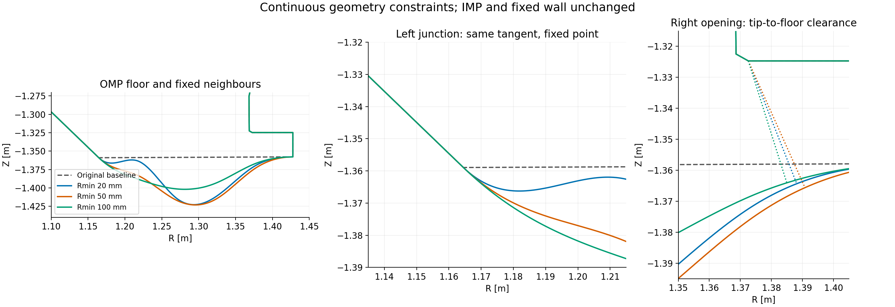
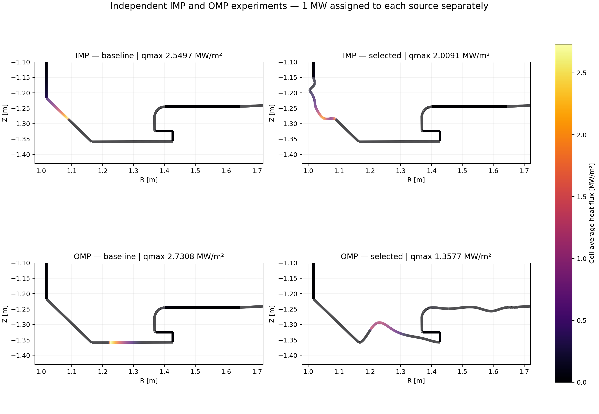

# Divertor geometry optimization

주어진 DIII-D 기준 형상과 자기 평형, 입력 전력·밀도·횡방향 확산계수에서 **도착 열유속을 넓게 분산하여 peak를 낮추는 형상**을 빠르게 탐색합니다. 실제 측정값과의 일치는 이 프로젝트의 최적화 목표나 실행 조건이 아닙니다.

이 저장소는 `freegs_divertor_no-transport` 작업 폴더의 2026-10-29 코드와 작업 기록을 보존합니다. 폴더 이름 및 과거 문서와 달리, 최신 실행 경로에는 연결 길이에 의존하는 수송 폭과 전력 보존형 경계 분배 모델이 포함됩니다. 과거 직접 매핑 모델도 그대로 남아 있습니다.

## 최신 결과

OMP 왼쪽 접합부의 접선 연결, 최소 곡률반경, 오른쪽 개구부 간격을 함께 적용한 재최적화입니다. 원본 기준 형상과 IMP 영역은 보존했습니다. 중앙 바닥이 아래로 내려가는 후보도 탐색했습니다.

| 최소 곡률반경 제약 | peak [MW/m²] | 기준 대비 | 오른쪽 최소 간격 |
|---|---:|---:|---:|
| 20 mm | 1.446258 | 47.038% 감소 | 42.577 mm |
| 50 mm | 1.995853 | 26.912% 감소 | 44.781 mm |
| 100 mm | 3.111172 | 13.931% 증가 | 41.239 mm |

기준 peak는 2.730756 MW/m², 요구 간격은 33.354336 mm입니다. 세 후보 모두 형상·전력·격자·보간 검증을 통과했으며, 20·50 mm에서 개선을 확인했습니다. 접선 연속(G1)을 적용했고, 접합부 곡률 연속(G2)은 강제하지 않았습니다. 기록된 탐색 예산에서 찾은 결과이며 전역 최적을 증명하지 않습니다.



- [재최적화 보고서](results/omp-tangent-curvature-20261029/REPORT.ko.md)
- [비교 데이터](results/omp-tangent-curvature-20261029/summary.csv)
- [검증 기록](results/omp-tangent-curvature-20261029/completion_checks.json)
- [설계·구현 계획](docs/superpowers/plans/2026-10-29-omp-tangent-curvature.md)

동일한 고정 입력으로 새 비교를 실행하려면 다음 순서를 사용합니다. 후보 선별·검증 스크립트는 현재 CuPy/CUDA 환경을 사용합니다. 전체 원본 실행 데이터와 코드/입력 스냅샷은 `D:/DivertorOptimization/studies/omp-tangent-curvature-20261029-v2`에 보존했습니다. 저장소 결과 폴더에서는 중복 입력 스냅샷과 테스트 사본을 제외했습니다. 테스트 원본은 `verification/`에 있습니다.

```powershell
python run_tangent_curvature_study.py --output D:/DivertorOptimization/studies/new-constrained-run
python qualify_tangent_candidates.py --output D:/DivertorOptimization/studies/new-constrained-run
python verification/validate_tangent_curvature.py --output D:/DivertorOptimization/studies/new-constrained-run
python visualize_tangent_curvature.py --output D:/DivertorOptimization/studies/new-constrained-run
```

## 이전 IMP·OMP 독립 최적화 — 추가 접선·곡률·간격 제약 전

각 열원에 **1 MW씩 별도로** 부여한 독립 실험입니다. IMP 실행은 IMP의 두 표면만, OMP 실행은 OMP의 네 표면만 바꾸고 반대 영역은 고정했습니다.

| 영역 | 기준 peak [MW/m²] | 검증 후 채택 peak [MW/m²] | 감소율 |
|---|---:|---:|---:|
| IMP | 2.549663 | 2.009104 | 21.201% |
| OMP | 2.730756 | 1.357740 | 50.280% |

고정 입력: n=1e19 m⁻³, χ⊥=0.3 m²/s, λq=3 mm, γ=7, κ₀=2000. 두 후보 모두 전력 보존, 독립 first-hit/열 상태 계산, 격자·보간 검사 및 고정 영역 불변 검사를 통과했습니다. 원래 탐색 최저 peak 후보 중 검증 기준에 미달한 결과도 함께 보존했습니다.



- [최적화 보고서](results/regional-20261028/REPORT.ko.md)
- [IMP 최종 좌표와 계수](results/regional-20261028/final_geometry/IMP/)
- [OMP 최종 좌표와 계수](results/regional-20261028/final_geometry/OMP/)
- [요약 데이터](results/regional-20261028/summary.csv)
- [코너·협소 구간 분석](results/omp-corner-gap-20261029/REPORT.ko.md)
- [하향 변형 진단 데이터](results/omp-corner-gap-20261029/downward_probe.json)
- [전체 작업 기록과 다음 과제](docs/WORKLOG.ko.md)

## 설치 및 실행

검증한 환경은 Windows, Python 3.13.12입니다. 프로젝트를 D 드라이브에 clone하고 결과도 D에 저장하는 구성을 권장합니다.

```powershell
python -m venv D:/DivertorOptimization/venv
D:/DivertorOptimization/venv/Scripts/Activate.ps1
python -m pip install -r requirements-repro.txt
python -m pip install --no-deps --target .local_dependencies/d3d-fixed-equilibrium pyarrow==25.0.1
$env:MKL_NUM_THREADS='1'
$env:OMP_NUM_THREADS='1'
python tools/verify_publication.py
```

두 번째 설치는 보존된 PyArrow 소스 파일의 해시 검사를 위해 필요합니다. `.local_dependencies`는 Git에 포함하지 않습니다. 다른 PyArrow 버전으로 대체하여 해시 검사를 무시하지 마세요.

CPU로 새 연구를 실행하려면 **아직 존재하지 않는 출력 폴더**를 사용합니다.

```powershell
python optimize_regional_transport.py --output D:/DivertorOptimization/studies/new-run --source both --backend cpu --generations 10
python optimize_regional_transport.py --output D:/DivertorOptimization/studies/new-run --source both --mode verify
python visualize_regional_transport.py --output D:/DivertorOptimization/studies/new-run
```

`--power-mw`, `--density`, `--chi`, `--lambda-mm`로 기준 입력을 지정합니다. `--source IMP` 또는 `OMP`로 한 영역만 실행할 수 있습니다. 최저 peak 후보가 정밀 검증을 통과하지 않으면 `qualify_regional_candidates.py`로 다른 후보를 선별하고 **선별된 후보에 전체 검증을 다시 수행**합니다. 선별만으로 개선 확인을 선언하지 않습니다.

GPU는 선택 기능입니다. RTX 3090에서 FP64 Gaussian 합산을 가속했으며, 같은 OMP 후보 3개 평가의 중앙시간 기준 약 1.46배 빨랐습니다. 전체 최적화 가속비는 아닙니다. 형상 교차·열 상태·CDF 전력·최종 검증은 CPU에서 수행합니다. [GPU 설치 및 재현 범위](docs/REPRODUCIBILITY.md)를 참고하세요.

```powershell
# CuPy/CUDA 환경을 설정한 경우
python optimize_regional_transport.py --output D:/DivertorOptimization/studies/new-gpu-run --source both --backend gpu
python -m pytest -q
```

GPU가 없는 환경에서는 GPU 전용 테스트 두 개를 제외할 수 있습니다.

```powershell
python -m pytest -q -k "not test_gpu_density_matches_cpu_narrow_broad_and_seam and not test_gpu_deposition_matches_preserved_cpu"
```

## 모델 범위와 현재 한계

- 자기 평형은 고정하고 타겟 형상을 바꿉니다. 기준 형상을 비교용으로 보존합니다.
- 연결 길이는 토로이달 감김을 포함합니다. 길이에 비례한 임의의 전력 손실을 주는 모델은 아닙니다.
- 열전도/sheath 기반 열 상태와 확산 폭을 이용하고, 연결된 벽의 면적 좌표에 Gaussian 전력을 분배합니다. 전체 2D 플라스마·중성입자 수송 방정식이나 방사 손실을 풀지는 않습니다.
- 최적화 목적은 전체 벽의 peak 감소입니다. 곡률반경·개구부 최소 간격 제약은 **아직 추가하지 않았습니다**. 기존 접합부의 코너도 남습니다.
- 두 결과는 독립 최적화입니다. 합친 형상에서 두 열원을 동시에 켠 최적해나 전역 최적해를 뜻하지 않습니다.

## 폴더 안내

| 경로 | 내용 |
|---|---|
| `d3d_optimization/` | 보존한 직접 매핑 및 추가 수송·GPU·영역 제한 모듈 |
| `verification/` | 회귀 테스트, 독립 물리량 대조 및 수치 검증 |
| `input/` | 실제 실행 입력과 과거 연구 결과 |
| `baseline_review/` | 기준 형상·자기장선 검토 자료 |
| `results/` | 2026-10-28 최종 연구와 2026-10-29 국소 형상 분석 |
| `docs/superpowers/plans/` | 설계 계획·검토 기록·원본 보존 해시 |
| `docs/publication/` | 이번 GitHub 배포의 파일 복사·검증 기록 |

과거 README는 [docs/README_LEGACY.md](docs/README_LEGACY.md)에 보존했습니다. 과거 문서의 '수송 없음' 설명은 당시 실행에 해당합니다. 기록에 남은 로컬 절대경로와 중복 snapshot 제외 범위는 [재현 안내](docs/REPRODUCIBILITY.md)에 명시했습니다.
