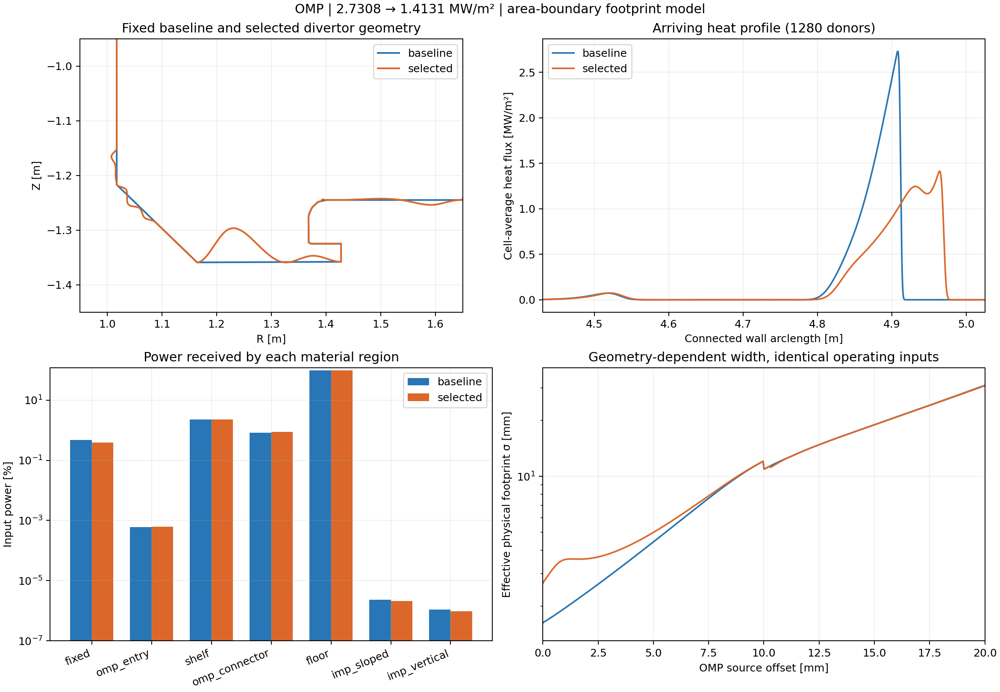
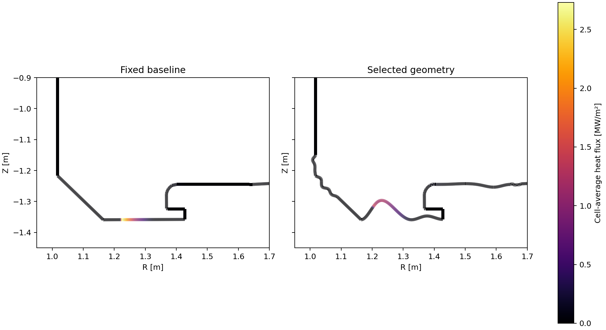

# 고정 D3D 기준 형상에서 OMP 최적화

목표는 주어진 형상과 가상 운전 입력을 사용하는 빠른 형상 비교·최적화입니다. 실제 측정값과의 일치는 목표와 판정 기준에 포함하지 않았습니다.

## 결과

- 기준 최대 열유속: **2.730756 MW/m²**
- 선택 형상 최대 열유속: **1.413114 MW/m²**
- 감소율: **48.252%**
- 수치 검증에서 개선 확인: **True**
- 탐색: 234개 고유 후보, 133개 적합, 267.6초
- 전체 탐색 실행(준비·저장 포함): 280.6초
- 기준 형상 준비: 11.0초, 기준 형상 1회 평가: 1.75초
- 최대 형상 변위: 62.302 mm
- 전력가중 평균 연결 길이: 25.173 → 22.453 m
- 전역 최적해를 증명한 결과가 아니라 주어진 탐색 예산에서 찾은 적합 후보입니다.

## 입력과 해석 범위

`{'power_W': 1000000.0, 'density_m3': 1e+19, 'chi_perp_m2_s': 0.3, 'lambda_q_m': 0.003, 'gamma': 7.0, 'kappa0': 2000.0}`

P는 선택한 OMP 소스의 계산 구간(0–98.776 mm)에 부여한 전력입니다. 전체 장치 전력이나 IMP/OMP 동시 전력 분할을 뜻하지 않습니다.
기준 벽과 자기 평형은 보존합니다. 각 후보에서 첫 도착점·연결 길이·열적 폭을 다시 계산합니다. Te는 지정한 P, n, sheath/전도 계수에 따른 two-point closure의 출력이며 독립적으로 강제한 입력은 아닙니다.

## 무엇을 바꿨는가

기존 OMP320 미배분 0.927699%는 자속 구간 밖 꼬리 0.796088%와 오목한 벽에서의 직선 차폐 제외 0.131611%였습니다. 기준 형상이 잘못된 것이 아니라 기존 받는 영역의 근사에서 제외된 전력입니다.
새 모델은 첫 도착점을 중심으로 연결된 닫힌 벽의 누적 회전면적 A=∫2πR ds에 주기 Gaussian을 정의합니다. 각 셀의 전력은 CDF 차이로 계산하여 도착한 전력을 재정규화 없이 보존합니다. 첫 벽에 도착하지 않은 전력은 미도착으로 남깁니다.
이것은 명시적인 **벽 footprint 대리모델**입니다. 기존 투영 Gaussian의 단순 범위 확장이 아닙니다. σ_flux를 국소 |∇ψ|로 변환한 물리 폭을 유효 벽방향 폭으로 사용하며, 1/sin 입사각에 의한 폭 투영은 적용하지 않습니다. 따라서 실제 플라스마 속 횡방향 궤적을 복원했다고 해석하면 안 됩니다.

## 수치 검증

| 보간 / donor 수 | 기준 qmax | 선택 qmax | 선택/기준 | 독립 audit |
|---|---:|---:|---:|---|
| cubic / 320 | 2.730658 | 1.413304 | 0.5175689 | True |
| cubic / 640 | 2.730737 | 1.413147 | 0.5174967 | True |
| cubic / 1280 | 2.730756 | 1.413114 | 0.5174807 | True |
| quintic / 640 | 2.729744 | 1.417540 | 0.5192941 | True |

전력 장부와 면적 적분, 독립 첫 교차점, 독립 자기장·열적 적분, 고정 벽 좌표, 원래의 형상/입사각 제약, 연속 spline 길이를 확인했습니다. 320/640/1280 donor 및 quintic 보간, 받는 벽만 세분화한 별도 검증을 포함합니다.

판정 상세: `{'improvement_confirmed': True, 'resolution_screen_passed': True, 'global_optimum_proven': False, 'scope': 'same boundary-footprint model and fixed operating inputs; numerical comparison only', 'max_peak_ratio_change': 0.0017974228357336974, 'max_absolute_peak_relative_change': 0.003108403857416188, 'max_region_power_l1_change': 0.0011781943732035683, 'max_wall_cdf_change': 0.0010090825612608656, 'max_peak_location_change_m': 0.00012401499933924692, 'finest_reduction_percent': 48.2519286347219}`

## 남는 한계

- 고정 자기장, 단방향 전도/sheath closure입니다. 복사·재결합·중성입자·운동량·시간 변화 및 횡수송이 온도에 주는 피드백은 풀지 않습니다.
- 폭이 매우 넓으면 연결된 전체 벽으로 전력이 퍼지는 모델입니다. 폭/전체 면적 비율과 0.1 m 이상 이동한 전력을 함께 기록합니다.
- 지원 대상은 하나의 단순한 닫힌 양의 R 벽입니다. 서로 분리된 벽 성분 사이의 전달은 구현하지 않았습니다.
- 최대점 탐색은 donor 근처와 벽 격자의 샘플에 연속 최적화를 결합합니다. 수학적인 전역 최대점 증명은 아니므로 수치 검증을 유지해야 합니다.
- 연결 길이가 길수록 무조건 좋은 목적함수를 넣지 않았습니다. 이번 선택 형상의 평균 연결 길이는 오히려 짧아졌습니다. 열유속 감소에는 기하·도착점·폭 변환이 함께 작용하므로 감소율을 parallel transport 단독 효과나 Super-X의 우월성으로 해석할 수 없습니다.
- 양의 유한 입력을 받지만 float 분해능 이하의 폭, overflow, 0 자기장 기울기 등은 명시적으로 실패합니다. 모든 수학적 입력에서 적합 형상이나 개선이 존재한다고 보장하지 않습니다.
- 평균 벽 이동 거리는 셀 중심 근사이며 최대 셀 길이/2의 오차 상한을 기록합니다. 0.1 m 이상 이동한 전력은 CDF 구간으로 계산합니다.

실행 방법은 저장소의 `BOUNDARY_OPTIMIZATION.md`, 재현 입력·계수는 이 폴더의 `manifest.json`, 검증은 `validation.json`, 상세 배열은 `*_refined.npz`에 있습니다.

## 기존 모델과의 고정 기준 형상 비교

| 소스 | 기존 미배분 [%] | 새 미배분 [%] | 기존 qmax [MW/m²] | 새 qmax [MW/m²] |
|---|---:|---:|---:|---:|
| OMP | 0.927708 | 0.000000 | 2.718238 | 2.730658 |
| IMP | 0.000538 | 0.000000 | 2.541221 | 2.549588 |

동일 형상·입력의 비교이며 새 모델은 전체 footprint 정의가 바뀌었습니다. 기존 미배분만 특정 표면에 더한 결과가 아닙니다.

## 입력 변화 점검

각 입력을 따로 바꾼 고정 형상 시험입니다. 아래 후보는 기존 historical 형상이며 이 연구의 선택 형상을 재최적화한 결과는 아닙니다.

| 입력 변경 | 기준 적합 | 기존 후보 적합 | 후보/기준 qmax |
|---|---|---|---:|
| power_0.5x | True | True | 0.53327 |
| power_2x | True | True | 0.56501 |
| density_0.5x | True | True | 0.57173 |
| density_2x | True | True | 0.52550 |
| chi_0.5x | True | True | 0.55972 |
| chi_2x | True | True | 0.53996 |
| chi_0.01x | True | True | 0.57851 |
| chi_10x | True | True | 0.52177 |
| lambda_1mm | True | True | 0.57779 |
| lambda_10mm | True | True | 0.64721 |
