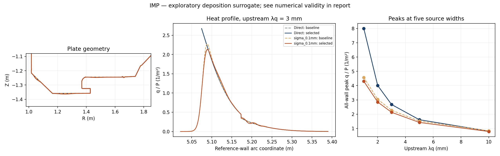
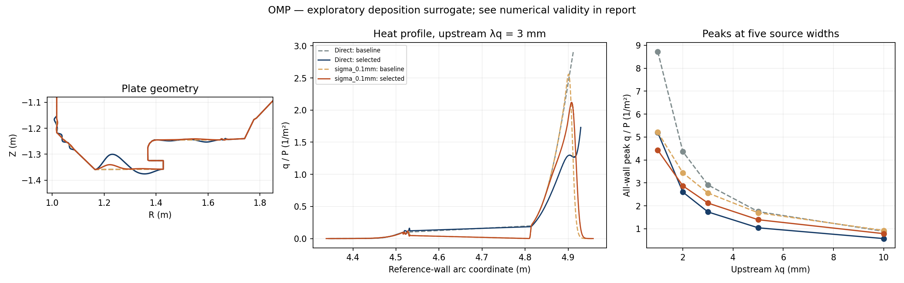

# 연결 길이 의존 broadening 비교

완료된 첫 비교에서 IMP의 sigma_ref=0.1 mm 후보는 기존 direct 선택 형상과 최대 약 **6.19 mm** 달랐으며, 같은 broadening 모델의 기준 형상 대비 다섯 열원 폭에서 피크가 모두 **최소 5.86% 감소**했다. 격자·보간법 검증과 시험한 anchor 민감도 검사를 통과했다. 이는 제한된 탐색에서 찾은 후보이며 전역 최적해가 아니다.

IMP 0.25 mm는 기본 설정에서 **3.75% 감소**, 형상 차이 **7.06 mm**였으나 anchor를 2.5 mm로 바꾸면 미해결 전력이 4.60%가 되어 부적합했다. 따라서 조건부 결과다. OMP 0.1 mm의 형상 차이는 **42.05 mm**였지만, 정밀 검증에서 기준 형상 미해결 전력이 최대 **0.2603%**로 허용치 0.1%를 넘어 **개선으로 인정하지 않았다**. OMP direct 후보의 같은 모델 내 감소율은 35.71%다.

IMP 0.1 mm의 전력 가중 평균 연결 길이는 정밀 격자에서 약 0.116–0.223 m 늘었다. 길이 지수를 1에서 0.5로 바꾼 고정 후보의 640경로 민감도 평가에서도 최소 4.21% 감소했지만, 이 보조 평가는 별도 최적화·전 격자 검증 결과가 아니다.

기존 production 파일 16개는 변경되지 않았다. 최종 테스트는 **109 passed, 1 skipped**. 계산 완료 후 보고서 처리만 수정했으며 원본 코드 사본과 [수정 기록](presentation_amendment.json)을 보존했다. 아래 그림은 가장 미세한 cubic 재평가 결과다. 부적합 모델의 곡선은 진단용이다.

고정 자기장과 기존 24개 벽 형상 자유도에서 수행한 탐색이다. 새 모델은 열침적 근사이며 평행·횡방향 수송 방정식, 입자 수송, 복사 또는 detachment를 푼 결과가 아니다.

기존 지수 열원과 단위 입력 전력을 유지한다. 실제 3차원 source-to-first-hit 연결 길이로 Gaussian 표준편차를 정하고, 같은 단조 자기선속 벽 가지에 분배한다. 전력은 전벽 침적·차폐·가지 밖·미충돌로 나누며 남은 전력을 재정규화하지 않는다.

`sigma_ref`는 upstream-equivalent 좌표의 표준편차이며 Eich S나 측정 확산계수가 아니다. 기본 L_ref=10 m, 지수=1, anchor=5 mm poloidal이다. 아래 수치는 물리적 최적해나 Super-X의 성능 예측을 뜻하지 않는다.

## IMP

모드: optimize; smoke: False; 탐색 해상도: 320 경로. 두 열원은 각각 단위 전력이며 합산하지 않는다.

| 모델 | 탐색 기준 형상 적합 | 탐색 미해결 전력 최대 | 선택 후보 / 기준 최대 비율 | 수치 개선 확인 |
|---|---:|---:|---:|---|
| direct | True | 0% | 1.000000 | passed |
| sigma_0.1mm | True | 1.08397e-07% | 0.941400 | 확인 |
| sigma_0.25mm | True | 0.0244943% | 0.962512 | 기본 설정에서 확인; anchor 민감 |
| sigma_0.5mm | False | 1.35339% | — | 기준 부적합: 탐색 제외 |

각 비율은 **같은 모델의 기준 형상**과 비교한 다섯 λq의 최대값이다. 미해결 전력이 0.1%를 초과하면 해당 모델/형상은 부적합이며, 기준 형상이 부적합하면 개선율을 인정하지 않는다.

검증 완료=True. 위 비율은 최종 검증 비율이 있으면 이를 사용하고, 없으면 탐색 비율을 표시한다. 실패 상태의 비율은 개선 증거로 사용하지 않는다.

- direct: 검증 기준 형상 적합=True; 검증 수준 전체 미해결 전력 최대=0%.
- sigma_0.1mm: 검증 기준 형상 적합=True; 검증 수준 전체 미해결 전력 최대=5.2811e-07%.
- sigma_0.25mm: 검증 기준 형상 적합=True; 검증 수준 전체 미해결 전력 최대=0.0251991%.
- sigma_0.5mm: 검증 기준 형상 적합=False; 검증 수준 전체 미해결 전력 최대=1.35622%.

### sigma_0.1mm: 형상 교차 평가

탐색 격자에서 새 후보의 기준 대비 최대 형상 변위: 6.1859 mm.

직접 매핑 모델의 선택 후보와의 최대 형상 차이: 6.1859 mm.

| 같은 broadening 모델에서 평가 | 최대 q/P 비율 | 후보 적합 |
|---|---:|---|
| direct_best | 1.000000 | True |
| sigma_0.1mm_best | 0.942445 | True |

세부 검증: `passed`; 관측 비율 변화=0.0005091140892433677; 절대 피크 상대 변화=0.0014578222968969028; anchor 민감=False. 수치 오차와 모델 가정 민감도를 구분한다.

### sigma_0.25mm: 형상 교차 평가

탐색 격자에서 새 후보의 기준 대비 최대 형상 변위: 7.0562 mm.

직접 매핑 모델의 선택 후보와의 최대 형상 차이: 7.0562 mm.

| 같은 broadening 모델에서 평가 | 최대 q/P 비율 | 후보 적합 |
|---|---:|---|
| direct_best | 1.000000 | True |
| sigma_0.25mm_best | 0.963461 | True |

세부 검증: `passed`; 관측 비율 변화=0.0014731091000126373; 절대 피크 상대 변화=0.0026195017307572197; anchor 민감=True. 수치 오차와 모델 가정 민감도를 구분한다.

상세 자료: [IMP manifest](IMP/manifest.json), 원시 탐색 로그는 각 모델 폴더의 `evaluations.jsonl`.

전체 격자·보간법·차폐거리·길이 지수 비교: [IMP validation](IMP/validation.json).

## OMP

모드: optimize; smoke: False; 탐색 해상도: 320 경로. 두 열원은 각각 단위 전력이며 합산하지 않는다.

| 모델 | 탐색 기준 형상 적합 | 탐색 미해결 전력 최대 | 선택 후보 / 기준 최대 비율 | 수치 개선 확인 |
|---|---:|---:|---:|---|
| direct | True | 0% | 0.642915 | 확인 |
| sigma_0.1mm | True | 0.0738709% | 0.853337 | incomplete_or_invalid_evidence |
| sigma_0.25mm | False | 0.345809% | — | 기준 부적합: 탐색 제외 |
| sigma_0.5mm | False | 2.62652% | — | 기준 부적합: 탐색 제외 |

각 비율은 **같은 모델의 기준 형상**과 비교한 다섯 λq의 최대값이다. 미해결 전력이 0.1%를 초과하면 해당 모델/형상은 부적합이며, 기준 형상이 부적합하면 개선율을 인정하지 않는다.

검증 완료=True. 위 비율은 최종 검증 비율이 있으면 이를 사용하고, 없으면 탐색 비율을 표시한다. 실패 상태의 비율은 개선 증거로 사용하지 않는다.

- direct: 검증 기준 형상 적합=True; 검증 수준 전체 미해결 전력 최대=0%.
- sigma_0.1mm: 검증 기준 형상 적합=False; 검증 수준 전체 미해결 전력 최대=0.260291%.
- sigma_0.25mm: 검증 기준 형상 적합=False; 검증 수준 전체 미해결 전력 최대=0.529941%.
- sigma_0.5mm: 검증 기준 형상 적합=False; 검증 수준 전체 미해결 전력 최대=2.63531%.

### sigma_0.1mm: 형상 교차 평가

탐색 격자에서 새 후보의 기준 대비 최대 형상 변위: 18.2847 mm.

직접 매핑 모델의 선택 후보와의 최대 형상 차이: 42.0489 mm.

| 같은 broadening 모델에서 평가 | 최대 q/P 비율 | 후보 적합 |
|---|---:|---|
| direct_best | 0.621287 | False |
| sigma_0.1mm_best | 0.853337 | True |

세부 검증: `incomplete_or_invalid_evidence`; 관측 비율 변화=None; 절대 피크 상대 변화=None; anchor 민감=True. 수치 오차와 모델 가정 민감도를 구분한다.

상세 자료: [OMP manifest](OMP/manifest.json), 원시 탐색 로그는 각 모델 폴더의 `evaluations.jsonl`.

전체 격자·보간법·차폐거리·길이 지수 비교: [OMP validation](OMP/validation.json).

## 재현 및 해석

실제 실행 인수는 각 manifest의 settings, 코드와 입력 SHA256은 provenance.json에 저장한다. 검증기는 변경된 코드/입력으로 과거 탐색을 검증했다고 주장하지 않도록 해시 불일치를 거부한다.

연결 길이를 늘렸을 때 σ가 늘어나도록 정의한 현상론적 모델이다. 길이에 대한 선호가 나타나도 그것만으로 평행 수송의 물리적 예측력이 검증되지는 않는다. 같은 자기장에서의 plate 비교이며 자기배위 최적화가 아니다.

전력 장부 보존과 독립 면적 적분, 격자 수렴은 서로 다른 검사다. 수치 검사 통과는 실험 검증이나 전역 최적해 증명이 아니다. 강한 퍼짐에서 가지 밖 전력이 커지면 더 넓은 물리적 수송 모델이 필요하다.
