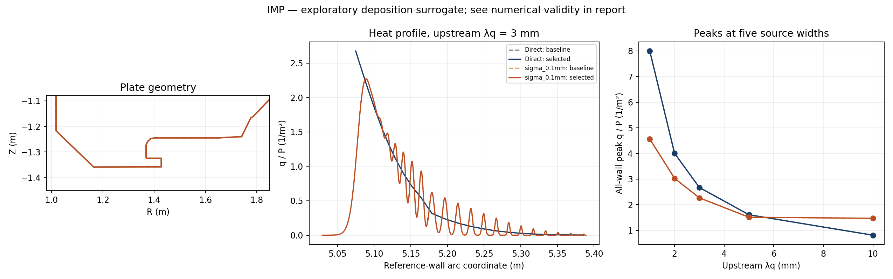
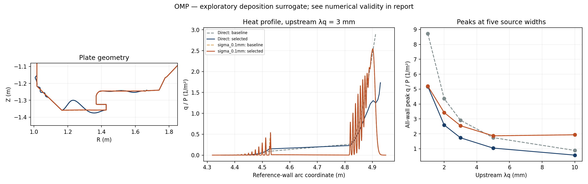

# 연결 길이 의존 broadening 비교

고정 자기장과 기존 24개 벽 형상 자유도에서 수행한 탐색이다. 새 모델은 열침적 근사이며 평행·횡방향 수송 방정식, 입자 수송, 복사 또는 detachment를 푼 결과가 아니다.

기존 지수 열원과 단위 입력 전력을 유지한다. 실제 3차원 source-to-first-hit 연결 길이로 Gaussian 표준편차를 정하고, 같은 단조 자기선속 벽 가지에 분배한다. 전력은 전벽 침적·차폐·가지 밖·미충돌로 나누며 남은 전력을 재정규화하지 않는다.

`sigma_ref`는 upstream-equivalent 좌표의 표준편차이며 Eich S나 측정 확산계수가 아니다. 기본 L_ref=10 m, 지수=1, anchor=5 mm poloidal이다. 아래 수치는 물리적 최적해나 Super-X의 성능 예측을 뜻하지 않는다.

## IMP

모드: optimize; smoke: True; 탐색 해상도: 48 경로. 두 열원은 각각 단위 전력이며 합산하지 않는다.

| 모델 | 기준 형상 적합 | 미해결 전력 최대 | 선택 후보 / 기준 최대 비율 | 수치 개선 확인 |
|---|---:|---:|---:|---|
| direct | True | 0% | 1.000000 | 검증 전 |
| sigma_0.1mm | True | 2.11035e-11% | 1.000000 | 검증 전 |
| sigma_0.25mm | True | 0.0159176% | 1.000000 | 검증 전 |
| sigma_0.5mm | False | 1.27702% | — | 기준 부적합: 탐색 제외 |

각 비율은 **같은 모델의 기준 형상**과 비교한 다섯 λq의 최대값이다. 미해결 전력이 0.1%를 초과하면 해당 모델/형상은 부적합이며, 기준 형상이 부적합하면 개선율을 인정하지 않는다.

### sigma_0.1mm: 형상 교차 평가

탐색 격자에서 새 후보의 기준 대비 최대 형상 변위: 0.0000 mm.

직접 매핑 모델의 선택 후보와의 최대 형상 차이: 0.0000 mm.

| 같은 broadening 모델에서 평가 | 최대 q/P 비율 | 후보 적합 |
|---|---:|---|
| direct_best | 1.000000 | True |
| sigma_0.1mm_best | 1.000000 | True |

### sigma_0.25mm: 형상 교차 평가

탐색 격자에서 새 후보의 기준 대비 최대 형상 변위: 0.0000 mm.

직접 매핑 모델의 선택 후보와의 최대 형상 차이: 0.0000 mm.

| 같은 broadening 모델에서 평가 | 최대 q/P 비율 | 후보 적합 |
|---|---:|---|
| direct_best | 1.000000 | True |
| sigma_0.25mm_best | 1.000000 | True |

상세 자료: [IMP manifest](IMP/manifest.json), 원시 탐색 로그는 각 모델 폴더의 `evaluations.jsonl`.

## OMP

모드: optimize; smoke: True; 탐색 해상도: 48 경로. 두 열원은 각각 단위 전력이며 합산하지 않는다.

| 모델 | 기준 형상 적합 | 미해결 전력 최대 | 선택 후보 / 기준 최대 비율 | 수치 개선 확인 |
|---|---:|---:|---:|---|
| direct | True | 0% | 0.646834 | 검증 전 |
| sigma_0.1mm | True | 0.0150262% | 0.999981 | 검증 전 |
| sigma_0.25mm | False | 0.661525% | — | 기준 부적합: 탐색 제외 |
| sigma_0.5mm | False | 2.50317% | — | 기준 부적합: 탐색 제외 |

각 비율은 **같은 모델의 기준 형상**과 비교한 다섯 λq의 최대값이다. 미해결 전력이 0.1%를 초과하면 해당 모델/형상은 부적합이며, 기준 형상이 부적합하면 개선율을 인정하지 않는다.

### sigma_0.1mm: 형상 교차 평가

탐색 격자에서 새 후보의 기준 대비 최대 형상 변위: 1.7194 mm.

직접 매핑 모델의 선택 후보와의 최대 형상 차이: 57.9902 mm.

| 같은 broadening 모델에서 평가 | 최대 q/P 비율 | 후보 적합 |
|---|---:|---|
| direct_best | 1.121091 | False |
| sigma_0.1mm_best | 0.999981 | True |

상세 자료: [OMP manifest](OMP/manifest.json), 원시 탐색 로그는 각 모델 폴더의 `evaluations.jsonl`.

## 재현 및 해석

실제 실행 인수는 각 manifest의 settings, 코드와 입력 SHA256은 provenance.json에 저장한다. 검증기는 변경된 코드/입력으로 과거 탐색을 검증했다고 주장하지 않도록 해시 불일치를 거부한다.

연결 길이를 늘렸을 때 σ가 늘어나도록 정의한 현상론적 모델이다. 길이에 대한 선호가 나타나도 그것만으로 평행 수송의 물리적 예측력이 검증되지는 않는다. 같은 자기장에서의 plate 비교이며 자기배위 최적화가 아니다.

전력 장부 보존과 독립 면적 적분, 격자 수렴은 서로 다른 검사다. 수치 검사 통과는 실험 검증이나 전역 최적해 증명이 아니다. 강한 퍼짐에서 가지 밖 전력이 커지면 더 넓은 물리적 수송 모델이 필요하다.
