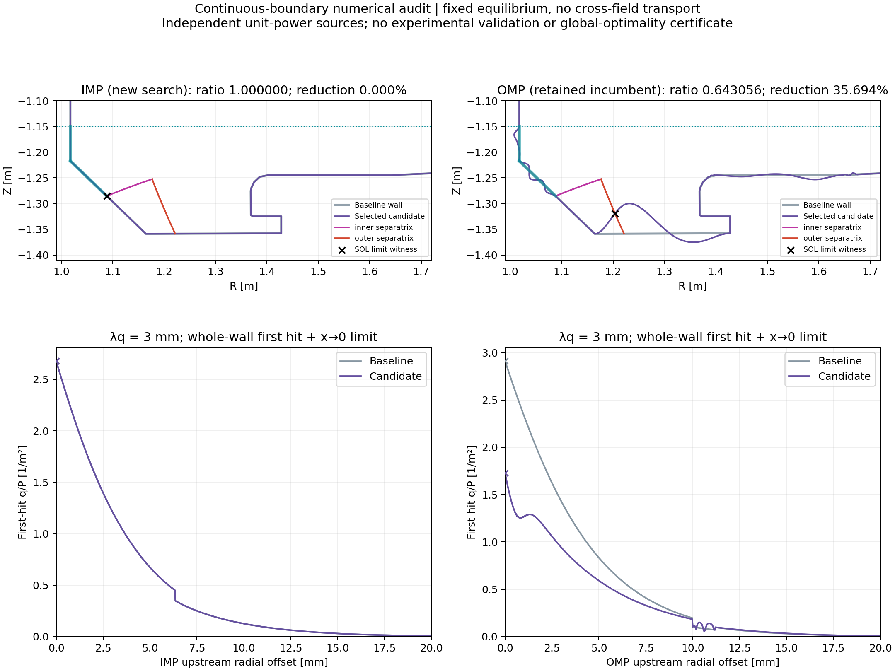

# 연속 IMP 경계 수정·재탐색 결과

문헌 조사, 계획, 자체 검토, 적대적 검토, 테스트 우선 구현, 독립 코드 검토, 본 탐색, 세부 검증 순서로 진행했다. 5 mm 연장은 적용하지 않았다.

| 결과 | 2560 경로 최대 비율 | 다섯 폭 중 최소 감소율 | 수치 검사 |
|---|---:|---:|---|
| IMP 기존 영역 | 1.000000000 | 0.0000% | passed |
| OMP 새 탐색 | 0.645046261 | 35.4954% | passed |
| OMP 이전 후보 재검증·유지 | 0.643056124 | 35.6944% | passed |

λq=1, 2, 3, 5, 10 mm 각각에서 기준 형상 대비 최대 q/P 비율을 구한 뒤 가장 큰 비율을 보고한다. IMP와 OMP는 별도 단위 열원이며 서로 합산하지 않는다.

## 수정 내용
- IMP 69번 시작점은 연속 ψX 충돌점으로 결정하고 69/70 접합부 샘플 틈을 제거했다. Z≤−1.15 및 제외 53/54/55 조건 유지.
- 원래 source/first-hit/shape 커널을 변경하지 않고 실제 첫 충돌 separatrix 극한값을 최대 열유속 평가에 추가했다. 극한점에는 유한 전력을 추가하지 않는다.
- 끝점 변위·접선이 고정되므로 경계만 맞춰도 IMP가 개선되는 것은 아니다. 이번 탐색에서의 0%는 전역적 개선 불가능 증명이 아니다.
- 형상 제약 통과, 해상도 검사 통과, 유의한 개선 확인을 구분했다. 새 OMP 후보로 이전 후보를 교체할 근거가 없어 이전 후보를 수정 모델에서 다시 검증한 뒤 유지했다.

## 수치 증거
- 회귀 테스트 48개 통과. 복원 파일 898개 확인, archived 계산 커널 보존.
- cubic 320/640/1280/2560, quintic1280 검사 완료. 전 수준 전체벽 first-hit 캐시와 독립 재계산의 segment 불일치 0.
- 모든 검사에서 고정 벽 좌표 변화 0, LCFS/구조물 교차 없음, 미매핑 전력 0.
- 정규화 오차는 적응형 적분과 대조했다. 전력 장부 균형은 실험 검증을 뜻하지 않는다.

| 후보 | 1280→2560 비율 최대 변화 | cubic→quintic 비율 최대 변화 |
|---|---:|---:|
| IMP | 0.00000000 | 0.00000000 |
| OMP_new | 0.00046068 | 0.00123059 |
| OMP_retained | 0.00046258 | 0.00076264 |

사전에 정한 각 비율 변화 허용값은 0.002이며, 개선량이 관측 변화의 2배+0.0001보다 커야 개선 확인으로 표시한다. 이 기준은 엄밀한 오차 상한이 아니다. 두 OMP 후보의 미세한 우열을 전역/물리적으로 인증한 것은 아니다.

## 탐색 시간
- IMP: 5825 unique 후보, 247.674초(4.13분), feasible 2034. DE는 13/29세대에 기존 수렴 조건으로 종료.
- OMP: 8257 unique 후보, 509.631초(8.49분), feasible 1911. DE 두 번 모두 40세대 상한까지 진행.
- 합계 14082 unique 후보, 약 12.62분의 탐색 elapsed 합계. 준비·문헌·검증 시간 제외. 검증을 병행한 부하가 있어 과거 12.2분 실행과 성능을 직접 비교할 수 없다.

## 5 mm 제안의 물리적 의미
벽을 5 mm 이동시키는 명령이 아니라 strike의 PFR 쪽 기존 벽까지 변형 자유도를 허용하는 제안이다. 연속 연결과 전체벽 열부하 조건 아래 형상 설계로 연구할 수 있지만, 5 mm에는 확정된 물리적 근거가 없다. PFR 횡방향 열수송, 복사/중성입자, 재료/냉각 검증을 수행한 것이 아니며 실제 장치의 타당성·안전성을 확정할 수 없다. 사용자는 타당성을 질문했으며 이를 승인으로 해석하지 않았다.

## 한계와 재현성
IR 표면 열유속/온도 자료가 없으므로 실험 검증은 수행할 수 없었다. 확률적 탐색과 수치 수렴 검사는 전역 최적해 증명이 아니다. no-transport 고정 평형 모델 범위의 결과다.
이 실행은 진행 중 전체 의존성 해시 sidecar를 보완했고 해당 시점이 명시돼 있다. 캡처 이전의 불변성을 소급 증명하지 않는다. 이후 실행은 verification/run_continuous_search.py가 시작 전에 캡처하며 검증은 누락/변경을 거부한다.

상세 근거: docs/superpowers/plans/2026-10-24-boundary-literature.md, continuous-boundary.md, boundary-reviews.md, boundary-execution.md. 선택 경로는 selected_results.json에 저장했다.

