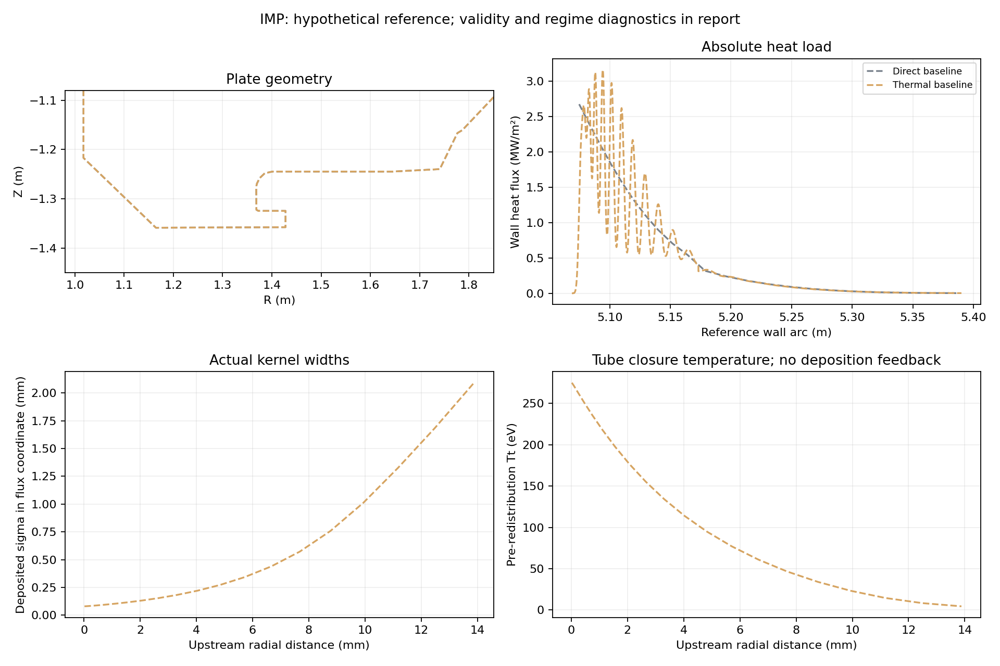
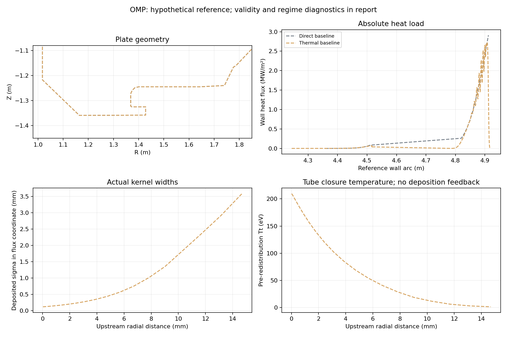

# 고정 기준 운전점의 형상 비교

입력 전력·상류 밀도·수송계수·sheath 규칙을 모든 형상에 동일하게 적용했다. 전도 two-point 온도 계산 후 횡방향 Gaussian 재분배를 하는 **one-way 근사**이며, 최종 열분포가 온도에 되먹임되는 2차원 수송 계산은 아니다. 실험 보정과 전역 최적해 증명은 하지 않았다.

direct는 기존 직접 매핑, frozen_transport는 기준 형상의 경로별 확산 폭을 고정한 대조군, thermal은 각 형상에서 온도와 확산 폭을 다시 계산하는 모델이다. 이번 목적함수는 **상류 폭 3 mm 한 조건의 피크**이며 과거 다섯 폭의 minimax 결과와 직접 비교하지 않는다.

IMP와 OMP는 각각 지정 전력을 받는 독립 시나리오다. 두 결과를 합쳐 실제 장치 총전력이라고 해석하지 않는다. 온도는 재분배 전 경로 진단값이며 최종 벽 위치의 플라즈마 온도가 아니다.

## IMP

기준: P=1 MW, nu=1e+19 m⁻³, χ⊥=0.3 m²/s, λq=3 mm. 검증 전. 탐색 48 경로; smoke=True.

| 모델 | 탐색 기준 적합 | 기준 피크 MW/m² | 탐색 미해결 전력 | 선택 후보/기준 | 수치 판정 |
|---|---|---:|---:|---:|---|
| direct | True | 2.67549 | 0% | — | 검증 전 |
| frozen_transport | True | 3.16277 | 0.000550524% | — | 검증 전 |
| thermal | True | 3.16277 | 0.000550524% | — | 검증 전 |

비율은 같은 모델·같은 운전점의 기준 형상 대비다. 검증 비율이 없으면 탐색 비율을 표시하며, 실패한 행의 비율은 개선 증거가 아니다. 전력 분배 영역 밖/차폐 전력이 0.1%를 초과하면 부적합이며 재정규화하지 않는다.

### 수송 근사의 적용 상태

기준 형상의 전력 가중 Tu=171.665 eV, 재분배 전 Tt=166.380 eV, sigma=0.2526 mm.

Tt<5 eV 경로의 전력 비중=1.211%; 전도 온도강하 지표<0.1인 경로 비중=62.846%; sigma>0.3λq 비중=4.374%.

낮은 Tt는 이 모델의 적용 한계 경고이며 detachment 판정이 아니다. 전도 온도강하가 작다고 유동을 해석한 것이 아니며, 전도 지배의 타당성은 별도 검증이 필요하다. 극저전력 꼬리의 비현실적 상태도 자르거나 온도 하한으로 숨기지 않았다.

원자료: [IMP manifest](IMP/manifest.json), [IMP validation](IMP/validation.json).

## OMP

기준: P=1 MW, nu=1e+19 m⁻³, χ⊥=0.3 m²/s, λq=3 mm. 검증 전. 탐색 48 경로; smoke=True.

| 모델 | 탐색 기준 적합 | 기준 피크 MW/m² | 탐색 미해결 전력 | 선택 후보/기준 | 수치 판정 |
|---|---|---:|---:|---:|---|
| direct | True | 2.90895 | 0% | — | 검증 전 |
| frozen_transport | False | 2.71433 | 1.14193% | — | 기준 부적합: 탐색 제외 |
| thermal | False | 2.71433 | 1.14193% | — | 기준 부적합: 탐색 제외 |

비율은 같은 모델·같은 운전점의 기준 형상 대비다. 검증 비율이 없으면 탐색 비율을 표시하며, 실패한 행의 비율은 개선 증거가 아니다. 전력 분배 영역 밖/차폐 전력이 0.1%를 초과하면 부적합이며 재정규화하지 않는다.

### 수송 근사의 적용 상태

기준 형상의 전력 가중 Tu=129.192 eV, 재분배 전 Tt=123.491 eV, sigma=0.4097 mm.

Tt<5 eV 경로의 전력 비중=1.602%; 전도 온도강하 지표<0.1인 경로 비중=48.960%; sigma>0.3λq 비중=8.917%.

낮은 Tt는 이 모델의 적용 한계 경고이며 detachment 판정이 아니다. 전도 온도강하가 작다고 유동을 해석한 것이 아니며, 전도 지배의 타당성은 별도 검증이 필요하다. 극저전력 꼬리의 비현실적 상태도 자르거나 온도 하한으로 숨기지 않았다.

원자료: [OMP manifest](OMP/manifest.json), [OMP validation](OMP/validation.json).

## 재현과 한계

설정은 각 manifest, 계산 전 코드·입력 해시는 provenance.json에 보존한다. 기존 direct 및 길이 의존 broadening 코드는 변경하지 않았다. 수치 검증은 first hit, 독립 자기장/열적분, 전력 장부/면적 적분, 형상 제약, 격자·보간법 민감도를 확인한다.

정적 bulk pressure와 sonic sheath의 factor-two 관계를 쓰며 입자·운동량·중성입자·복사·분리(detachment)를 풀지 않는다. 최종 재분배 열유속은 재분배 전 Tt의 sheath 식을 다시 만족시키도록 계산되지 않는다. 자기장 고정 plate 비교이며 Super-X 자기배위 설계가 아니다.

Spreading은 [Nille–Sieglin–Eich 전도 근사](https://arxiv.org/html/1610.04148)의 적분을 전 경로/가변 자기장에 확장한 가정이다. χ⊥는 전자 열용량 1.5 e n 기준이다.
