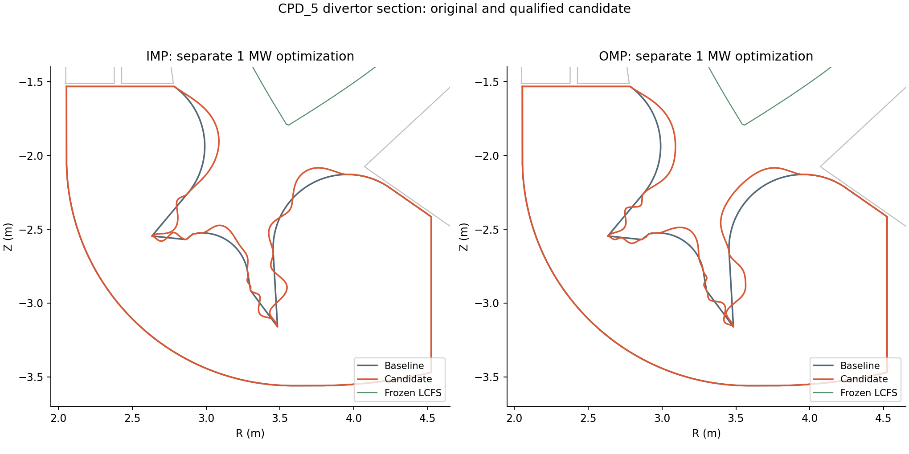
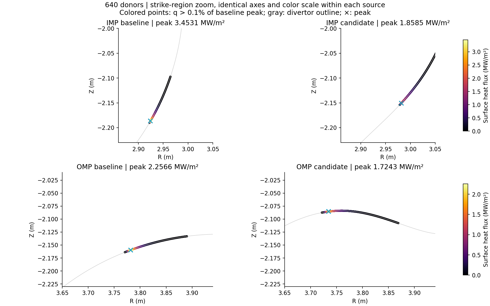
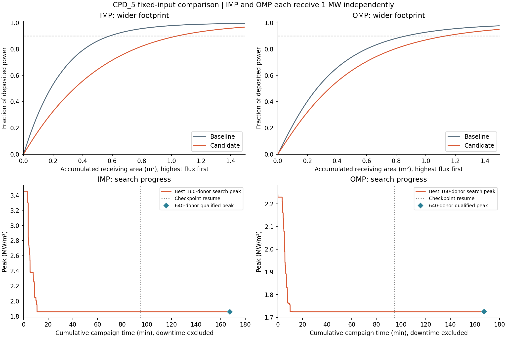

# CPD_5 고정 평형 divertor 최적화 결과

**2026-11-03 완료. 기준 CPD_5 형상과 동일한 평형·입력에서 IMP peak 46.18%, OMP peak 23.59% 감소를 320/640 donor 쌍대 평가로 확인했다.** 전력의 90%를 받는 면적도 증가했다. 이는 지정한 축약모델과 형상 제약 안에서 수치적으로 확인한 개선이며, 전역 최적성·실험 검증·제작 적합성 인증은 아니다.

IMP와 OMP는 **각각 1 MW를 독립적으로 부여한 별도 최적화**이고, 최종 형상도 두 개다. 두 결과를 하나의 형상 또는 합산 2 MW 결과로 해석하지 않는다.

## 동일 조건의 최종 비교

| 지표 | IMP 기준 → 후보 | OMP 기준 → 후보 |
|---|---:|---:|
| 640 donor peak (MW/m²) | 3.453097 → **1.858480** | 2.256565 → **1.724260** |
| peak 감소율 | **46.1793%** | **23.5892%** |
| 90% 전력 수용 면적 (m²) | 0.583000 → **1.039849** | 0.866831 → **1.135260** |
| 면적 증가율 | **78.3618%** | **30.9667%** |
| 320 donor peak (MW/m²) | 3.452941 → 1.858406 | 2.256485 → 1.724197 |
| peak 개선량 (MW/m²) | 1.594617 | 0.532305 |
| 해상도 변화 기반 오차 추정량 (MW/m²) | 0.000229385 | 0.000143249 |

오차 추정량은 기준·후보 각각의 320→640 peak 변화 절댓값의 합이다. 엄밀한 구간 상·하한은 아니다. 320 설정은 경로·벽·호 샘플 1 mm 및 적분 차수 128, 640 설정은 0.5 mm 및 256이다. 같은 후보 계수와 입력에서 donor 수와 공간·적분 해상도를 함께 높였으며, 두 해상도에서 모두 형상 적합성·전력 수지·면적 기준을 통과했다.

열부하 그림은 각 source의 기준·후보에 같은 축과 색 범위를 사용한다. 기준 peak의 0.1%를 넘는 표본을 표시하고, 나머지 형상은 회색으로 그렸다. 표의 global peak와 전력 수지는 표시 영역이나 색상 임계값으로 제한하지 않고 모든 수용 경계에서 계산했다.

## 검증 내용

- 총 8개 NPZ(2 source × 2 형상 × 2 해상도)의 peak, 전력 합계, 90% 면적을 원시 배열에서 다시 계산해 `study.json`과 대조했다. 미도착·미해결 전력은 모두 0, 최대 상대 전력 수지 오차는 4.44e-16이다. 손실 전력 재정규화는 하지 않았다.
- 640 donor 후보의 후면·상단 캡 전력은 IMP 약 0.7923 W, OMP 약 0.6904 W이다. OMP에서 다른 경계로 직접 도착한 전력은 약 7.03e-7 W이다. peak 감소는 전력 누락이나 큰 후면 전력 이동으로 얻은 결과가 아니다.
- 형상 재검사는 0.25 mm 샘플로 수행했다. polygon 유효성, VV 내부 포함, Blanket/Shield 비접촉, LCFS 비침범을 통과했다. 원래 끝점·접선의 계산 차이는 0이다. 고정된 다른 면은 유지된다.
- 각 면의 길이는 별도 적응 적분으로 확인했다. 최대 길이 비율은 IMP 1.199923894, OMP 1.199786421로 한계 1.2 이하다. 계수 절댓값 최대는 모두 100 mm다.
- 매끄러운 면의 최소 곡률 반경은 IMP **20.06028 mm**, OMP **20.00659 mm**이다. 각 면 10,001개 표본과 기존 국소 극값 탐색의 결과가 일치한다. OMP는 20 mm 제약에 매우 가깝다. 원래의 날카로운 노드 모서리는 이 제한의 대상이 아니다. 충돌 검사는 샘플 기반이며 제작 공차까지 인증한 결과는 아니다.
- 실행 사본 98개 파일 해시와 원본 중단 체크포인트·후보 이력 해시를 확인했다. 입력 전력·밀도·확산 계수·열전도 및 sheath 가정, source 위치·폭은 최초 실행과 같다. FreeGS 평형을 다시 풀거나 조정하지 않았다.

고정 평형 SHA256: `70b1c6caf974a4628afcf0cd6584ac3ac127c7bfd7c67430670199e2c5b3501d`.

원본 형상 YAML SHA256: `232284eed999301db487c176c88db4b36695fd5a0154c718c323f94a28f74d55`.

정확한 해시와 모든 수치는 [audit.json](audit.json), [study.json](study.json)에 있다. 실행 소스 커밋은 `4a0cd80a332210235652262f30b026635b73921d`이며 기존 D3D 코드와 입력은 변경하지 않았다.

## 소요시간과 빠른 탐색 관점

중단 전 5,674.955초에 재개 후 4,366.574초를 합쳐 **10,041.529초 = 2시간 47분 21.5초**를 사용했다. 재개 시 기존 3,690개 평가의 상태를 복원했고, 총 탐색 평가는 **6,523개**(IMP 3,262 / OMP 3,261)다. 복원 7.47초와 최종 검증 165.81초가 재개 예산에 포함되어 있다. 검증용으로 확보한 900초를 모두 쓰지 않아 3시간 한도보다 **12분 38.5초 일찍** 끝났다. 중단 대기·개발·그림 및 보고서 작성 시간은 최적화 실행시간에 포함하지 않는다.

캐시를 재사용한 유효한 160 donor 후보 평가의 중앙값은 IMP **1.17초**, OMP **1.66초**(95백분위 1.95 / 2.82초)였다. 최종 640 donor 후보 평가는 각각 23.06 / 29.64초였다. 112개의 초기 평가 예외는 기각·기록되었으며 최종 8개 평가에는 예외가 없다. 앞선 재개 작업에서 정확한 인접 중복 RZ 표본을 제거해 영길이 구간 문제를 수정했다.

이 실행에서는 최종 탐색 peak의 0.1% 이내 후보를 누적 **IMP 11.14분 / OMP 10.04분**에 이미 찾았다. 이후 추가 탐색의 개선은 작았고, 재개의 주요 성과는 최종 고해상도 검증을 끝낸 것이다. 따라서 빠른 형상 탐색이라는 목표는 유지된다. 다음 개발에서는 수치 오차보다 작은 개선을 채택하지 않는 기준과 정체 감지를 도입하고, 유망 후보에만 320/640 검증을 적용해 총 완료시간을 줄이는 것이 우선이다. 이 시간은 이번 고정 입력 한 사례의 관측이며 다른 장치의 보장시간은 아니다.

## 결과 범위와 재현 자료

FreeGS로 정한 단일 하부 X-point 평형, D3D에서 가져온 운전값·열입력, 주어진 곡선 변형 범위 안에서 평가했다. 현상론적 표면 Gaussian footprint 모델로, 각 실제 경계 loop 안에서 전력을 분배한다. 확산 폭을 임의로 자르지 않았고, 저전력 donor 꼬리에서는 큰 폭·매우 낮은 온도 같은 열모델의 극한값이 남는다. 이는 전 수송 방정식 해나 장치 운전 성능의 실증이 아니다. 연속 공간 peak의 엄밀한 인증과 전역 최적성 증명도 이번 판정에 포함하지 않았다.

- 최종 형상: [IMP 계수·RZ 단면](geometry-IMP.json), [OMP 계수·RZ 단면](geometry-OMP.json). 0.25 mm 샘플 단면 및 정확한 B-spline 계수이며 STEP B-rep 파일은 아니다. 원본 CAD는 보존했다.
- 원시 비교 배열: [IMP 기준 320](baseline-IMP-320.npz), [후보 320](candidate-IMP-320.npz), [기준 640](baseline-IMP-640.npz), [후보 640](candidate-IMP-640.npz); [OMP 기준 320](baseline-OMP-320.npz), [후보 320](candidate-OMP-320.npz), [기준 640](baseline-OMP-640.npz), [후보 640](candidate-OMP-640.npz).
- NPZ의 `q` 단위는 할당 전력당 m⁻²다. `source_power_W`를 곱하면 W/m²이며, MW/m²에는 추가로 1e6을 나눈다. `loop_*_cell_power`는 할당 전력의 비율이다. 도착점·연결 길이·누적 적분·확산 폭도 NPZ에 포함된다.
- [검증·그림 재생 스크립트](audit_and_plot.py), [탐색 요약 이력](search-history.json). 그림은 같은 이름의 SVG로도 제공한다.
- 원본 이력·캐시·실행 사본은 `D:/DivertorOptimization/studies/cpd5-20261103`에 그대로 보존했다. 이 폴더에는 선택된 최종 근거만 복사했다.
