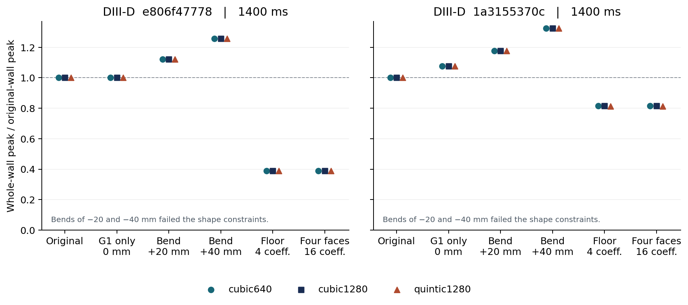

# DIII-D 평형 파일에서 피크를 낮추는 데 네 면을 모두 바꿔야 하는가?

2026년 11월 8일 · 고정 DIII-D 물질벽 · 하부 OMP · 1 MW · λq 3 mm · χ⊥ 0.3 m²/s · 밀도 10¹⁹ m⁻³ · 곡률반경 하한 20 mm

**동일한 360초 탐색에서 바닥의 계수 4개만 허용해도 네 면의 계수 16개를 열었을 때의 피크 감소를 재현했다.** 원벽 대비 감소율은 1400 ms의 두 개발 평형에서 각각 61.02%, 18.37%였다. 바닥 계수를 하나의 굽힘 크기로 묶어 미리 지정한 다섯 값에서는 이 효과를 재현하지 못했다. 연구 목적은 고정된 공급 전력에서 **전 벽 표면 법선 열유속 피크의 최소화**다. A₂, 면별 전력, 열점 위치는 기전 해석에 사용했다. [사전 고정한 비교](protocol.ko.md) · [사용자 진입점](../../docs/user-optimizer.ko.md)

## 사용자가 파일을 넣고 받은 결과

기존 manifest나 파일명 치환 없이 원본 parquet와 시각을 입력했다. 실제 엔진에서 원벽 열계산 가능 여부, 고정 끝점의 필요조건, 정밀 적격 설계를 구분한다. 내장 DIII-D 벽과 설계 끝점은 고정하고, 매 입력에서 자기축·하부 X점·두 분리면 가지·첫 충돌·열폭을 다시 구했다. 원래 직선 바닥과 이웃 면의 접선 오차는 44.24°다. 이를 비교 원벽으로 보존하고 G1을 만족한 대체 형상에 별도로 후보 ID를 부여했다. [사용 예와 상태 정의](../../docs/user-optimizer.ko.md) · [4개 실제 실행의 재검산](entry-verification.json)

| 입력 파일 ID · 모두 1400 ms | 원벽 → 선택 피크 (MW/m²) | 실제 반환 |
|---|---:|---|
| e806f47778, 240초 진입점 시험 | 5.225410 → 3.347390 | 202.2초에 첫 적격 후보, 229.2초에 채택 후보. 마감 초과 후보 1개 제외 |
| 1a3155370c, 255초 진입점 시험 | 2.730756 → 1.944223 | 170.6초에 첫 적격 후보. 원벽 대비 28.80% 감소 |
| 332a6d97fc | 4.528984 → 후보 없음 | 선반 고정 접선 1.48147° < 1.5°. 같은 점의 자기피치 상한 2.49963° |
| 51d83022ca | 5.381170 → 후보 없음 | 고정 접선 1.09244°. 같은 점에서 임의의 축대칭 판이 낼 수 있는 최대 1.25852° < 1.5° |

제외한 두 평형도 공급 1 MW의 전력수지가 닫혔다. 하한 미달 선반에 첫 충돌한 전력은 각각 2.618, 41.921 kW였고, 재분배 뒤 셀 중점의 해석 입사각이 하한 미만인 선반 셀의 적분 전력은 2.266, 38.816 kW였다. 두 값은 서로 다른 관측량이다. 후보 배제는 양의 주기 Gaussian이 연결된 벽의 모든 열린 구간을 가열한다는 이 모델의 성질과 고정 끝점·접선에 의존한다. 내부 최소각은 해석 spline 법선과 수치 정련으로 구했다. 가공 여유나 실제 장치에서의 차폐 여부까지 판정하는 증명으로 사용할 수는 없다. [입력별 원벽·프로파일·로그](entry-checks.zip) · [선반 판정 구현](../../d3d_optimization/user_physics.py)

처음 세 실행은 개발 중의 통합 검사다. 그 뒤 선반 구간 내부 최소각 정련, 입력 이력 및 실패 출력 보존을 보강했다. 초기 빌드에서는 일부 코드 해시를 실행 종료 시 읽었으므로 최초 세 실행의 모든 중간 소스 바이트를 고정한 기록으로 취급하지 않는다. 성공한 첫 후보의 선반 최소각은 별도 조밀 검사에서도 cubic 1.76445°, quintic 1.76447°였다. 내장 파일 진입점 확인과 아래 두 쌍의 형상 시험을 구분해 보존했으며, 정량적인 형상 비교에는 사전 고정 이후의 짝지은 네 실행만 사용했다.

## 같은 시간에 어느 형상을 찾았나

양쪽 모두 같은 시드 20711로 원벽에서 시작하고 과거 후보를 읽지 않았다. 원벽 준비부터 360초를 썼으며 적격 설계 중 반올림 전 정밀 피크가 가장 낮은 형상을 반환했다. 실행 순서는 평형 간에 교차했다. 시간 내 횟수가 달라도 실제 예산을 유지했다. 아래 q는 cubic1280의 정련한 전 벽 피크다.

| 평형 | 탐색 | q (MW/m²) | 원벽 대비 감소 | 시간 내 정밀 적격 수 | 첫 적격 / 채택 후보 완료 (s) | 마지막 계산 초과 (s) |
|---|---|---:|---:|---:|---:|---:|
| e806f47778 | 바닥 4개 | 2.036811430 | 61.0210% | 9 | 164.2 / 333.4 | 16.1 |
| e806f47778 | 전체 16개 | 2.036811414 | 61.0210% | 8 | 171.8 / 354.2 | 12.8 |
| 1a3155370c | 바닥 4개 | 2.229231488 | 18.3658% | 9 | 163.6 / 281.2 | 11.7 |
| 1a3155370c | 전체 16개 | 2.229231488 | 18.3658% | 9 | 162.7 / 303.1 | 8.1 |

첫 평형에서는 두 승자의 바닥 계수가 정확히 같다. 전체 승자에서 다른 세 면의 계수만 0으로 만들면 바닥 승자 ID `a20aa1f2469a`가 그대로 나온다. 두 번째 평형에서 바닥 계수의 최대 차는 3.0×10⁻¹² m이다. 전체 승자의 바닥만 그대로 남긴 직접 대조는 2.229231487729 MW/m²였다. 이번 두 검색은 사실상 같은 바닥 형상을 찾아냈고, 나머지 세 면을 움직인 것이 최고점에 준 변화는 작았다. 동일 시드·공통 투영·공통 바닥 재시작을 썼으므로 탐색 경로도 서로 연관된다. [e806f47778 실행 증거](e806f47778.zip) · [1a3155370c 실행 증거](1a3155370c.zip)

## 같은 계수를 격자와 보간법을 바꿔 다시 넣으면

cubic640, cubic1280, quintic1280 각각에서 **같은 원벽, 각 탐색 승자, 전체 승자의 바닥만 남긴 형상, 미리 정한 단일 굽힘**을 다시 풀었다. 각 설정의 원벽에 대한 감소율을 구했다. 등록 판정량은 100 × (바닥 피크 / 전체 피크 − 1)이며, 두 승자가 모두 적격이고 모두 원벽을 개선해야 한다.

| 평형 | 수치 설정 | 원벽 (MW/m²) | 바닥 4개 / 전체 16개 (MW/m²) | 바닥 감소율 |
|---|---|---:|---:|---:|
| e806f47778 | cubic640 | 5.225371 | 2.036875 / 2.036875 | 61.0195% |
| | cubic1280 | 5.225410 | 2.036811 / 2.036811 | 61.0210% |
| | quintic1280 | 5.225428 | 2.033972 / 2.033972 | 61.0755% |
| 1a3155370c | cubic640 | 2.730737 | 2.229203 / 2.229203 | 18.3662% |
| | cubic1280 | 2.730756 | 2.229231 / 2.229231 | 18.3658% |
| | quintic1280 | 2.729760 | 2.220724 / 2.220724 | 18.6476% |

두 평형 모두 세 수치 설정에서 사전 기준 ±1%에 들었다. 두 승자 간 상대 차의 절댓값은 각각 최대 7.78×10⁻⁷%, 6.78×10⁻⁹%였다. 작은 차이의 부호에 물리적 순위 의미를 부여하기 어렵다. 두 탐색 결과에서 선반 좌표는 각각 최대 5.86, 8.83 mm 달랐고, 바닥은 각각 0, 1.9×10⁻⁹ mm 이내에서 일치했다. 기본 격자에서는 각 승자의 열유속 피크와 A₂를 원래 시간 제한 실행과 다시 대조했다. [첫 평형의 전체 재평가](e806f47778/summary.json) · [둘째 평형의 전체 재평가](1a3155370c/summary.json)

**단일 굽힘 대조.** 바닥의 네 자유계수를 모두 같은 값으로 묶고 나머지 세 면을 고정했다. −40, −20 mm는 각각 개구 간격이 요구치보다 31.51, 16.13 mm 부족했고 최소 바닥 반경도 13.69, 19.07 mm로 20 mm를 밑돌았다. 0, +20, +40 mm는 적격이었으나 cubic1280 피크가 첫 평형에서 각각 5.22541, 5.85899, 6.56241 MW/m², 둘째에서 2.93739, 3.21319, 3.61471 MW/m²였다. 첫 평형의 0 mm는 원벽과 계산 정밀도 내에서 같았다. 이 결과가 배제하는 범위는 시험한 계수 패턴과 진폭이다. 다른 저차 기저·굽힘 조합까지 탐색한 실험은 아니다. [첫 평형의 모든 대조군](e806f47778/replay.csv) · [둘째 평형의 모든 대조군](1a3155370c/replay.csv)

## 바닥에서 무엇이 달라졌나

cubic1280에서 두 평형 모두 최고 열점은 원벽·선택 형상에서 바닥에 있었다. 바닥에 직접 들어간 전력은 각각 931.227, 964.276 kW였으며 바닥 설계 뒤에도 같은 값이었다. 다음은 바닥만 움직인 승자의 값이다. 80% 폭은 바닥의 한 끝에서 실제 벽 호길이를 따라 적분한 침적전력 누적 10%와 90% 사이 거리다. 평균은 바닥에 첫 도달한 자속관의 전력가중 평균이다. [적분 코드](measure_floor.py) · [두 평형·세 형상의 원값](floor-footprint.csv)

| 평형 | 바닥 80% 폭 (mm) | 전 벽 A₂ (m²) | 바닥 도달 경로 길이 (m) | 물리 열폭 (mm) | 바닥 최초 충돌 평균 입사각 (°) |
|---|---:|---:|---:|---:|---:|
| e806f47778, 원벽 → 바닥 설계 | 33.04 → 64.37 | 0.351 → 0.763 | 23.55 → 22.77 | 1.751 → 1.940 | 2.199 → 1.148 |
| 1a3155370c, 원벽 → 바닥 설계 | 62.94 → 102.45 | 0.610 → 0.937 | 25.68 → 23.59 | 3.107 → 3.843 | 1.266 → 0.850 |

두 사례에서는 비슷한 전력이 같은 바닥에 도착하면서 그 면을 따라 침적되는 폭이 넓어졌다. 두 평형 모두 평균 평행 경로는 짧아졌고 경로별 열수송식이 산출한 평균 물리 폭은 늘었다. 이 관측만으로 기하 팽창과 열폭 변화의 인과 기여율을 나눌 수는 없다. 표의 바닥 입사각은 직선 조각 첫 충돌의 평균이고 1.5° 하한을 적용한 면은 선반이다. 두 바닥 승자의 최소 바닥 곡률반경은 약 20.10 mm다. 개구 간격의 요구치 대비 여유는 각각 4.211 mm와 **0.000928 mm**이므로 두 번째 사례의 수치상 적격에 제조 여유를 부여해서는 안 된다.

각 승자의 선반 곡선에서 좌표 262,145개로 접선을 독립 차분한 검사에서도 최저각은 e806f47778의 cubic/quintic에서 1.76445°/1.76447°, 1a3155370c에서 1.56428°/1.56432°였다. 이 계산은 선반에 적용한 각도 하한을 점검한다. [법선 검산 코드](check_shelf_normals.py) · [후보별 최저각과 좌표](shelf-normal-check.json)

첫 평형의 [실제 형상 겹침](e806f47778/geometry.png)과 [공통 물질 좌표의 전 벽 프로파일](e806f47778/profiles.png), 둘째 평형의 [실제 형상 겹침](1a3155370c/geometry.png)과 [열유속 프로파일](1a3155370c/profiles.png)에서 열점과 바닥 곡률 변화를 확인할 수 있다. 선반·연결부·비설계면을 포함한 전력 이동은 [첫 평형](e806f47778/regional-power.csv)과 [둘째 평형](1a3155370c/regional-power.csv)의 면별 표에 있다.

## 원고에서 채택할 해석

현재 원고가 주장할 수 있는 성과는 **고정된 DIII-D 평형·기준벽·운전 입력으로부터 시간 안에 적격 저피크 형상을 반환하고, 배제 시 물리적 이유와 원벽 열분포도 돌려주는 것**이다. 여기서 얻은 형상 결과는 해당 두 평형에서 바닥 네 계수가 충분했다는 증거다. 네 면을 동시에 변형하는 것 자체를 독창성의 근거로 제시하기는 어렵다. 새 평형 적용률, 전역 최적성, 제조 가능 범위 및 독립 수송식에서의 개선은 각각 다른 연구 질문이다.

원고용 기존 설명도 정정했다. OMP20의 과거 탐색 최저 `2cf53582`는 정밀 기하 검사에서 용기와 교차했으며, 보관 18단계 `0eb363d2`는 원벽 대비 피크 −47.26%를 재현했지만 국소 분포 차 2.693%로 판정 기준 1%를 넘었다. FIREFLY에서는 18단계가 명목 배경 −11.2%, 저온·저밀도 배경 +13.1%였고, 블라인드 패널의 개선은 상위군 13/20, 무작위군 12/20이었다. 이번 형상 비교의 계산은 같은 축약 수송식을 사용했다. [정정과 기존 1차 자료](../nf-submission-review-20261108/REPORT.ko.md) · [재현과 원자료 구성](reproduce.ko.md)
