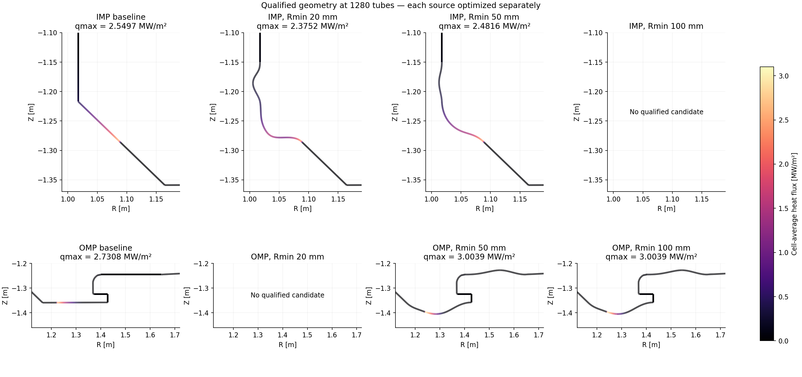

# 72시간 IMP·OMP 최적화 최종 판정

탐색과 정밀 검증은 2026-11-01 05:26 UTC 무렵 종료했다. 절대 종료 시한은 연장하지 않았다. 기준 D3D, 독립 1 MW 열원, 입력 및 수송 모델을 유지했다. 총 6,302,015개 형상을 제안하고 272,080회 열계산을 수행했다. 전역 최적성을 증명한 결과는 아니다.

| 영역 | 최소 반경 mm | 최종 검증 peak MW/m² | 기준 대비 | 판정 |
|---|---:|---:|---:|---|
| IMP | 20 | 2.375184 | 6.8432% 감소 | 개선 확인 |
| IMP | 50 | 2.481554 | 2.6713% 감소 | 개선 확인 |
| IMP | 100 | — | — | 탐색에서 허용 후보 미발견 |
| OMP | 20 | — | — | 정밀 검증한 최종 후보 4개 모두 탈락 |
| OMP | 50 | 3.003868 | 10.0013% 증가 | 검증 통과, 개선 아님 |
| OMP | 100 | 3.003868 | 10.0013% 증가 | 검증 통과, 개선 아님 |

기준 peak는 IMP 2.549663, OMP 2.730756 MW/m²이다. qualified는 수치·형상 검증 통과를 뜻하며 기준보다 개선됐다는 뜻은 아니다.

## 검증과 보존

검증 통과한 네 경우는 320/640/1280 상류 경로, cubic/quintic, 벽격자 세분화 및 독립 형상 검사를 통과했다. 격자·보간 변경 시 최대 peak 상대 변화는 IMP20 0.172%, IMP50 0.121%, OMP50/100 0.083%였다. 전력 장부 오차는 최대 약 1.7e-15이며 미도착·미해결 전력은 0이다. CPU/GPU 최종 peak 상대 차이는 0이며, 최종화 코드에서 분포 배열 일치도 확인했다. GPU 가속은 Gaussian 열분포 평가에 적용했으며 모든 계산이 GPU에서 수행된 것은 아니다.

실행 snapshot의 874개 파일 해시와 frozen_files.json 해시를 확인했다. 이전 연구의 manifest 16개와 이번 manifest/selected_refined 원본은 보존했다. 세부 증거와 해시는 final_verification.json에 기록했다. 원시 탐색 로그와 전체 CSV는 D:/DivertorOptimization/studies/imp-omp-global-20261029에 유지한다. 저장소에는 요약·그림·manifest·압축 결과 및 형상 좌표를 보존한다.

## OMP 결과 해석과 남은 문제

OMP20의 낮은 peak 후보는 접선·곡률 해석 검사를 통과했지만 chord tolerance 1e-7 m로 세분한 전체 벽의 독립 유효성 검사에서 탈락했다. 따라서 약 1.44 MW/m²의 낮은 수치를 유효한 개선으로 보고하지 않는다. 정확한 충돌 위치나 세분화 판정 원인은 이번 마감 검토에서 확정하지 않았다.

OMP50의 낮은 coarse peak 후보도 전체 벽 유효성 검사에서 탈락했다. 최종 채택 후보는 R100 후보를 R50 조건에서 재검증한 것으로, 두 경우의 peak가 같다. 이 후보는 기준보다 나쁘므로 최적화 성과로 채택하지 않는다.

또한 현재 최종화는 fine shortlist에서 최대 4개 후보만 정밀 검증하며, 이전 연구의 검증된 incumbent를 항상 보존하여 비교하는 구조가 아니다. 따라서 이번 결과를 과거 연구까지 포함한 최선이라고 부를 수 없다. 이전 OMP50 검증 결과 1.995853 MW/m² 및 이전 OMP20 결과 1.446258 MW/m²는 원본 그대로 보존하며, 이번의 더 나쁜 결과로 대체하지 않는다. 이전 결과가 이번 강화된 독립 검사를 동일하게 통과한다고 단정하지 않는다.

다음 개선은 (1) 탐색 단계와 최종 단계의 전체 벽 유효성 판정 차이 분석·정합, (2) 동일 검증 기준을 통과한 incumbent의 영구 보존 및 최종 후보 강제 포함이다. 이번 작업에서는 실행 snapshot이나 제약을 바꾸지 않았고 추가 최적화를 시작하지 않았다. 후보 미발견은 해의 부재를 증명하지 않는다. 수치 검증은 고정 입력의 축약 수송 모델 내부 비교이며, 모든 입력 조건 또는 더 완전한 수송 물리에서의 우월성을 보장하지 않는다.

