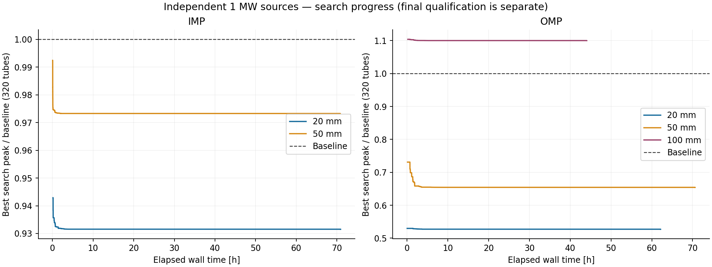
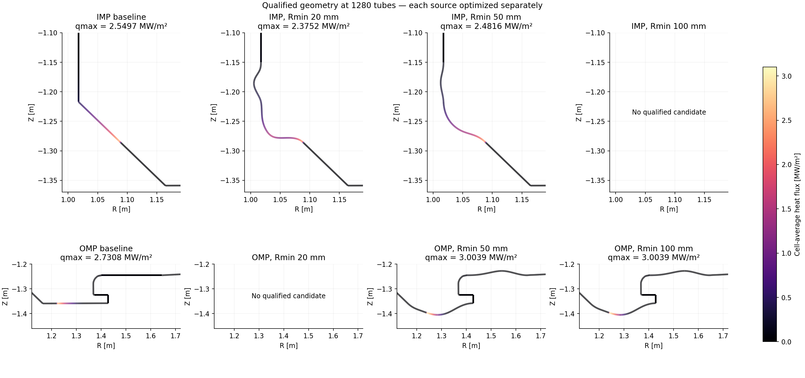

# IMP·OMP 접선·곡률 제약 전역 탐색

- 종료 시한: 2026-11-01T15:10:20+09:00
- IMP·OMP는 각각 독립적인 1 MW 열원 실험입니다.
- 기준 D3D, 입력 전력과 수송 조건은 고정했습니다. 표의 최종 peak는 상류 flux tube 1280개 결과입니다.
- 전역 최적성 증명은 아닙니다. 정해진 곡선 계열과 계수 범위에서 찾은 최선 후보입니다.
- IMP 공통 접선은 두 구간에 대해 정규화 내적 ≥0.2인 방향 범위에서 탐색합니다.
- IMP의 3개 연결, OMP 바닥 왼쪽 연결에 G1 조건을 적용합니다. 곡률 제한은 양쪽 부호를 허용합니다.
- OMP 오른쪽 개구부는 기존 최소 간격을 유지합니다. 원래 고정된 다른 공학 코너는 그대로입니다.

| 영역 | Rmin (mm) | 상태 | 기준 peak | 선택 peak (MW/m²) | 감소율 | 제안 / 열계산 | 재시작 |
|---|---:|---|---:|---:|---:|---:|---:|
| IMP | 20 | qualified | 2.5497 | 2.3752 | 6.8432% | 391483 / 63161 | 165 |
| IMP | 50 | qualified | 2.5497 | 2.4816 | 2.6713% | 1014217 / 55798 | 494 |
| IMP | 100 | no_qualified_candidate_found | — | — | —% | 4357922 / 0 | 2722 |
| OMP | 20 | no_qualified_candidate_found | — | — | —% | 113025 / 48427 | 28 |
| OMP | 50 | qualified | 2.7308 | 3.0039 | -10.0013% | 146355 / 49617 | 23 |
| OMP | 100 | qualified | 2.7308 | 3.0039 | -10.0013% | 279013 / 55077 | 134 |

후보 미발견은 불가능성 증명이 아닙니다. 조건을 완화하지 않고 제약 위반 기록을 보존했습니다.
정밀 검증은 전력 보존·전체 첫 충돌·독립 열적분·도착 위치·열유속 CDF·격자 수렴과 GPU/CPU 분포 일치를 포함합니다.
수송은 기존의 단방향 열수송 및 전력 보존형 벽 broadening 축약 모델입니다. 측정값 일치는 이 연구의 판정 조건이 아닙니다.

