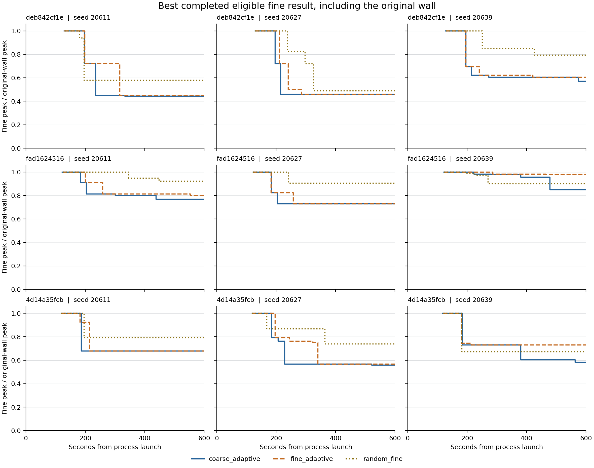

# DIII-D 고정 입력에서 시간별 탐색 성능과 수치 설정 민감도

600초의 같은 평형·시드별 비교에서 저비용 적응 / 정밀 적응 탐색의 명목 피크 비교는 9/0/0(첫째가 낮음/정확히 같음/둘째가 낮음), 미확인 0쌍이다. 저비용 적응 / 투영 무작위 정밀 탐색의 명목 피크 비교는 9/0/0(첫째가 낮음/정확히 같음/둘째가 낮음), 미확인 0쌍이다. 각 비교는 세 평형 안의 세 시드, 총 아홉 쌍이며 독립 방전 아홉 개가 아니다. 작은 native 차이도 사전 고정한 엄격한 < 규칙의 명목 승패에 남기고, 수치 설정에서의 분리 여부는 별도로 판정한다.

600초 선택의 네 수치 설정 범위를 교차 비교하면 저비용 / 정밀 적응 탐색: 저비용 쪽으로 범위 분리 6/9, 중첩·접촉 3, 반대 분리 0, 미확인·부적격 0; 같은 설정마다 저비용 피크가 낮음 9/9. 저비용 쪽 분리 중 이전 native 관측 재현까지 확인된 쌍은 6개다. 저비용 / 투영 무작위 정밀 탐색: 저비용 쪽으로 범위 분리 9/9, 중첩·접촉 0, 반대 분리 0, 미확인·부적격 0; 같은 설정마다 저비용 피크가 낮음 9/9. 저비용 쪽 분리 중 이전 native 관측 재현까지 확인된 쌍은 9개다. 같은 설정별 방향 일치와 설정 전체 범위의 분리는 별도 기준이다. 원값의 작은 승패만으로 미세 우열을 확정하지 않으며, 이 범위는 신뢰구간·연속체 오차 상한이 아니다.

| 방법 | 600초 사용 가능 | 기준 대비 q 감소 | q↓·A2↑ |
| --- | --- | --- | --- |
| 저비용 적응 탐색 | 9 | 9 | 8 |
| 정밀 적응 탐색 | 9 | 9 | 8 |
| 투영 무작위 정밀 탐색 | 9 | 9 | 8 |

세 평형의 시드 반복을 포함한 27개 실행을 종료 상태와 원시 event로 대조했다. 600초에 기준벽보다 피크가 낮은 실행은 27/27, 피크 감소와 A2 증가가 함께 확인된 실행은 24/27이다. 최초 5% 감소는 26/27개 실행에서 시간 내 관측됐다. 분모는 방법별 실행 수이며 독립 방전 수는 아니다.

같은 모델의 관측 후보 중 시간 내 확인한 최저 피크를 비교한다. 전역 최적이나 유일한 최적 형상을 뜻하지 않는다. 세 평형은 이전 연구에서 이미 사용한 입력이며 미사용 holdout으로 부르지 않는다. OMP 1 MW와 제공된 DIII-D 원래 물질벽을 고정 기준으로 유지했다.

정밀 적응 탐색 9/9개 실행에서 600초 안의 DE trial 완료가 없었다. 전체 DE trial 완료 0건이다. 완료 요청은 초기 집단 평가 504건, 좌표 polish 23건이며 캐시 요청을 포함한다. 기록된 완료 단계는 초기 집단 평가와 좌표 polish뿐이다. 따라서 이번 비교는 native 기본 population=64/projected_seeds=12와 600초 예산의 설정 비교다. 방법별 최적 튜닝이나 충분한 시간에서의 점근적 최적화 우열을 검증한 결과로 확장하지 않는다.

## 실제 완료 시각의 best-so-far

각 선은 그 방법의 기준벽 준비가 끝난 실제 시각에서 시작한다. 세로축은 정밀 피크/해당 기준벽 피크다. 적격 정밀 평가가 시간 안에 끝났을 때만 갱신하며 저비용 점수와 초과된 결과는 채택하지 않는다. 준비·임포트·CPU 대조·기록 비용을 포함한 프로세스 시작 기준 시각이다. 실패 실행의 선은 실제 종료 시각에서 멈추며, 그전에 인증된 마지막 결과는 이후 checkpoint 표에서도 유지할 수 있다.

## 200/400/600초 비교

각 행은 같은 평형·방법의 세 시드 반복이다. 중앙값과 시드 범위는 기술 통계이며 신뢰구간이 아니다. q 감소/A2 증가와 명목 승패는 원값의 엄격한 < 및 > 규칙을 그대로 쓴다. 상대 1e-10 backend 재현 허용차 진단은 별도 필드이며 물리적 수치 불확실성으로 해석하지 않는다.

| 평형 | 방법 | 초 | 사용 가능/3 | 피크 감소 중앙값 % | 시드 범위 % | q 감소 | q↓·A2↑ |
| --- | --- | --- | --- | --- | --- | --- | --- |
| 4d14a35fcb | 저비용 적응 탐색 | 200 | 3 | 27.037 | 20.72–32.10 | 3 | 3 |
| 4d14a35fcb | 저비용 적응 탐색 | 400 | 3 | 39.651 | 32.10–43.37 | 3 | 3 |
| 4d14a35fcb | 저비용 적응 탐색 | 600 | 3 | 41.771 | 32.10–44.07 | 3 | 3 |
| 4d14a35fcb | 정밀 적응 탐색 | 200 | 3 | 20.717 | 7.65–25.49 | 3 | 3 |
| 4d14a35fcb | 정밀 적응 탐색 | 400 | 3 | 32.100 | 27.04–43.37 | 3 | 3 |
| 4d14a35fcb | 정밀 적응 탐색 | 600 | 3 | 32.100 | 27.04–43.37 | 3 | 3 |
| 4d14a35fcb | 투영 무작위 정밀 탐색 | 200 | 3 | 20.740 | 13.34–32.81 | 3 | 3 |
| 4d14a35fcb | 투영 무작위 정밀 탐색 | 400 | 3 | 26.108 | 20.74–32.81 | 3 | 3 |
| 4d14a35fcb | 투영 무작위 정밀 탐색 | 600 | 3 | 26.108 | 20.74–32.81 | 3 | 3 |
| deb842cf1e | 저비용 적응 탐색 | 200 | 3 | 27.847 | 27.70–30.48 | 3 | 3 |
| deb842cf1e | 저비용 적응 탐색 | 400 | 3 | 54.184 | 39.42–55.69 | 3 | 3 |
| deb842cf1e | 저비용 적응 탐색 | 600 | 3 | 54.184 | 43.05–55.69 | 3 | 3 |
| deb842cf1e | 정밀 적응 탐색 | 200 | 3 | 27.698 | 0.00–30.48 | 2 | 2 |
| deb842cf1e | 정밀 적응 탐색 | 400 | 3 | 54.184 | 37.88–55.13 | 3 | 3 |
| deb842cf1e | 정밀 적응 탐색 | 600 | 3 | 54.184 | 39.42–55.13 | 3 | 3 |
| deb842cf1e | 투영 무작위 정밀 탐색 | 200 | 3 | 0.000 | 0.00–42.00 | 1 | 1 |
| deb842cf1e | 투영 무작위 정밀 탐색 | 400 | 3 | 42.003 | 15.00–51.14 | 3 | 3 |
| deb842cf1e | 투영 무작위 정밀 탐색 | 600 | 3 | 42.003 | 20.69–51.14 | 3 | 3 |
| fad1624516 | 저비용 적응 탐색 | 200 | 3 | 8.758 | 0.00–17.52 | 2 | 1 |
| fad1624516 | 저비용 적응 탐색 | 400 | 3 | 19.915 | 4.28–27.10 | 3 | 2 |
| fad1624516 | 저비용 적응 탐색 | 600 | 3 | 23.152 | 15.02–27.10 | 3 | 2 |
| fad1624516 | 정밀 적응 탐색 | 200 | 3 | 0.000 | 0.00–17.52 | 1 | 1 |
| fad1624516 | 정밀 적응 탐색 | 400 | 3 | 18.630 | 1.74–27.10 | 3 | 2 |
| fad1624516 | 정밀 적응 탐색 | 600 | 3 | 19.915 | 2.03–27.10 | 3 | 2 |
| fad1624516 | 투영 무작위 정밀 탐색 | 200 | 3 | 0.000 | 0.00–1.02 | 1 | 0 |
| fad1624516 | 투영 무작위 정밀 탐색 | 400 | 3 | 9.505 | 5.20–9.86 | 3 | 2 |
| fad1624516 | 투영 무작위 정밀 탐색 | 600 | 3 | 9.505 | 7.77–9.86 | 3 | 2 |

같은 평형·시드·시간의 쌍만 비교했다. 아래는 세 시드의 첫 방법 피크가 낮음/정확히 같음/둘째 방법 피크가 낮음/미확인 개수다. 작은 native 점수 차이가 추가 수치 설정에서도 분리되는지는 뒤의 판정과 구분한다.

| 평형 | 초 | 방법 쌍 | 첫째/정확동률/둘째/미확인 |
| --- | --- | --- | --- |
| deb842cf1e | 200 | 저비용 적응 탐색 / 정밀 적응 탐색 | 1/2/0/0 |
| deb842cf1e | 200 | 저비용 적응 탐색 / 투영 무작위 정밀 탐색 | 2/0/1/0 |
| deb842cf1e | 200 | 정밀 적응 탐색 / 투영 무작위 정밀 탐색 | 1/1/1/0 |
| deb842cf1e | 400 | 저비용 적응 탐색 / 정밀 적응 탐색 | 2/1/0/0 |
| deb842cf1e | 400 | 저비용 적응 탐색 / 투영 무작위 정밀 탐색 | 3/0/0/0 |
| deb842cf1e | 400 | 정밀 적응 탐색 / 투영 무작위 정밀 탐색 | 3/0/0/0 |
| deb842cf1e | 600 | 저비용 적응 탐색 / 정밀 적응 탐색 | 3/0/0/0 |
| deb842cf1e | 600 | 저비용 적응 탐색 / 투영 무작위 정밀 탐색 | 3/0/0/0 |
| deb842cf1e | 600 | 정밀 적응 탐색 / 투영 무작위 정밀 탐색 | 3/0/0/0 |
| fad1624516 | 200 | 저비용 적응 탐색 / 정밀 적응 탐색 | 1/2/0/0 |
| fad1624516 | 200 | 저비용 적응 탐색 / 투영 무작위 정밀 탐색 | 2/0/1/0 |
| fad1624516 | 200 | 정밀 적응 탐색 / 투영 무작위 정밀 탐색 | 1/1/1/0 |
| fad1624516 | 400 | 저비용 적응 탐색 / 정밀 적응 탐색 | 2/1/0/0 |
| fad1624516 | 400 | 저비용 적응 탐색 / 투영 무작위 정밀 탐색 | 2/0/1/0 |
| fad1624516 | 400 | 정밀 적응 탐색 / 투영 무작위 정밀 탐색 | 2/0/1/0 |
| fad1624516 | 600 | 저비용 적응 탐색 / 정밀 적응 탐색 | 3/0/0/0 |
| fad1624516 | 600 | 저비용 적응 탐색 / 투영 무작위 정밀 탐색 | 3/0/0/0 |
| fad1624516 | 600 | 정밀 적응 탐색 / 투영 무작위 정밀 탐색 | 2/0/1/0 |
| 4d14a35fcb | 200 | 저비용 적응 탐색 / 정밀 적응 탐색 | 2/1/0/0 |
| 4d14a35fcb | 200 | 저비용 적응 탐색 / 투영 무작위 정밀 탐색 | 2/0/1/0 |
| 4d14a35fcb | 200 | 정밀 적응 탐색 / 투영 무작위 정밀 탐색 | 1/0/2/0 |
| 4d14a35fcb | 400 | 저비용 적응 탐색 / 정밀 적응 탐색 | 3/0/0/0 |
| 4d14a35fcb | 400 | 저비용 적응 탐색 / 투영 무작위 정밀 탐색 | 3/0/0/0 |
| 4d14a35fcb | 400 | 정밀 적응 탐색 / 투영 무작위 정밀 탐색 | 2/0/1/0 |
| 4d14a35fcb | 600 | 저비용 적응 탐색 / 정밀 적응 탐색 | 3/0/0/0 |
| 4d14a35fcb | 600 | 저비용 적응 탐색 / 투영 무작위 정밀 탐색 | 3/0/0/0 |
| 4d14a35fcb | 600 | 정밀 적응 탐색 / 투영 무작위 정밀 탐색 | 2/0/1/0 |

## 최초 5% 개선과 우측 검열

미관측 실행의 개선 시각을 600초 성공으로 대입하지 않았다. 실패 실행은 실제 관측 종료 시각에서 검열하며, 감독자 중단으로 인증된 checkpoint가 없는 실행은 성능 곡선에서 제외하고 실패로 남긴다.

| 평형 | 시드 | 방법 | 최초 5% 초 | 검열 시각 초 | 상태 |
| --- | --- | --- | --- | --- | --- |
| deb842cf1e | 20611 | 저비용 적응 탐색 | 196.800 | 미확인 | observed |
| deb842cf1e | 20611 | 정밀 적응 탐색 | 198.326 | 미확인 | observed |
| deb842cf1e | 20611 | 투영 무작위 정밀 탐색 | 180.852 | 미확인 | observed |
| deb842cf1e | 20627 | 정밀 적응 탐색 | 210.694 | 미확인 | observed |
| deb842cf1e | 20627 | 투영 무작위 정밀 탐색 | 238.282 | 미확인 | observed |
| deb842cf1e | 20627 | 저비용 적응 탐색 | 196.366 | 미확인 | observed |
| deb842cf1e | 20639 | 투영 무작위 정밀 탐색 | 251.204 | 미확인 | observed |
| deb842cf1e | 20639 | 저비용 적응 탐색 | 195.751 | 미확인 | observed |
| deb842cf1e | 20639 | 정밀 적응 탐색 | 196.079 | 미확인 | observed |
| fad1624516 | 20611 | 정밀 적응 탐색 | 200.070 | 미확인 | observed |
| fad1624516 | 20611 | 투영 무작위 정밀 탐색 | 345.856 | 미확인 | observed |
| fad1624516 | 20611 | 저비용 적응 탐색 | 184.347 | 미확인 | observed |
| fad1624516 | 20627 | 투영 무작위 정밀 탐색 | 240.927 | 미확인 | observed |
| fad1624516 | 20627 | 저비용 적응 탐색 | 183.985 | 미확인 | observed |
| fad1624516 | 20627 | 정밀 적응 탐색 | 182.926 | 미확인 | observed |
| fad1624516 | 20639 | 저비용 적응 탐색 | 478.965 | 미확인 | observed |
| fad1624516 | 20639 | 정밀 적응 탐색 | 미확인 | 600.000 | deadline_without_5pct_improvement |
| fad1624516 | 20639 | 투영 무작위 정밀 탐색 | 270.538 | 미확인 | observed |
| 4d14a35fcb | 20611 | 투영 무작위 정밀 탐색 | 195.909 | 미확인 | observed |
| 4d14a35fcb | 20611 | 저비용 적응 탐색 | 186.328 | 미확인 | observed |
| 4d14a35fcb | 20611 | 정밀 적응 탐색 | 182.765 | 미확인 | observed |
| 4d14a35fcb | 20627 | 저비용 적응 탐색 | 184.764 | 미확인 | observed |
| 4d14a35fcb | 20627 | 정밀 적응 탐색 | 196.090 | 미확인 | observed |
| 4d14a35fcb | 20627 | 투영 무작위 정밀 탐색 | 168.615 | 미확인 | observed |
| 4d14a35fcb | 20639 | 정밀 적응 탐색 | 181.800 | 미확인 | observed |
| 4d14a35fcb | 20639 | 투영 무작위 정밀 탐색 | 182.882 | 미확인 | observed |
| 4d14a35fcb | 20639 | 저비용 적응 탐색 | 184.026 | 미확인 | observed |

## 시한 초과 결과 진단

시한을 넘긴 coarse/fine 점수는 보존만 하며 승자·곡선·최초 5% 시각에 넣지 않는다. 아래 비교는 캐시가 아니고 침적 결과가 확인된 전체 적격 late fine만 600초 채택 fine incumbent와 대조한다. 부분 계산·관측값 누락·부적격 결과와 채택 기준이 없는 실행은 비교 불가로 남긴다. coarse 값은 개수만 세며 fine 피크와 수치 비교하지 않는다. 원값의 엄격한 개선과 상대 1e-10 재현 허용차 진단을 구분한다. 후자는 물리적 불확실성이나 늦은 결과의 채택 근거가 아니다.

| 방법 | late coarse | late fine | 새 적격 fine | 대조 가능 | 엄격 개선 | 재현 허용차 밖 개선 |
| --- | --- | --- | --- | --- | --- | --- |
| 저비용 적응 탐색 | 3 | 5 | 5 | 5 | 3 | 1 |
| 정밀 적응 탐색 | 0 | 9 | 9 | 9 | 0 | 0 |
| 투영 무작위 정밀 탐색 | 0 | 9 | 9 | 9 | 0 | 0 |

600초 incumbent보다 원값 피크가 낮았던 late fine만 아래에 보인다. 작은 차이도 표시하며 개선율은 600초 incumbent 대비다.

| 평형 | 시드 | 방법 | ID 앞 12자 | 완료 초 | 600초 피크 | late 피크 | 추가 감소 % | 재현 허용차 진단 |
| --- | --- | --- | --- | --- | --- | --- | --- | --- |
| deb842cf1e | 20627 | 저비용 적응 탐색 | 4e93d9577598 | 611.786 | 4.73759476405 | 4.73759476405 | 1.831868e-11 | within_replay_tolerance |
| 4d14a35fcb | 20627 | 저비용 적응 탐색 | 0b80ef9d6db0 | 613.396 | 1.62819649594 | 1.62819649588 | 3.6650016e-09 | within_replay_tolerance |
| 4d14a35fcb | 20639 | 저비용 적응 탐색 | 9245affc2c54 | 610.102 | 1.69527294571 | 1.66874237937 | 1.5649731 | late_lower |

## 실제 비용과 준비·대조 비용

아래는 세 평형·세 시드에서 관측한 방법별 최소–최대 초다. 600초는 채택 시한이며 실제 종료 시간이 아니다. 종료 중인 평가의 초과분과 최종 직렬화/부모 관측 차이를 보존했다. CPU parity 시간은 scoring event에 이미 포함되므로 더해서 이중 계산하지 않는다. 준비 시간을 빼서 warm-start 성능으로 바꾸지 않는다. 감독자 timeout에서도 부모가 관측한 프로세스 종료 시각과 초과분은 포함한다. 작업자 최종 시각이 없으면 미확인으로 남기며 부모 시각으로 대체하지 않는다. 실행별 stage 합계와 로그/optimizer bookkeeping 등 채택 시간에 포함된 시각 공백은 summary.json에 있다.

| 방법 | 시작 준비 | 기준 준비 완료 | 준비/구축 합 | 보고된 CPU parity | 시간 내 scoring event 합 | 작업자 종료 | 작업자 초과 | 부모 관측 종료 | 부모 관측 초과 |
| --- | --- | --- | --- | --- | --- | --- | --- | --- | --- |
| 저비용 적응 탐색 | 1.03–1.11 | 118.42–129.11 | 126.63–138.55 | 31.31–36.61 | 440.17–451.16 | 600.03–613.78 | 0.03–13.78 | 600.54–614.30 | 0.54–14.30 |
| 정밀 적응 탐색 | 1.02–2.86 | 118.93–130.11 | 117.49–129.05 | 29.80–36.69 | 456.51–471.10 | 601.11–613.80 | 1.11–13.80 | 601.56–614.23 | 1.56–14.23 |
| 투영 무작위 정밀 탐색 | 1.03–1.13 | 118.53–130.49 | 117.08–129.39 | 29.80–35.45 | 455.14–471.80 | 601.64–610.75 | 1.64–10.75 | 602.06–611.25 | 2.06–11.25 |

## 요청·침적 결과·캐시·기하 탈락

아래 수는 각 방법의 활성 탐색 수준에서 동일 평형의 세 시드를 합한 값이다. 저비용 적응 탐색의 활성 수준은 coarse이며 정밀 승격 요청은 summary.json의 fine 항목에 별도로 남긴다. '침적 결과'는 physics_evaluated=true인 새 후보 평가다. 이 값은 침적 결과가 반환되었다는 뜻이며 총 열계산 진입 횟수나 CPU/GPU 호출 수가 아니다. 첫 parity 대조의 CPU/GPU 시간은 별도 payload로 보존했다. '기하 탈락'은 명시적 기하 오류만 센다. 단계별 초기/DE/좌표 수는 캐시를 포함한 완료 요청 수이며 새 침적 결과 수와 다르다. 생성 탈락에는 투영·벽 검사·근접중복 등의 이유별 합계가 포함된다. 감독자 중단 실행의 남아 있는 원시 개수는 미인증 진단값으로 표시하며 성능 checkpoint에는 사용하지 않는다.

| 평형 | 방법 | 초 | 시작 | 완료 | 침적 결과 | 캐시 | 기하 탈락 | 기타 비침적 | 생성 탈락 | 초기/DE/좌표 |
| --- | --- | --- | --- | --- | --- | --- | --- | --- | --- | --- |
| 4d14a35fcb | 저비용 적응 탐색 | 200 | 24 | 24 | 24 | 0 | 0 | 0 | 0 | 24/0/0 |
| 4d14a35fcb | 저비용 적응 탐색 | 400 | 362 | 362 | 132 | 0 | 230 | 0 | 0 | 192/152/18 |
| 4d14a35fcb | 저비용 적응 탐색 | 600 | 792 | 792 | 241 | 2 | 549 | 0 | 0 | 192/559/41 |
| 4d14a35fcb | 정밀 적응 탐색 | 200 | 12 | 9 | 9 | 0 | 0 | 0 | 0 | 9/0/0 |
| 4d14a35fcb | 정밀 적응 탐색 | 400 | 71 | 68 | 46 | 0 | 22 | 0 | 0 | 65/0/3 |
| 4d14a35fcb | 정밀 적응 탐색 | 600 | 174 | 171 | 84 | 0 | 87 | 0 | 0 | 164/0/7 |
| 4d14a35fcb | 투영 무작위 정밀 탐색 | 200 | 11 | 8 | 8 | 0 | 0 | 0 | 0 | 0/0/0 |
| 4d14a35fcb | 투영 무작위 정밀 탐색 | 400 | 50 | 47 | 47 | 0 | 0 | 0 | 0 | 0/0/0 |
| 4d14a35fcb | 투영 무작위 정밀 탐색 | 600 | 89 | 86 | 86 | 0 | 0 | 0 | 0 | 0/0/0 |
| deb842cf1e | 저비용 적응 탐색 | 200 | 23 | 20 | 20 | 0 | 0 | 0 | 0 | 20/0/0 |
| deb842cf1e | 저비용 적응 탐색 | 400 | 438 | 437 | 143 | 0 | 294 | 0 | 0 | 192/224/21 |
| deb842cf1e | 저비용 적응 탐색 | 600 | 920 | 919 | 263 | 3 | 653 | 0 | 0 | 192/680/47 |
| deb842cf1e | 정밀 적응 탐색 | 200 | 9 | 6 | 6 | 0 | 0 | 0 | 0 | 6/0/0 |
| deb842cf1e | 정밀 적응 탐색 | 400 | 70 | 67 | 45 | 0 | 22 | 0 | 0 | 65/0/2 |
| deb842cf1e | 정밀 적응 탐색 | 600 | 175 | 172 | 85 | 0 | 87 | 0 | 0 | 165/0/7 |
| deb842cf1e | 투영 무작위 정밀 탐색 | 200 | 9 | 6 | 6 | 0 | 0 | 0 | 0 | 0/0/0 |
| deb842cf1e | 투영 무작위 정밀 탐색 | 400 | 50 | 47 | 47 | 0 | 0 | 0 | 0 | 0/0/0 |
| deb842cf1e | 투영 무작위 정밀 탐색 | 600 | 90 | 87 | 87 | 0 | 0 | 0 | 0 | 0/0/0 |
| fad1624516 | 저비용 적응 탐색 | 200 | 24 | 24 | 24 | 0 | 0 | 0 | 0 | 24/0/0 |
| fad1624516 | 저비용 적응 탐색 | 400 | 396 | 395 | 144 | 0 | 251 | 0 | 0 | 192/184/19 |
| fad1624516 | 저비용 적응 탐색 | 600 | 752 | 750 | 269 | 0 | 481 | 0 | 0 | 192/519/39 |
| fad1624516 | 정밀 적응 탐색 | 200 | 11 | 8 | 8 | 0 | 0 | 0 | 0 | 8/0/0 |
| fad1624516 | 정밀 적응 탐색 | 400 | 75 | 72 | 48 | 0 | 24 | 0 | 0 | 69/0/3 |
| fad1624516 | 정밀 적응 탐색 | 600 | 187 | 184 | 89 | 0 | 95 | 0 | 0 | 175/0/9 |
| fad1624516 | 투영 무작위 정밀 탐색 | 200 | 12 | 9 | 9 | 0 | 0 | 0 | 0 | 0/0/0 |
| fad1624516 | 투영 무작위 정밀 탐색 | 400 | 51 | 48 | 48 | 0 | 0 | 0 | 0 | 0/0/0 |
| fad1624516 | 투영 무작위 정밀 탐색 | 600 | 93 | 90 | 90 | 0 | 0 | 0 | 0 | 0/0/0 |

## 시간 내 실제 다룬 벡터의 차원

후보 벡터를 중심화하고 고정 계수 경계 폭 0.2 m로 나눈 행렬의 rank(절대 특이값 기준 1e-12)를 다시 계산했다. 제안/침적 결과/전체 적격 후보를 분리한다. 아래는 세 시드의 rank 범위이며 각 축 최소·최대·범위와 특이값은 summary.json에 있다. 제안 rank는 벡터가 저장된 완료 제안에 한한다. 무작위 생성에서 벡터 없이 탈락 이유만 남은 시도는 rank에 넣을 수 없다. 초기 64개 집단의 rank=16만으로 시간 내 64개 평가 완료나 DE 단계 진입, 전 형상 공간 탐색을 주장하지 않는다.

| 평형 | 방법 | 초 | 제안 rank | 침적 결과 rank | 전체 적격 rank |
| --- | --- | --- | --- | --- | --- |
| 4d14a35fcb | 저비용 적응 탐색 | 200 | 4–4 | 4–4 | 4–4 |
| 4d14a35fcb | 저비용 적응 탐색 | 400 | 16–16 | 16–16 | 16–16 |
| 4d14a35fcb | 저비용 적응 탐색 | 600 | 16–16 | 16–16 | 16–16 |
| 4d14a35fcb | 정밀 적응 탐색 | 200 | 3–3 | 2–2 | 2–2 |
| 4d14a35fcb | 정밀 적응 탐색 | 400 | 13–16 | 7–8 | 7–8 |
| 4d14a35fcb | 정밀 적응 탐색 | 600 | 16–16 | 16–16 | 16–16 |
| 4d14a35fcb | 투영 무작위 정밀 탐색 | 200 | 2–3 | 1–2 | 1–2 |
| 4d14a35fcb | 투영 무작위 정밀 탐색 | 400 | 15–16 | 14–15 | 14–15 |
| 4d14a35fcb | 투영 무작위 정밀 탐색 | 600 | 16–16 | 16–16 | 16–16 |
| deb842cf1e | 저비용 적응 탐색 | 200 | 4–4 | 4–4 | 4–4 |
| deb842cf1e | 저비용 적응 탐색 | 400 | 16–16 | 16–16 | 16–16 |
| deb842cf1e | 저비용 적응 탐색 | 600 | 16–16 | 16–16 | 16–16 |
| deb842cf1e | 정밀 적응 탐색 | 200 | 2–2 | 1–1 | 1–1 |
| deb842cf1e | 정밀 적응 탐색 | 400 | 12–16 | 7–7 | 7–7 |
| deb842cf1e | 정밀 적응 탐색 | 600 | 16–16 | 16–16 | 16–16 |
| deb842cf1e | 투영 무작위 정밀 탐색 | 200 | 2–2 | 1–1 | 1–1 |
| deb842cf1e | 투영 무작위 정밀 탐색 | 400 | 15–16 | 14–15 | 14–15 |
| deb842cf1e | 투영 무작위 정밀 탐색 | 600 | 16–16 | 16–16 | 16–16 |
| fad1624516 | 저비용 적응 탐색 | 200 | 4–4 | 4–4 | 4–4 |
| fad1624516 | 저비용 적응 탐색 | 400 | 16–16 | 16–16 | 16–16 |
| fad1624516 | 저비용 적응 탐색 | 600 | 16–16 | 16–16 | 16–16 |
| fad1624516 | 정밀 적응 탐색 | 200 | 2–3 | 1–2 | 1–2 |
| fad1624516 | 정밀 적응 탐색 | 400 | 13–16 | 8–8 | 8–8 |
| fad1624516 | 정밀 적응 탐색 | 600 | 16–16 | 16–16 | 16–16 |
| fad1624516 | 투영 무작위 정밀 탐색 | 200 | 3–3 | 2–2 | 2–2 |
| fad1624516 | 투영 무작위 정밀 탐색 | 400 | 16–16 | 15–15 | 15–15 |
| fad1624516 | 투영 무작위 정밀 탐색 | 600 | 16–16 | 16–16 | 16–16 |

## 고정 유한 패널의 선택 손실

추가 패널 열계산 전에 기하 규칙으로 목록을 고정한 패널의 전수 정밀 최저와 비교한 손실이다. 동일 시드·생성 규칙 때문에 실시간 random_fine 후보와 겹칠 수 있으며, 새 holdout 후보나 독립 실험으로 세지 않는다. 선택 규칙은 사전 고정했고 후보 열결과를 목록 선택에 사용하지 않았다. 무작위 기대값은 공통 coarse 적격 모집단에서 동일 정밀 요청 수 k개를 중복 없이 고르는 정확한 조합 기대값이며, fine 부적격도 요청을 소비한다. 이는 동일 벽시계 시간 비교나 실시간 random_fine 성능을 대신하지 않는다.

| 평형 | 시드 | 패널 n | coarse 적격 | k | 선택 손실 % | 무작위 기대 손실 % | live 제안/정밀 중복 | 24개 완성 |
| --- | --- | --- | --- | --- | --- | --- | --- | --- |
| deb842cf1e | 20611 | 24 | 24 | 6 | 0.000 | 17.919 | 24/24 | True |
| deb842cf1e | 20627 | 24 | 24 | 6 | 0.000 | 54.179 | 24/24 | True |
| deb842cf1e | 20639 | 24 | 24 | 6 | 0.000 | 9.238 | 24/24 | True |
| fad1624516 | 20611 | 24 | 24 | 6 | 0.000 | 5.215 | 24/24 | True |
| fad1624516 | 20627 | 24 | 24 | 6 | 0.000 | 6.748 | 24/24 | True |
| fad1624516 | 20639 | 24 | 24 | 6 | 0.000 | 7.487 | 24/24 | True |
| 4d14a35fcb | 20611 | 24 | 24 | 6 | 0.000 | 11.095 | 24/24 | True |
| 4d14a35fcb | 20627 | 24 | 24 | 6 | 0.000 | 14.408 | 24/24 | True |
| 4d14a35fcb | 20639 | 24 | 24 | 6 | 0.000 | 10.155 | 24/24 | True |

중복은 동일 평형의 모든 live 시드·방법과 대조했다. 시간 내 정밀 관측 중복은 적격/부적격을 모두 포함한다. 과거 전체 형상 archive와의 중복은 검사하지 않았으므로 과거 후보와도 겹칠 수 있다.

패널 fine 평가 기록 216행은 서로 다른 형상 109개에 해당한다. 평형별 고유 형상 수의 합은 216이며 모든 평형에 공통인 형상은 52개다. 이 수에는 원래 기준벽을 넣지 않았다. 평가 기록 수를 독립 형상 수나 총 열해석 호출 수로 해석하지 않는다.

| 평형 | 패널 수 | fine 기록 행 | 고유 형상 | 평형 내 반복 행 |
| --- | --- | --- | --- | --- |
| 4d14a35fcb | 3 | 72 | 72 | 0 |
| deb842cf1e | 3 | 72 | 72 | 0 |
| fad1624516 | 3 | 72 | 72 | 0 |

### 사후 입력 간 재사용

각 출발 평형의 세 고정 패널 합집합(최대 72개 후보)과 원래 기준벽에서 관측 fine 피크가 가장 낮은 형상을 고른 뒤, 같은 ID가 도착 평형의 기존 패널에 있을 때만 그 결과를 읽었다. 출발 선택이 기준벽이면 도착 평형의 기준벽을 쓴다. 동률이면 기준벽을 유지하며, 반복 ID의 적격성과 관측값을 native 재현 허용치 1e-10으로 대조한 후 원값 최저를 보존한다. 기준벽의 반복 관측도 대조하고 고정 시드 순서의 첫 기록을 기준으로 쓴다. 이 허용치는 물리적 불확실성 경계가 아니다. 추가 열계산이나 미관측·부적격 값의 대입은 없다. 음의 피크 감소율은 도착 기준벽보다 나빠졌다는 뜻이다. 이는 사후 유한 집합 진단이며 holdout 전이 검증·전역 최적성·실시간 600초 선택 결과가 아니다. 선택 ID 전체와 원본 패널 해시·시드·행 번호·반복 관측은 summary.json에 있다.

| 출발 평형 | 도착 평형 | 선택 ID 앞 12자 | 상태 | 피크 MW/m² | A2 m² | 피크 감소 % | A2 변화 % |
| --- | --- | --- | --- | --- | --- | --- | --- |
| 4d14a35fcb | 4d14a35fcb | 5de21abcdfc1 | 적격 | 1.956 | 0.670 | 32.808 | 14.293 |
| 4d14a35fcb | deb842cf1e | 5de21abcdfc1 | 미관측 | 미확인 | 미확인 | 미확인 | 미확인 |
| 4d14a35fcb | fad1624516 | 5de21abcdfc1 | 미관측 | 미확인 | 미확인 | 미확인 | 미확인 |
| deb842cf1e | 4d14a35fcb | 499edd3e9bf0 | 미관측 | 미확인 | 미확인 | 미확인 | 미확인 |
| deb842cf1e | deb842cf1e | 499edd3e9bf0 | 적격 | 5.052 | 0.345 | 51.142 | 92.417 |
| deb842cf1e | fad1624516 | 499edd3e9bf0 | 적격 | 5.424 | 0.347 | -11.880 | -7.846 |
| fad1624516 | 4d14a35fcb | 79c8aecd7b7e | 적격 | 4.195 | 0.447 | -44.076 | -23.767 |
| fad1624516 | deb842cf1e | 79c8aecd7b7e | 적격 | 10.209 | 0.184 | 1.268 | 2.483 |
| fad1624516 | fad1624516 | 79c8aecd7b7e | 적격 | 4.370 | 0.376 | 9.864 | 0.076 |

## 수치 설정과 미세 우열

대조 가능한 이전 native 관측이 모두 일치했는지: True. 고정 후보 수에는 각 평형의 기준벽도 포함된다. 기존 native 관측이 없는 후보는 새로 계산했더라도 재현 일치 사례가 아니다. 예를 들어 coarse-only 초과 후보는 이전 정밀 관측이 없을 수 있다. 적격성만 비교한 경우도 피크/A2 관측값 일치와 구분한다. 부적격 결과라도 양쪽에 유한 양수 관측값이 있으면 대조하며 관측값 존재 여부가 달라지면 실패로 남긴다.

| 평형 | 고정 후보 | 이전 관측 후보 | 관측값 대조 후보 | 적격성만 후보 | 이전 관측 없음 | 기타 관측값 없음 | 대조 관측 건 | 피크/A2 대조 값 | 적격성만 관측 건 |
| --- | --- | --- | --- | --- | --- | --- | --- | --- | --- |
| deb842cf1e | 39 | 38 | 38 | 0 | 1 | 0 | 55 | 110 | 0 |
| fad1624516 | 39 | 37 | 37 | 0 | 2 | 0 | 56 | 112 | 0 |
| 4d14a35fcb | 39 | 39 | 39 | 0 | 0 | 0 | 55 | 110 | 0 |

관측 건수는 동일 후보의 여러 저장 결과를 포함하며 후보 수와 다르다. 표의 '관측값 대조 후보'는 실제 대조가 있었다는 수이며 모두 일치했다는 개별 성공 수로 대신 쓰지 않는다.

cubic640/cubic1280/quintic640/quintic1280을 같은 기준벽과 짝지어 비교했다. 설정마다 같은 방향이어도 전체 범위가 겹치면 미세 우열은 미확정으로 둔다. 이전 관측값의 native 재현 대조를 확인하지 못한 후보 관련 실시간 우열은 확정하지 않는다. 범위가 분리된 경우에도 이번 유한 수치 설정에서의 분리이며 확률적 신뢰구간·연속체 오차 상한이 아니다.

| 평형 | 초 | 방법쌍 범위분리 | 중첩/접촉 | 설정별 순서역전 | 동일형상 | 근접피크쌍 분리 | 근접쌍 있음 |
| --- | --- | --- | --- | --- | --- | --- | --- |
| deb842cf1e | 200 | 6 | 3 | 0 | 3 | 6 | 6 |
| deb842cf1e | 400 | 8 | 1 | 0 | 1 | 3 | 9 |
| deb842cf1e | 600 | 8 | 1 | 0 | 0 | 3 | 9 |
| fad1624516 | 200 | 6 | 3 | 0 | 3 | 2 | 4 |
| fad1624516 | 400 | 8 | 1 | 0 | 1 | 2 | 9 |
| fad1624516 | 600 | 8 | 1 | 0 | 0 | 3 | 9 |
| 4d14a35fcb | 200 | 8 | 1 | 0 | 1 | 3 | 9 |
| 4d14a35fcb | 400 | 7 | 2 | 0 | 0 | 2 | 9 |
| 4d14a35fcb | 600 | 8 | 1 | 0 | 0 | 2 | 9 |

방법 쌍은 각 평형·시드·checkpoint에서 모두 대조했다. 근접 후보는 같은 평형에서 시간 내 관측한 적격 정밀 후보 중 native 피크가 가장 가까운 별개 후보이며, 형상 공간의 모든 이웃을 뜻하지 않는다. 설정별 paired ordering, A2 변화·감소와 부적격 상태는 summary.json의 후보 및 쌍별 원값에 보존했다.

600초 선택 형상의 같은 설정 기준벽 대비 변화는 다음과 같다. 범위는 실제 확인한 설정의 최솟값–최댓값이며 전체 설정 적격 여부를 별도로 표시한다.

| 평형 | 시드 | 방법 | 피크 감소 % 범위 | A2 변화 % 범위 | 전 설정 적격 | A2 감소 있음 | 기준 범위와 분리 |
| --- | --- | --- | --- | --- | --- | --- | --- |
| deb842cf1e | 20611 | 저비용 적응 탐색 | 55.62–55.69 | 121.43–121.99 | True | False | True |
| deb842cf1e | 20611 | 정밀 적응 탐색 | 55.04–55.13 | 113.58–114.08 | True | False | True |
| deb842cf1e | 20611 | 투영 무작위 정밀 탐색 | 41.94–42.00 | 66.40–66.67 | True | False | True |
| deb842cf1e | 20627 | 정밀 적응 탐색 | 54.12–54.18 | 120.36–120.89 | True | False | True |
| deb842cf1e | 20627 | 투영 무작위 정밀 탐색 | 51.07–51.14 | 91.96–92.42 | True | False | True |
| deb842cf1e | 20627 | 저비용 적응 탐색 | 54.12–54.18 | 120.36–120.89 | True | False | True |
| deb842cf1e | 20639 | 투영 무작위 정밀 탐색 | 20.69–20.72 | 16.90–16.97 | True | False | True |
| deb842cf1e | 20639 | 저비용 적응 탐색 | 42.98–43.05 | 74.94–75.23 | True | False | True |
| deb842cf1e | 20639 | 정밀 적응 탐색 | 39.36–39.42 | 52.70–52.93 | True | False | True |
| fad1624516 | 20611 | 정밀 적응 탐색 | 19.91–19.92 | 7.78–7.81 | True | False | True |
| fad1624516 | 20611 | 투영 무작위 정밀 탐색 | 7.77–7.79 | -0.72–-0.70 | True | True | True |
| fad1624516 | 20611 | 저비용 적응 탐색 | 23.14–23.15 | 11.64–11.68 | True | False | True |
| fad1624516 | 20627 | 투영 무작위 정밀 탐색 | 9.50–9.53 | 0.65–0.67 | True | False | True |
| fad1624516 | 20627 | 저비용 적응 탐색 | 27.09–27.10 | 20.80–20.85 | True | False | True |
| fad1624516 | 20627 | 정밀 적응 탐색 | 27.09–27.10 | 20.80–20.85 | True | False | True |
| fad1624516 | 20639 | 저비용 적응 탐색 | 14.99–15.02 | -2.11–-2.08 | True | True | True |
| fad1624516 | 20639 | 정밀 적응 탐색 | 2.03–2.04 | -5.37–-5.36 | True | True | True |
| fad1624516 | 20639 | 투영 무작위 정밀 탐색 | 9.86–9.89 | 0.08–0.09 | True | False | True |
| 4d14a35fcb | 20611 | 투영 무작위 정밀 탐색 | 20.74–20.81 | 1.56–1.62 | True | False | True |
| 4d14a35fcb | 20611 | 저비용 적응 탐색 | 32.05–32.10 | 14.51–14.56 | True | False | True |
| 4d14a35fcb | 20611 | 정밀 적응 탐색 | 32.05–32.10 | 14.51–14.56 | True | False | True |
| 4d14a35fcb | 20627 | 저비용 적응 탐색 | 44.03–44.08 | 35.06–35.17 | True | False | True |
| 4d14a35fcb | 20627 | 정밀 적응 탐색 | 43.32–43.37 | 33.94–34.05 | True | False | True |
| 4d14a35fcb | 20627 | 투영 무작위 정밀 탐색 | 26.04–26.11 | 12.93–12.94 | True | False | True |
| 4d14a35fcb | 20639 | 정밀 적응 탐색 | 26.97–27.04 | 12.64–12.66 | True | False | True |
| 4d14a35fcb | 20639 | 투영 무작위 정밀 탐색 | 32.78–32.81 | 14.29–14.35 | True | False | True |
| 4d14a35fcb | 20639 | 저비용 적응 탐색 | 41.77–41.81 | 30.58–30.71 | True | False | True |

## 관측된 coarse 적격성 탈락의 별도 사후 진단

인증된 main event 중 시간 내 완료·비캐시·침적 결과 반환·전체 부적격인 coarse 관측 3건에서 평형별 중복을 제거한 3개 후보를 추가로 확인했다. 열유속 값·오류 종류·이전 fine 결과로 대상을 좁히지 않았고, 목록은 추가 계산 전에 고정했다. native cubic1280만의 조건부 사후 진단이며 전역 false-negative 비율, 사전 등록 endpoint, 동일 시간 성능 비교가 아니다. fine 적격이면 기준벽 개선 여부와 관계없이 coarse 적격성 false negative로 세며, 계산 실패는 알 수 없음으로 남긴다. 주요 600초 승자·곡선·개선 시각은 바뀌지 않는다.

| 평형 | 선택 후보 | 확인된 false negative | fine 부적격 | 알 수 없음 |
| --- | --- | --- | --- | --- |
| 4d14a35fcb | 1 | 0 | 1 | 0 |
| fad1624516 | 2 | 0 | 2 | 0 |

피크/A2의 단위는 각각 MW/m²와 m²다. 비율은 관측값의 진단용 비교이며 부적격·실패 점수를 채택하지 않는다. 600초 비교는 해당 coarse 탈락을 관측한 시드의 고정 coarse-adaptive 승자를 기준으로 한다.

| 평형 | ID 앞 12자 | 상태 | coarse 피크/A2 | native fine 피크/A2 | 기준벽 대비 피크 감소 % | 시드별 600초 대비 | coarse 오류 | fine 오류 |
| --- | --- | --- | --- | --- | --- | --- | --- | --- |
| 4d14a35fcb | 357095bc8fe7 | fine 부적격 | 2.990 / 0.630 | 2.991 / 0.630 | -2.721 | 20639: -76.409% | receiving_angle_constraint_failed | receiving_angle_constraint_failed |
| fad1624516 | 8d978756d0e8 | fine 부적격 | 4.370 / 0.420 | 4.370 / 0.419 | 9.857 | 20627: -23.645% | receiving_angle_constraint_failed | receiving_angle_constraint_failed |
| fad1624516 | f78360607c42 | fine 부적격 | 4.160 / 0.433 | 4.160 / 0.432 | 14.191 | 20611: -11.661% | receiving_angle_constraint_failed | receiving_angle_constraint_failed |

전체 coarse 관측·원시 해시·native score 상태·오류와 A2 변화, 기준벽 및 시드별 600초 원값 비교는 summary.json의 screen_rejections에 보존한다. 추가 native 계산 비용도 이 항목의 costs에 따로 기록하며 600초 예산에 섞지 않는다.

## 설정 정정과 남은 범위

처음 population=12/projected_seeds=12 부분 실행에서는 성공한 바닥 투영 12개가 초기 집단을 모두 채워 DE 집단의 0–11번 계수가 고정됐다. 첫 방법 간 비교가 완료되기 전에 중단했으며 원래 생산 기본값 64/12로 정정했다. 열유속 비교 결과로 조정하지 않았고 이전 부분 실행·스냅샷은 별도 보존하며 이번 27개 결과에 섞지 않았다. 정정 기록과 이전 프로토콜/중단 파일의 해시를 대조했다.

FIREFLY 별도 교차검사, 연속 first-hit 수송, 1800초 확장, IMP 및 다른 운전점은 이 단계의 완료 주장에 포함하지 않는다. 특정 타일 q(s)의 1% 수렴이나 실험적 정확도도 이 결과로 인증하지 않는다.

## 재현 자료

큰 원시 event·후보·코드 스냅샷은 D의 원래 study에 둔다. 이 폴더의 summary.json에는 독립 재집계값, 각 checkpoint의 쌍별 비교·벡터 범위·검열 상태와 입력 해시를 보존한다. anytime_curves.pdf는 같은 그림의 벡터 출력이다. 사후 패널/수치 설정 비용은 실시간 600초 경쟁 밖이며 summary.json에 별도 기록했다.

- 연구 자료: `D:\DivertorOptimization\studies\nf-anytime-fullspace-20261106`
- 보고서 생성 UTC: 2026-11-06T14:48:12.117313+00:00
- 생성 코드 SHA-256: `8a033c364ae139c4468279cf1e148fe7f41db4bd7cb4fc09f18ac118611c7401`
