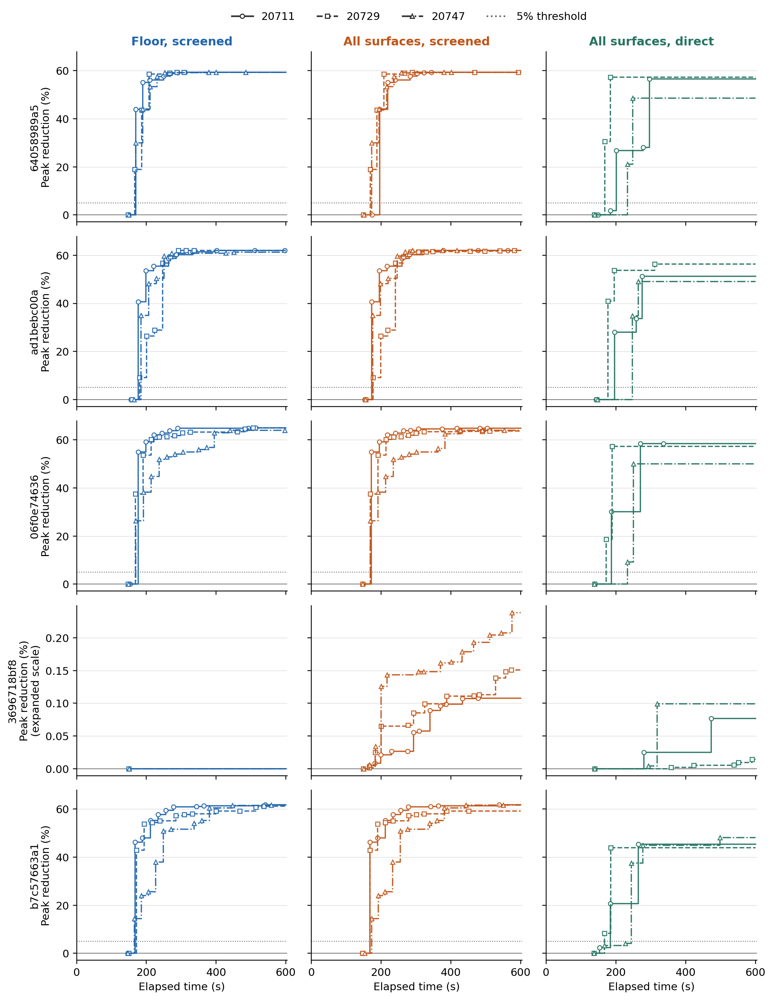

# 새 DIII-D 평형 파일을 주면 600초 안에 열유속 피크를 줄일 수 있는가?

**사전 등록한 12개 파일 중 4개에서 세 탐색 방법 모두 원벽 대비 전 벽 열유속 피크를 5% 이상 줄였다.** 이 네 평형에서는 바닥의 4개 계수만 허용한 탐색도 세 시드 모두 200초 안에 5% 개선을 달성했다. 600초에 얻은 바닥 탐색의 피크 감소율은 방전별 시드 중앙값으로 59.38–64.94%였다. 다섯 번째 평형에서도 적격 형상을 반환했지만, 최고 열유속이 OMP 연결부에 있어 어느 방법도 5%에 도달하지 못했다. 나머지 7개에도 원래 순번과 실패 원인을 보존했다. [등록 계획](protocol.ko.md) · [108개 시간 제한 결과](stage3_report.json)

공급 전력 1 MW, 고정 자기평형·물질벽, 같은 축약 수송식에서 **전 벽 표면법선 열유속 피크**를 최소화했다. 세 방법은 모두 cubic1280에서 마감 전에 열계산을 마치고 기하·수송 제약을 통과한 형상만 반환한다. 첫 두 방법은 cubic320 선별을 공통으로 쓰고 바닥 4계수 또는 네 면 16계수를 허용한다. 직접 방법은 16계수를 쓰며 정밀 계산으로 32개체 차분진화를 갱신한다. 같은 방전에서 시드 20711, 20729, 20747를 짝지었다. 108개 슬롯은 12개 익명 원파일의 반복 측정이다. 시간 원점은 파일을 넣는 공개 CLI 진입 직후다. [방법 고정 및 개발 시운전](method-freeze.ko.md) · [소스·실행 순서 봉인](expected.json)

## 어느 입력까지 작동했는가

| 단계 | 원파일 수 | 판정 |
|---|---:|---|
| 원본 바이트를 확인함 | 12/12 | 공개 revision과 LFS SHA-256 일치 |
| 정확한 1400 ms 프레임이 있고 과거 프레임과 중복되지 않음 | 11/12 | 한 파일에서 가장 가까운 시각은 1140 ms |
| 고정 벽에서 원래 열분포를 계산함 | 8/12 | 3개 파일에서 하부 X점을 검증하지 못함 |
| 선반 고정 끝점의 입사각 필요조건을 통과함 | 6/12 | 2개 파일에서 국소 자기 피치 상한이 1.5°에 미달 |
| 시간 안에 적격 대체 형상을 반환함 | 5/12 | 한 파일에서 불변 벽 구간과 LCFS의 교차를 사후 확인 |
| 원벽보다 피크를 5% 이상 낮춤 | 4/12 | 세 방법, 세 시드 모두 같은 네 파일. 측정 가능한 원벽 8개를 분모로 하면 4/8 |

적격 설계 반환은 방법별 15/36, 5% 개선은 12/36이었다. 바닥 선별에서 원벽보다 피크가 엄밀히 낮아진 슬롯은 12개, 전체 선별과 전체 직접에서는 각각 15개였다. 방법별로 6개 슬롯은 탐색했으나 마감까지 5%에 도달하지 않아 관측을 중단했다. 시각 결측·입력 실패·선반 배제의 18개 슬롯에는 가상 600초를 넣지 않았다. [원파일 등록](inputs/registration.json) · [시각별 상태와 수치](stage3_runs.csv)

## 같은 600초에서 얻은 피크

아래 감소율은 각 파일에서 **세 시드가 반환한 600초 최저 적격 피크의 원벽 대비 감소율 중앙값**이다. 원벽 피크의 단위는 MW/m²다. 원벽의 열점은 표면법선 열유속이 최대인 물질면이다.

| 익명 원파일 | 원벽 피크 | 원벽 열점 | 바닥 선별 | 전체 선별 | 전체 직접 |
|---|---:|---|---:|---:|---:|
| `64058989a5` | 8.372 | 바닥 | 59.38% | 59.38% | 56.56% |
| `ad1bebc00a` | 7.632 | 바닥 | 62.05% | 62.05% | 51.20% |
| `06f0e74636` | 4.892 | 바닥 | 64.94% | 63.95% | 57.24% |
| `3696718bf8` | 5.564 | OMP 연결부 | 0.00% | 0.15% | 0.08% |
| `b7c57663a1` | 5.623 | 바닥 | 61.66% | 61.69% | 45.43% |

600초에 양쪽 형상이 모두 적격인 15쌍에서 전체 선별과 바닥 선별의 차이 `100 × (q_floor/q_full − 1)`는 **12쌍에서 ±1% 이내**였다. 전체가 1% 넘게 유리한 경우는 `ad1bebc00a`의 시드 20747 한 쌍(+2.035%)이었다. 바닥이 유리한 경우는 `06f0e74636`의 20729(−3.599%)와 `b7c57663a1`의 20729(−4.776%)였다. 나머지 21쌍은 두 적격 피크가 없어 차이를 산출할 수 없었다. [원값과 시드별 비교](stage3_pairs.csv)

전체 선별은 전체 직접보다 비교 가능한 15쌍 모두에서 낮은 피크를 찾았다. 바닥 열점 네 파일의 12쌍에서 `100 × (1 − q_screened/q_direct)`는 **4.82–29.91%**, 연결부 열점의 3쌍에서는 0.03–0.14%였다. 직접 대조군도 적격 결과가 있던 15개 실행 모두에서 시한 내에 초기화 이후의 적격 DE 열계산을 마쳤다. 직접 대조군의 최종 승자는 초기 집단에서 11개, DE 시도에서 3개, 좌표 정련에서 1개 나왔다. 이 비교에는 **후보를 제안하는 방식과 평가 충실도를 배분하는 방식**이 함께 들어 있다. 선별 단계만의 기여도를 시험하려면 제안 규칙을 공통으로 둔 새 대조가 필요하다. [비교 절차](method-freeze.ko.md) · [정밀 시도 집계](stage3_report.json)

## 파일 입력부터 걸린 시간

5%에 실제로 도달한 각 방법의 12개 슬롯에서 최초 도달시간 범위는 바닥 선별 **166.0–184.9초**, 전체 선별 **167.6–195.5초**, 전체 직접 **167.2–246.7초**였다. 원벽 열계산을 마친 시각 자체가 111.6–142.8초였다. 200초에 5% 개선을 이미 달성한 슬롯은 전체 36개 중 바닥 선별 12개, 전체 선별 12개, 전체 직접 7개였다. 400초와 600초에는 모두 12개였다. 도달시간 범위는 성공한 경우에 조건부이며, 시간별 성공 수에는 등록한 슬롯 전체를 포함했다. [각 시점 최저 피크](stage3_runs.csv)

첫 정밀 적격 평가 전은 빈 구간이다. 5% 점선은 사전 고정한 개선 기준이다. 연결부 열점 행은 0.24% 이내의 변화를 읽을 수 있도록 세로축을 확대했다. 5개 파일에서 그린 모든 200·400·600초 값은 원 이벤트와 독립 집계 결과를 대조했다. [벡터 그림](anytime.pdf) · [각 계단의 실제 후보·시각·피크](anytime-events.csv)

## 바닥을 바꿨을 때 전력이 어떻게 이동했는가

`64058989a5`에서는 원벽으로 들어간 1 MW 중 **바닥 침적 전력 911.712 kW**가 바닥 선별 후에도 약 911.712 kW였다. 전 벽 A₂는 0.2232에서 0.5121 m²로 증가했고, 바닥에 남은 최고 피크는 8.3717에서 3.4004 MW/m²로 낮아졌다. 같은 바닥 면에서 전력을 넓게 받은 결과와 부합한다. A₂는 분포의 진단량이며 후보 채택에는 사용하지 않았다. [형상](examples/64058989a5/geometry.png) · [공통 물질 좌표의 열유속 분포](examples/64058989a5/profiles.png)

`3696718bf8`의 원벽에서는 바닥에 직접 도달한 전력이 0 W였고, 재분배까지 포함한 **바닥 침적은 0.636 W**, 연결부 침적은 **313.631 kW**였다. 바닥 형상만 움직인 세 경우 모두 연결부가 5.5640 MW/m²로 전 벽의 최고점이었다. 전체 선별은 연결부 열점을 유지하면서 0.108–0.238%를 낮췄다. 이 비교는 원벽 열점과 면별 전력이 바닥 변경의 효용을 가려내는 입력이 될 수 있음을 보여준다. 이 12개 파일에서 관찰한 규칙의 예측 성능은 별도 표본에서 평가해야 한다. 예시 그림은 원벽 열점 유형별 등록 순위가 가장 앞선 파일과 첫 시드 20711을 사용했다. 그림의 프로파일은 셀 평균이고 표의 선정 피크는 정련한 표면 최댓값이다. [형상](examples/3696718bf8/geometry.png) · [열유속 분포](examples/3696718bf8/profiles.png) · [45개 반환 형상의 면별 전력](regional-power.csv) · [전 벽 피크·A₂·열폭](winning-walls.csv)

## 전체 형상이 이긴 이유를 고정 형상으로 재계산

원래 정밀값에서 전체 형상이 바닥 선별 승자보다 엄밀히 낮았던 쌍을 모두 선정했다. 1차 비교인 전체 선별 대 바닥 선별 9쌍, 제안기까지 달라지는 2차 비교인 전체 직접 대 바닥 선별 3쌍이다. 각 전체 승자의 **바닥 계수 4개를 그대로 두고 비바닥 12개만 0으로** 바꿨다. 원벽·원래 두 승자·이 복원 형상을 동일한 평형, 공급 조건 및 제약 아래 평가했다. 같은 입력·같은 형상 ID는 재사용했다. 각 격자의 정밀 피크를 `q_full`, 바닥만 남긴 복원을 `q_ablated`, 별도의 바닥 탐색 승자를 `q_floor`로 쓰면, `q_floor − q_full = (q_floor − q_ablated) + (q_ablated − q_full)`이다. 첫 항은 서로 다른 바닥을 찾은 차이, 둘째는 **같은 바닥에서 비바닥 변형을 넣은 직접 차이**다. [격자별 분해표](ablation.csv) · [고정 후보 ID와 재계산 판정](replay-summary.json)

4개 평형에서 서로 다른 대체 형상 29개와 원벽 4개를 세 수치 설정에서 평가해 **99개 측정값**을 얻었다. 선정된 12쌍 모두 기준 해상도에서 원벽과 양쪽 승자의 피크·A₂가 상대 허용오차 10⁻⁹ 이내로 재현됐다. 36개 쌍·격자 조합 모두 바닥 복원 형상의 직접 비교가 가능했다. 같은 축약 수송식에서 12쌍·세 수치 설정 전체의 비바닥 직접 이득은 최대 **0.242%**였다.

**전체 선별이 1% 넘게 앞섰던 유일한 쌍에서, 2.04%의 차이는 더 좋은 바닥 형상을 찾은 효과였다.** `ad1bebc00a`·20747의 값은 다음과 같다. 단위는 MW/m²이며, 마감 안의 두 승자를 고른 후 세 격자에서 재평가했다.

| 같은 설계 | cubic1280 | cubic640 | quintic1280 |
|---|---:|---:|---:|
| 바닥 선별 승자 | 2.954872 | 2.955085 | 2.961135 |
| 전체 선별 승자 | 2.895934 | 2.896037 | 2.902238 |
| 전체 승자의 바닥만 유지 | 2.895934 | 2.896037 | 2.902238 |

세 수치 설정에서 전체 대 별도 바닥의 차이는 **2.029–2.039%**였다. 비바닥 변형을 제거하면 전체 승자의 피크가 약 0.0000005% 더 낮아졌다. 이 미세한 차이의 부호에 물리적 의미를 부여할 정밀도 근거는 없다. 바닥만 남겨도 약 2% 이득이 보존된다는 점은 세 설정에서 일치했다.

연결부가 열점인 `3696718bf8`에서는 다른 결과가 나왔다. 전체 선별 승자에서 비바닥 변형을 제거하면 바닥 선별 승자와 같은 피크로 돌아갔다. 비바닥 변형의 직접 이득은 세 시드·세 설정에서 **0.107–0.242%**였고, 부호도 유지됐다. 이 값은 사전 정의한 1% 방법 간 실용 차이와 원벽 대비 5% 목표보다 작다. 이 대조는 비바닥 12계수를 묶어 복원했다. 연결부·선반·입구 중 어느 하나의 단독 인과 효과를 특정하려면 각 면을 따로 고정하는 대조가 필요하다.

## 형상을 받지 못한 일곱 입력

- `37db1a57bb`에는 1400 ms가 없다. `8d1575d8c4`의 물질벽과 LCFS 꼭짓점은 모두 격자 안에 있었지만 하부 X점 탐색이 EFIT 격자 하단보다 **58.12 mm** 바깥에서 자기장을 요청했다. `a7e51f17f7`, `8bb901c2a1`에서 찾은 정상점은 각각 최저 LCFS 꼭짓점과 0.387 m, 0.221 m 떨어져 현 0.15 m 조건을 통과하지 못했다. 이 세 건의 배제는 입력 처리 단계에서 발생했다. 실제 방전의 자기배위에 대한 최종 판정은 열려 있다. [원 좌표·수치해법 호출 경로](input-diagnostics.json)
- `6193b526d8`, `1b9349fec8`의 원벽 피크는 각각 4.080, 1.187 MW/m²였다. 선반 고정점의 실제 접선 입사각은 1.100°, 0.098°, 같은 위치의 국소 자기 피치가 허용하는 축대칭 최대 입사각도 각각 **1.179°, 0.314°**였다. 양의 재분배 커널과 고정 끝점에서 1.5° 제약을 적용했을 때 발생하는 배제다. [입사각·원벽 상태](stage3_report.json)
- `b5e07dde39`의 원벽 열분포는 계산됐으나 모든 방법·시드가 600초 안에 적격 설계를 찾지 못했다. 아홉 실행에서 제안 139,406건이었다. 사후 검사에서 **움직일 수 없는 원벽 구간 4, 5**가 LCFS 닫힌 다각형과 각각 14.904 mm, 1.886 mm 겹쳤다. 구간 4의 내부 표본은 LCFS 경계에서 2.239 mm 안쪽이다. 이 두 구간을 그대로 쓰는 모든 후보는 현재의 전 벽 교차 검사에서 탈락한다. 이 입력에는 원파일을 읽은 뒤 고정 벽부터 검사해 같은 결론을 반환할 수 있다. 실험의 시간·성공률은 원래 실행 기록에서 산정했다. [좌표·원파일 해시·실행 증거](fixed-wall-diagnostics.json)

## NF 원고의 주장과 다음 실험

**현재 근거가 지지하는 주장은 고정 DIII-D 평형에서 10분 안에 낮은 피크의 적격 형상을 찾는 범위와, 그 성패를 결정한 물질면·형상 제약을 전향적으로 계량했다는 것이다.** 전력 분포를 그리는 것과 표적 형상을 자동 최적화하는 것에는 선례가 있다. 이 연구에서 차별화할 수 있는 부분은 미사용 파일을 분모에 유지한 제한시간 비교, 기준 열점에 따라 달라진 단순 형상의 효용, 비바닥 직접 효과와 더 좋은 바닥을 찾은 효과의 분해다. 자동으로 최적의 면을 골라내는 정책은 다음 검증 대상이다. [Dekeyser 등, 표적 형상 자동 최적화 원저](https://doi.org/10.1016/j.jnucmat.2014.10.064) · [선행 연구 대조표](../nf-submission-review-20261108/REPORT.ko.md)

1. **입력의 적용 범위를 빠르게 판별한다.** 가장 먼저 고정 벽–LCFS 교차를 검사하면 이번 `b5e07dde39`의 9회 탐색을 생략하고 동일한 기하 판정을 줄 수 있다. X점 실패는 격자 내부에서 여러 임계점을 찾고 안장점과 분리면 연결을 구분하는 경로와 대조한다. 하부 divertor를 갖지 않는 평형과 현 수치해법이 놓친 평형을 구분하는 것이 목표다. FreeGSNKE는 격자에서 임계점 후보를 찾고 Hessian으로 분류하며, INGRID는 한 개·두 개 X점을 갖는 배위를 구분한다. [FreeGSNKE 임계점 구현](https://docs.freegsnke.com/api/freegsnke.critical) · [INGRID 원저](https://arxiv.org/abs/2102.07040)
2. **자동 면 선택은 새 자료에서 시험한다.** 이번 네 바닥 열점과 한 연결부 열점으로부터 원벽의 최고점·면별 침적 전력을 사용한 ‘바닥 우선’ 규칙을 개발할 수 있다. 후보군에는 연결부·선반·입구를 개별적으로 열어 본 대조도 포함한다. 기존 12개를 개발 자료로 전환할 때는 규칙·같은 시간 예산·성공 기준을 고정한 뒤 새로운 미사용 파일에서 전체 탐색과 짝지어 평가한다.
3. **NF에서 실물 설계 성능을 주장하려면 독립 수송 대조가 필요하다.** 이번 cubic/quintic 정련은 같은 물리식 안에서의 재현이다. 바닥 열점의 큰 개선 사례와 연결부의 미세 개선 사례를 함께 고정한 뒤, 동일 입력 전력과 벽에서 독립 수송식으로 열점·피크·면별 전력 보존을 비교한다. 기존 FIREFLY 검토에서 배경 조건에 따른 부호 반전이 있었으므로 새 설계의 순위 유지 여부는 별도로 측정한다. 공학적으로는 반환 45개 중 21개의 개구 여유가 0.1 mm 미만이었다. 이 수치는 관측한 여유이며, 제조 공차를 새로 정의하기 전까지 적격 판정은 명목 형상에 한정한다. [기존 독립 수송 비교](../nf-submission-review-20261108/REPORT.ko.md) · [DIII-D 전용 divertor의 SOLPS-ITER·두 점 모형 비교](https://impact.ornl.gov/en/publications/solps-iter-modeling-of-a-dedicated-divertor-for-negative-triangul/) · [후보별 개구 여유](winning-walls.csv)

## 실행과 증거

RTX 3090 한 장에서 2026년 11월 8일 22:21:59부터 11월 9일 08:08:09까지(KST) 등록 슬롯을 순서대로 처리했다. 조기 배제를 포함한 경과는 **9시간 46분 10초**였다. 부모가 관측한 작업자 시작·종료 108쌍, 프로세스 또는 등록 제외 기록 108개를 대조했다. 각 슬롯의 최초 시도 한 번으로 완료됐다. 원벽과 승자의 117개 전력 장부에서 누락·미해결 전력은 0, 공급 전력으로 정규화한 수지 오차의 최댓값은 6.7×10⁻¹⁶이었다. 표본은 익명 공개 원파일이고, 이 결과로 실제 장치 전체의 성공률이나 세 시드의 통계적 독립성을 추정할 수는 없다. [실행 환경](execution-environment.json) · [보존 자료의 manifest](evidence/evidence-manifest.json) · [재현 절차](reproduce.ko.md)
