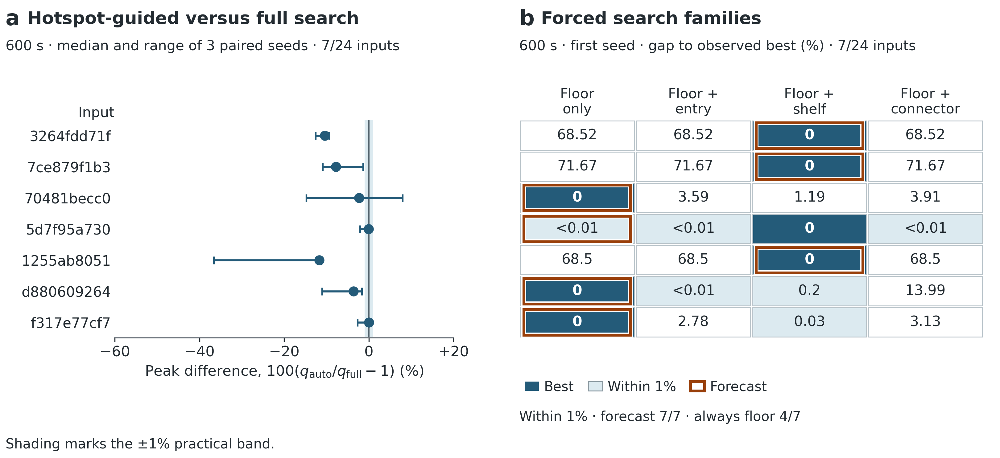
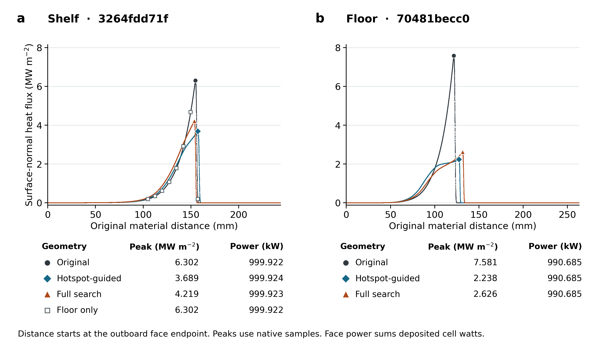

# 원벽 열점으로 어느 디버터 면을 탐색할지 예측할 수 있는가?

**새 DIII-D 평형 파일 24개 중 7개에서 적격 형상끼리 비교할 수 있었다. 이 7개에서 원벽 열점 규칙은 독립적으로 실행한 네 집중 탐색의 최저 피크 대비 1% 이내인 가족을 7번 골랐다. 항상 바닥만 고르면 4번이었다.** 차이를 만든 세 파일의 원벽 열점은 모두 선반이었다. 동일 시간에 바닥과 선반을 함께 바꿀 때만 큰 피크 감소가 나타났다. 바닥 열점 네 파일에서는 바닥만으로 충분했다. 목적함수는 공급 전력 1 MW에서의 **전 벽 표면법선 열유속 최댓값**이다. 전력 분포와 유효 면적은 피크가 어떻게 변했는지 설명하는 진단량이다. [사전 등록](protocol.ko.md) · [파일별 예측과 대조군](policy-predictions.csv)

## 무엇을 고정하고 시험했는가

공개 데이터의 고정 revision에서 과거 36개 원파일을 제외한 뒤 경로 해시 순서로 24개를 등록했다. 과거에 확보한 8,097개 평형 프레임과 대조했다. 모든 요청 시각은 1400 ms였고 빠진 파일을 보충하지 않았다. 원벽, 평형, 상류 전력과 수송계수, 선반 입사각·곡률·전 벽 기하 제약, 저비용 선별 및 정밀 채택 절차를 모든 방법에서 공유했다. 실행 순서·시드·전체 소스의 SHA-256을 첫 새 열계산 전에 공개했다. [코드 고정](https://github.com/gyub05110-sudo/divertor_optimize/commit/f5da3caa25fac60e5ad3b94057bd21e52421fd30) · [240개 슬롯을 봉인한 커밋](https://github.com/gyub05110-sudo/divertor_optimize/commit/bd188c7a34f1108869392588b2d96e91592edd4f) · [입력 감사](inputs/independent-audit.json)

1. 원벽 cubic1280 계산에서 면별 피크를 읽는다. 바닥 열점이면 바닥 4계수만, 선반·입구·연결부 열점이면 그 면의 4계수와 바닥 4계수를 연다. 최대 피크의 상대 차가 10⁻¹⁰ 이내이면 침적 W와 고정 순서로 결정한다. 동률 집합에 고정 벽 또는 IMP가 들어가면 면 선택을 유보하고 전체 16계수로 돌아간다. 첫 후보 생성 전에 이 결정과 면별 측정값을 기록한다.
2. 자동 선택과 전체 16계수 탐색은 새 세 시드에서 각각 별도 프로세스로 실행한다. 각자 600초이며 입력·원벽·규칙 평가·후보 준비까지 예산에 포함한다. 첫 시드에서는 바닥만, 바닥+입구, 바닥+선반, 바닥+연결부도 각각 실제로 600초씩 실행한다.
3. 예측의 기준은 첫 시드의 네 **강제 실행**에서 관측한 최저 피크다. 자동 실행의 결과와 강제 실행의 결과는 시간 제한 때문에 같은 가족·시드에서도 달라질 수 있다. 제품 성능은 따로 세 시드에서 각각의 자동 실행과 전체 실행을 짝지어 비교한다. [사용자 CLI](../../docs/user-optimizer.ko.md) · [실행계획](expected.json)

## 적용 범위

| 새 원파일의 결과 | 파일 | 방법별 파일×시드 |
|---|---:|---:|
| 정확한 1400 ms 프레임 없음 | 1 | 3 |
| 위쪽 LCFS 안장점 확인, 필요한 하부 분리면 재구성 불가 | 8 | 24 |
| 원벽 열분포 측정, 선반 고정 접선 또는 국소 자기피치의 1.5° 입사각 조건 미달 | 8 | 24 |
| 시간 안에 적격 형상을 반환하고 원벽 피크를 5% 이상 낮춤 | 7 | 21 |
| 합계 | 24 | 72 |

원벽은 15/24에서 측정했고 7/24에서 두 방법 모두 세 시드 전부 5% 이상 개선했다. 나머지 17개 파일에는 최초 5% 도달 시각이 정의되지 않는다. 탐색을 시작하고도 마감까지 5%에 도달하지 못한 제품 슬롯은 0개였다. 고정 벽 열점에 따라 선택을 유보한 파일 `0af2e6f616`은 선반 제약도 위반해 후보 탐색 전에 종료했다. 이 표본의 유보 경로에서 전체 탐색이 적격 설계를 반환한 사례는 없었다. 불변 벽과 LCFS의 교차로 배제된 새 파일도 0개였다. 이 기하 검사는 과거 실패 파일의 원벽 선분 4·5에서 각각 14.904, 1.886 mm가 LCFS와 겹치는 것을 재현했다. [전체 240개 슬롯](registered-runs.csv) · [불변 벽 검증](development/fixed-wall-regression.json) · [과거 하부 X점 실패 3건의 원본 격자 검사](development/lower-x-diagnostics.json)

## 면 선택과 전체 탐색의 비교

표에서 집중 탐색 열은 첫 시드의 별도 강제 실행이다. 감소율과 자동/전체 차이의 중앙값은 파일마다 세 시드를 짝지어 계산했다. 차이의 정의는 100 × (자동 피크 / 전체 피크 − 1)이며 음수이면 자동이 더 낮다. 아래 피크의 단위는 MW/m²다. [첫 시드 대조군](policy-predictions.csv) · [모든 시드·시간대의 쌍](product-pairs.csv)

| 파일 | 예측 | 원벽 피크 | 바닥만 | 예측 가족 | 자동의 원벽 대비 감소율 중앙값 | 자동/전체 차이 중앙값 | 자동/전체 차이 최악값 |
|---|---|---:|---:|---:|---:|---:|---:|
| `3264fdd71f` | 바닥+선반 | 6.302 | 6.302 | 3.739 | 41.47% | −10.37% | −9.41% |
| `7ce879f1b3` | 바닥+선반 | 6.109 | 6.109 | 3.559 | 40.91% | −7.82% | −1.39% |
| `70481becc0` | 바닥 | 7.581 | 2.238 | 2.238 | 70.48% | −2.34% | **+7.94%** |
| `5d7f95a730` | 바닥 | 8.056 | 4.139 | 4.139 | 48.63% | −0.05% | <0.01% |
| `1255ab8051` | 바닥+선반 | 6.313 | 6.313 | 3.746 | 44.43% | −11.68% | −11.17% |
| `d880609264` | 바닥 | 5.665 | 2.277 | 2.277 | 59.80% | −3.66% | −1.70% |
| `f317e77cf7` | 바닥 | 9.864 | 2.578 | 2.578 | 73.82% | <0.01% | <0.01% |

엄밀한 최저를 맞힌 것은 6/7이다. `5d7f95a730`에서는 바닥+선반이 바닥만보다 약 0.00000076% 낮았고 네 가족 모두 1% 안에 들었다. 바닥 충분을 양성으로 놓으면 TP 4, TN 3, FP 0, FN 0이다. 관측 재현율은 바닥 충분 4/4, 다른 면 필요 3/3이다. 선반 열점 세 파일에서는 바닥만 고른 피크가 관측 최저보다 68.50–71.67% 높았다. 새로운 적격 파일에서 입구나 연결부가 필요했던 경우는 없어 이 두 분기의 예측력은 평가하지 못했다. 비교 가능한 7개와 제외된 17개를 함께 보존했다. [예측의 정확한 수치 및 실용 동률](policy-predictions.csv)

600초에 두 방법이 모두 적격인 21쌍에서 자동이 1% 넘게 낮은 경우는 16쌍, ±1% 이내는 4쌍, 전체가 1% 넘게 낮은 경우는 1쌍이었다. 파일별 중앙값을 단위로 보면 자동 우세 5개와 실용 동률 2개다. 파일별 중앙값 일곱 개의 중앙값은 −3.66%였다. 예외는 `70481becc0`, 시드 30757로 자동 2.4343, 전체 2.2552 MW/m²였다. 전체가 이룬 5% 개선을 자동이 마감 시점에 놓친 파일·시드는 0개였다. [벡터 그림](policy-validation.pdf) · [원자료 검산 보고서](stage4_report.json)

| 시각 | 원벽 피크를 5% 이상 낮춘 자동 슬롯 / 72 | 전체 슬롯 / 72 |
|---|---:|---:|
| 200초 | 12 | 11 |
| 400초 | 20 | 21 |
| 600초 | 21 | 21 |

도달한 21개 슬롯에서 최초 5% 시각의 중앙값은 자동 177.3초, 전체 182.6초였다. 400초에는 `7ce879f1b3`의 시드 30757에서 전체만 5%에 도달했고 자동은 약 476.7초에 도달했다. 적격 자동 실행에서 입력 후 원벽 계산 완료까지 중앙값은 123.2초였다. 후보 채택 마감은 600초이며, 이미 시작한 마지막 열계산과 파일 저장을 포함한 실제 CLI 종료까지 중앙값은 자동 610.3초, 전체 613.2초였다. 두 방법 모두 늦게 끝난 후보를 채택하지 않았다. 이번 자료에서 자동 선택의 가장 분명한 이점은 한정된 시간에 얼마나 낮은 피크를 찾는가에 있다. [체크포인트 및 검열 기록](registered-runs.csv) · [실제 실행 환경](execution-environment.json)

## 같은 전력에서 피크는 어떻게 낮아졌는가

첫 시드의 일곱 자동 승자 모두 원벽과 같은 면에 최고 열유속이 남았다. 원벽 대비 그 면의 최초 충돌 전력은 일곱 파일 모두 같았다. 해당 면의 침적 전력 변화는 선반 세 파일에서 +1.43∼+1.82 W, 바닥 네 파일에서 +0.045∼+0.082 W였다. 첫 시드에서 실제 선택한 두 형상의 예를 원벽과 같은 물질 좌표에 놓았다. A₂는 전 벽 셀의 침적 전력 Pᵢ와 면적 Aᵢ로 계산한 (ΣPᵢ)²/Σ(Pᵢ²/Aᵢ)다. [원본·자동·전체·네 대조군의 면별 전력 및 피크](regional-power.json)

| 파일과 원벽 열점 | 형상 | 전 벽 피크 (MW/m²) | 원래 열점 면의 침적 전력 (kW) | 전 벽 A₂ (m²) |
|---|---|---:|---:|---:|
| `3264fdd71f` 선반 | 원벽 | 6.302 | 999.9224 | 0.2921 |
|  | 자동 | 3.689 | 999.9241 | 0.4050 |
|  | 전체 | 4.219 | 999.9226 | 0.3735 |
| `70481becc0` 바닥 | 원벽 | 7.581 | 990.6846 | 0.2418 |
|  | 자동 | 2.238 | 990.6846 | 0.5600 |
|  | 전체 | 2.626 | 990.6846 | 0.5438 |

두 예에서는 원래 열점 면에 도달한 총 전력이 거의 일정한 상태에서 벽 위 분포가 넓어지고 피크가 낮아졌다. A₂와 피크의 순위가 항상 일치하는 것은 아니다. `d880609264`의 첫 시드에서 전체 탐색은 자동보다 큰 A₂를 얻었지만(0.7105 대 0.6682 m²), 피크 기준으로는 자동이 더 낮았다(2.277 대 2.560 MW/m²). 모든 후보의 채택과 방법 비교에는 피크를 사용했다. 원벽 150개와 승자 70개의 전력 장부에서 누락·미해결 전력은 0이었고, 공급 전력 대비 수지 오차의 최댓값은 1.67×10⁻¹⁵이었다. [면별 원자료](regional-power.json) · [형상별 전력 장부](stage4_report.json)

그림은 원본 등록 순서에서 해당 열점의 첫 적격 파일을 택했다. 가로축은 원벽의 해당 면 끝점에서 잰 물질 좌표다. 새 형상의 정밀 열유속 표본을 원래 선분과 선분 내 위치로 대응시켰다. 선반 예의 바닥 단독 결과(빈 사각형)는 원벽 선반 분포와 겹친다. [인쇄용 PDF](hotspot-profiles.pdf) · [그림 재현 코드](plot_hotspot_profiles.py)

## 고정 형상의 수치 민감도

첫 시드에서 자동과 전체의 차이가 1%를 넘은 6개 파일의 승자 12개를 다시 계산했다. 네 강제 실행의 최저보다 예측 가족이 1% 넘게 뒤진 파일은 0개였다. 아래 값은 고정된 두 형상의 자동/전체 피크 차이(%)다. 동일 cubic1280에서 원벽·승자의 피크와 A₂가 상대 허용치 10⁻⁹ 이내로 재현됐다. 6쌍 모두 세 수치 설정에서 두 형상이 적격이었고, 자동의 피크가 더 낮았으며 두 형상 모두 원벽 대비 5% 이상 낮았다. [24개 파일 전체의 사후 판정과 고정 후보 수치](stage4_replay.json)

| 파일 | cubic1280 | cubic640 | quintic1280 |
|---|---:|---:|---:|
| `3264fdd71f` | −12.57 | −12.57 | −12.57 |
| `7ce879f1b3` | −10.94 | −10.93 | −10.94 |
| `70481becc0` | −14.76 | −14.76 | −14.52 |
| `1255ab8051` | −11.17 | −11.16 | −11.16 |
| `d880609264` | −11.05 | −11.05 | −11.10 |
| `f317e77cf7` | −2.70 | −2.72 | −2.66 |

재계산 대상은 사전 등록대로 첫 시드의 해당 쌍이었다. `70481becc0`에서 전체가 이긴 세 번째 시드의 +7.94% 값은 시간 제한 탐색의 cubic1280 측정값이다.

## NF 원고에 넣을 주장

이 표본은 **원벽 피크가 생긴 면이 바닥만으로 충분한 경우와 선반도 열어야 하는 경우를 구별할 수 있다**는 근거를 준다. 최초 피크 위치에서 탐색 변수를 고른 뒤 같은 시간에 네 대조군과 전체 탐색을 실제로 실행했기 때문에, 선택이 맞은 경우와 검색 예산에 따른 손익을 따로 측정할 수 있었다. 7개 적격 파일 중 개선의 추가 근거를 제공한 것은 선반 3개다. 익명 공개 파일 사이의 물리적 독립성, 다른 운전점에서의 성능, 입구·연결부를 고른 새 적격 사례까지는 이 수치로 추정할 수 없다. 기준벽과 운전 조건은 고정했고 비교의 참조점은 각 탐색이 시간 안에 발견한 최저다. [전체 실패·적격 사례](registered-runs.csv) · [예측 판정](policy-predictions.csv)

표적 형상 최적화와 열부하 분산에는 이미 선례가 있다. Dekeyser 등은 축약 경계 플라스마 모형과 수반법으로 표적 열부하 균일화를 연구했고, Frerichs는 ITER 외측 표적에 FLARE와 입자군 최적화를 적용해 배경 플라스마 가정에 따라 유리한 형상이 달라짐을 보였다. 이 연구의 독창성 주장은 **입력 평형의 원벽 열점으로 탐색할 면을 사전에 선택하고, 그 선택의 예측력·반환율·시간당 후보 품질을 새 파일에서 정량화했다**는 범위가 적절하다. [Dekeyser 등, Nuclear Fusion](https://doi.org/10.1088/0029-5515/54/7/073022) · [Frerichs, 저자 공개 원고](https://arxiv.org/abs/2509.00206)

영문 결과 문장으로는 다음 범위가 해당한다.

> We preregistered a search rule that uses the location of the peak surface-normal heat flux on the reference wall to select which divertor surfaces may vary. Of 24 previously unseen DIII-D equilibrium files, seven supported all four targeted searches. Under a common 600 s budget, the predicted family attained a peak within 1% of the lowest found by the four independently run families in all seven cases, compared with four for a floor-only rule. In 16 of 21 paired runs on these seven files, the hotspot-guided search reduced the peak by more than 1% relative to the full 16-parameter search. Four pairs were within 1%, and the full search performed better in one.

다음 물리 검증에는 형상을 그대로 고정한 채 바닥과 선반 사례에서 독립 수송식이 원벽 열점 위치와 후보 순위를 보존하는지 비교하는 것이 적절하다. Lore 등의 DIII-D 전용 디버터 연구도 두 점 모형과 SOLPS-ITER로 연결 길이와 폐쇄성의 기여를 구분했다. 이번 결과는 지정한 축약 수송식에서의 예측과 수치 민감도를 다룬다. [Lore 등, 저자 기관 기록](https://impact.ornl.gov/en/publications/solps-iter-modeling-of-a-dedicated-divertor-for-negative-triangul/)

## 기록과 재현

2026년 11월 9일 12:53부터 11월 10일 03:45까지(KST) 단일 RTX 3090에서 240개 슬롯을 처리했다. 실제 CLI 호출 230개는 모두 최초 시도에서 종료했고 나머지 10개는 결측 시각을 가진 한 파일의 등록 제외 기록이다. 04:27에 고정 형상 재계산까지 마쳤다. 정밀 표본의 좌표·원벽 선분·면별 피크, 기하, 공급·침적 전력, 시계와 후보 채택을 원기록에서 검산했다. Git의 경량 보존본에는 모든 실행 결과와 이벤트, 재계산 판정, 전체 목록과 해시가 들어 있다. 공개 평형 원본 및 모든 수치 배열을 담은 완전 보존본은 D 드라이브에 두었다. [보존본 지문과 위치](evidence-checksums.json) · [재현 안내](reproduce.ko.md)
