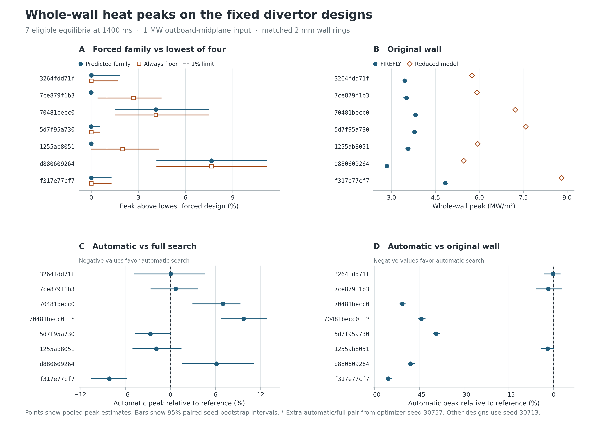

# 어느 디버터 면을 바꾸면 전 벽 피크가 낮아지는가

**원벽 열점이 바닥이던 4개 평형에서는 자동 탐색이 반환한 형상이 독립 FIREFLY 계산에서도 전 벽 피크를 원벽보다 39.34–55.38% 낮췄다. 축소 모델이 선반 열점으로 분류한 3개에서는 선반 자체의 피크가 낮아졌지만, 전 벽 최대는 원벽과 자동 형상 모두 안쪽 경사면에 있었다.** 세 선반 사례의 전 벽 피크 감소 추정치는 0.17–1.96%이고 각각의 짝지은 95% 구간이 0을 포함한다. 이 수치는 첫 최적화 시드 30713에서 실제로 반환한 형상에 대한 결과다. [원벽·자동·전체 비교표](firefly-products.csv)

**면 선택 예측을 1% 정밀도로 지지한 평형은 7개 중 3개다.** 같은 축소 모델에서 7/7이었던 결과를 독립 수송 모델에 그대로 적용하기 어렵다. 예측과 별개로 최종 제품을 평가했을 때, 전체 탐색이 더 낮은 피크를 준 쌍도 있었다. [가족별 예측표](firefly-forecast.csv) · [4단계 원래 시험](../nf-stage4-20261109/REPORT.ko.md)

## 시험 범위

4단계에서 새로 등록한 DIII-D 파일 24개 중 같은 1400 ms에서 네 강제 탐색을 모두 비교할 수 있었던 7개를 전수 사용했다. 나머지 17개는 프레임 부재 1개, 하부 분리면 구성 조건 8개, 원벽의 입사각 등 기하 조건 8개였다. 형상별 목표는 **주어진 1 MW에서 전 벽 표면법선 열유속의 최댓값 최소화**다. FIREFLY가 평가한 것은 각 600초 탐색이 이미 반환한 고정 형상이다. 탐색 시간과 별도로 수행한 교차 모델 검증이다. [사전 등록](protocol.ko.md) · [51개 역할의 원본·시드·좌표 식별자](wall-registration.json)

각 평형에서 원벽, 네 가족의 개별 강제 탐색 승자(바닥, 바닥+입구, 바닥+선반, 바닥+연결부), 실제 자동 탐색 승자, 전체 16계수 탐색 승자를 보존했다. 4단계에서 전체 탐색의 우위가 컸던 `70481becc0`의 시드 30757 자동·전체 쌍을 추가했다. 같은 평형에서 벽 좌표가 바이트 단위로 같을 때만 하나의 열계산을 공유했다. 따라서 **예측은 7개 평형, 제품은 7개 평형의 8쌍, 총 51개 역할과 46개 고유 형상**이다. 최저는 등록된 네 강제 승자 중의 최저다. 시간 무제한 전역 최적해까지 측정한 범위는 아니다.

## 1. 평형·벽·열원 연결

대표 선반 평형 `3264fdd71f` 7개 벽과 대표 바닥 평형 `70481becc0` 8개 벽부터 자기장 성분·부호, 자기축·LCFS, 실제 물질벽의 모든 꼭짓점과 OMP 열원 1,280개의 위치 및 개별 전력을 대조했다. 같은 검사를 46개 벽에 적용했다. 58,880개 형상별 열원 추적이 모두 하부 벽에 도달했다. 원래 추적에 대한 전력 가중 착지 오차의 95백분위는 형상별 최대 0.151 mm, 전력 가중 평균 연결길이 상대오차의 최댓값은 0.250% 미만이었다. 가장 큰 개별 착지 오차 109.18 mm는 바닥 대표 평형의 한 열원점(7.01×10⁻¹⁰ W)에서 발생했다. 자기장 성분의 최대 절대차는 3.69×10⁻⁶ T, 정규화 자속의 최대 절대차는 5.34×10⁻⁷이다. [평형별 입력 검산](bridge-cases.csv) · [형상별 상세값](bridge.json)

첫 두 MPI 실행에서 각각 상부벽에 36.55 W가 침적돼 원래의 0.3 W 미만 검사를 통과하지 못했다. 원인을 특정 난수 궤적으로 재현했다. 내부 자기 경계에서 좌표를 보정할 때 물리좌표와 자기좌표가 달라져 중간면에서 반사가 한 번 더 일어났다. 한 줄을 수정한 독립 빌드 두 개의 SHA-256이 일치했고, 기준 사례와 실패한 두 사례를 다시 계산해 상부벽 0 W를 확인했다. 원래 두 결과와 제어용 재생을 별도로 보존하고, 수정 버전을 다시 봉인한 뒤 276회를 처음부터 계산했다. 또한 한 평형에서 누적 열원확률 끝점의 반올림 오차를 바로잡았고, 열원 위치와 개별 W가 원래 배열과 일치하는지 검산했다. [실패 기록](first-run-incident.json) · [경계 수정 및 제어 계산](amendment-r2.ko.md) · [누적확률 수정 기록](input-cdf-correction.json) · [본 계산 봉인](execution-r2.json)

## 2. 고정 형상의 독립 열계산

FIREFLY/FLARE의 간략화한 고정 배경 열수송 모델로 각 형상에 여섯 개의 짝지은 시드를 사용했다. 이온종은 중수소, 배경은 100 eV와 10¹⁹ m⁻³, 유효 수직수송계수는 0.45 m²/s이다. OMP에서 공급한 전 토러스 기준 1 MW를 1/64 토로이달 구간에서 추적했다. 시드당 MPI 4랭크 합계 4,096이므로 총 **276회, 1,130,496이력**이다. 모든 결과의 상부 물질벽·반사면·영역 이탈·시간 검열 전력은 각각 0 W였고, 전력 장부의 최대 절대 잔차는 4.66×10⁻¹⁰ W였다. 본 행렬의 실제 경과시간은 약 13시간 10분, 네이티브 계산의 누적 CPU 시간은 104.4시간이다. [실행 환경](execution-environment-r2.json) · [Frerichs 등의 FIREFLY 논문](https://arxiv.org/abs/2604.11497)

두 모델의 적분 전력을 실제 물질면 경계에 맞춘 약 2 mm 고리로 옮기고 동일한 회전면적으로 나눴다. FIREFLY의 점추정은 여섯 시드의 고리별 전력을 먼저 평균한 뒤 얻은 전 벽 최댓값이다. 형상 간 시드를 짝지어 6⁶ = 46,656개 재표집에서 고리별 평균, 최대, 네 강제 승자 중 최저를 다시 계산했다. 아래 구간은 이 여섯 시드의 Monte Carlo 변동을 나타낸다. 모델 차이, 배경 가정, 다른 평형에 대한 불확실성은 별도다. [같은 고리의 두 모델 및 원래 정밀 피크](metrics.json) · [재현 안내](reproduce.ko.md)

### 면 선택과 제품 성능

예측 가족의 강제 승자가 네 강제 승자의 FIREFLY 최저 대비 1% 이내인지 평가했다. 점추정만 보면 원벽 열점 규칙은 5/7, 항상 바닥은 3/7이다. 사전에 정한 엄격한 판정(95% 구간 상한 ≤1%, 점추정에서 양 끝까지의 최대 거리 ≤1%p)에서는 규칙이 **지지 3, 유보 4**, 항상 바닥이 **지지 1, 유보 6**이다. 규칙에서 유보된 네 파일 중 `70481becc0`와 `d880609264`의 구간은 전체가 1%를 넘었다. 각각 바닥+선반과 바닥+연결부가 더 낮았다. 두 건은 정밀도 기준으로 유보이며, 방향만으로 보면 예측에 불리한 증거다.

제품 비교에서도 순위가 바뀌었다. FIREFLY에서 실제 전체 승자는 8쌍 중 3쌍, 실제 자동 승자는 1쌍에서 상대 피크가 더 낮았고 4쌍은 95% 구간이 0을 포함했다. `70481becc0`은 두 시드 모두 전체가 유리했다. 시드 30757에서는 축소 모델의 원래 정밀 평가에서 자동이 전체보다 7.94% 높았고, FIREFLY에서도 9.75% 높았다. 같은 평형의 30713에서는 축소 모델이 자동 우세(−14.76%)였으나 FIREFLY는 전체 우세(+6.99%)였다. `d880609264`에서도 −11.05%에서 +6.12%로 순위가 바뀌었다. `f317e77cf7`에서는 자동의 우위가 유지됐다. [파일별 원래 모델·동일 고리 모델·FIREFLY 상대차](firefly-products.csv)

상대 피크 차이 (%)와 짝지은 Monte Carlo 95% 구간. 음수는 분자 형상의 피크가 더 낮음을 뜻한다.

| 평형 | 지목한 가족 | 지목/4종 최저 | 1% 판정 | 바닥/4종 최저 | 1% 판정 | 지목/바닥 |
|---|---|---:|---|---:|---|---:|
| 3264fdd71f | 바닥+선반 | +0.01 [+0.00, +1.82] | 유보 | +0.00 [+0.00, +1.68] | 유보 | +0.01 [-1.65, +1.82] |
| 7ce879f1b3 | 바닥+선반 | +0.00 [+0.00, +0.00] | 지지 | +2.69 [+0.40, +4.47] | 유보 | -2.62 [-4.28, -0.40] |
| 70481becc0 | 바닥 | +4.11 [+1.50, +7.48] | 유보 | +4.11 [+1.50, +7.48] | 유보 | 동일 형상 |
| 5d7f95a730 | 바닥 | +0.00 [+0.00, +0.56] | 지지 | +0.00 [+0.00, +0.56] | 지지 | 동일 형상 |
| 1255ab8051 | 바닥+선반 | +0.00 [+0.00, +0.07] | 지지 | +1.99 [+0.00, +4.32] | 유보 | -1.96 [-4.14, +0.07] |
| d880609264 | 바닥 | +7.64 [+4.14, +11.19] | 유보 | +7.64 [+4.14, +11.19] | 유보 | 동일 형상 |
| f317e77cf7 | 바닥 | +0.00 [+0.00, +1.28] | 유보 | +0.00 [+0.00, +1.28] | 유보 | 동일 형상 |

| 평형 | 최적화 시드 | 자동/전체 (%) | 자동/원벽 (%) | 전체/원벽 (%) |
|---|---:|---:|---:|---:|
| 3264fdd71f | 30713 | +0.04 [-4.80, +4.60] | -0.17 [-3.13, +2.31] | -0.21 [-3.44, +2.82] |
| 7ce879f1b3 | 30713 | +0.71 [-2.63, +3.66] | -1.80 [-5.94, +2.75] | -2.49 [-6.13, +0.92] |
| 70481becc0 | 30713 | +6.99 [+2.93, +9.32] | -50.68 [-51.59, -49.60] | -53.91 [-54.68, -52.14] |
| 70481becc0 | 30757 | +9.75 [+6.77, +12.86] | -44.32 [-45.46, -42.90] | -49.26 [-50.56, -47.42] |
| 5d7f95a730 | 30713 | -2.68 [-4.74, +0.07] | -39.34 [-40.45, -38.12] | -37.68 [-38.93, -36.46] |
| 1255ab8051 | 30713 | -1.86 [-5.06, +1.46] | -1.96 [-4.14, +0.07] | -0.10 [-2.93, +2.80] |
| d880609264 | 30713 | +6.12 [+1.50, +11.09] | -47.92 [-48.70, -46.42] | -50.92 [-52.88, -47.99] |
| f317e77cf7 | 30713 | -8.12 [-10.52, -5.75] | -55.38 [-56.14, -54.05] | -51.43 [-52.27, -50.20] |

| 원벽 평형 | 원래 모델 정밀 열점 | 2 mm 모델 열점·피크 (MW/m²) | FIREFLY 열점·피크 [95% 구간] (MW/m²) |
|---|---|---:|---:|
| 3264fdd71f | 선반 | 선반 5.758 | imp_sloped 3.450 [3.382, 3.532] |
| 7ce879f1b3 | 선반 | 선반 5.918 | imp_sloped 3.510 [3.405, 3.600] |
| 70481becc0 | 바닥 | 바닥 7.231 | 바닥 3.816 [3.778, 3.892] |
| 5d7f95a730 | 바닥 | 바닥 7.587 | 바닥 3.786 [3.742, 3.856] |
| 1255ab8051 | 선반 | 선반 5.945 | imp_sloped 3.560 [3.474, 3.647] |
| d880609264 | 바닥 | 바닥 5.471 | 바닥 2.840 [2.810, 2.910] |
| f317e77cf7 | 바닥 | 바닥 8.817 | 바닥 4.837 [4.756, 4.919] |

### 선반의 분산 효과와 전 벽 피크

선반 3개 원벽에서 축소 모델은 안쪽 경사면(`imp_sloped`)에 0.0079–0.0087 W를 배분했지만 FIREFLY는 **98.1–100.6 kW**를 배분했다. FIREFLY에서도 선반은 약 878–880 kW로 가장 많은 전력을 받았다. 그보다 작은 전력을 받는 안쪽 경사면의 국소 열유속이 더 높았다. 세 원벽 모두 여섯 시드의 모든 부트스트랩 재표집에서 전 벽 최대가 이 경사면에 있었다.

선반 대표 `3264fdd71f`에서 자동 형상은 선반의 국소 피크를 **3.21→2.42 MW/m²**로 낮추고 전 벽 유효면적 A₂를 **0.463→0.562 m²**로 늘렸다. 안쪽 경사면은 **3.450→3.445 MW/m²**여서 전 벽 피크 변화는 −0.17%였다. 선반에 입사한 kW와 해당 면의 MW/m² 최대는 다른 물리량이다. 바닥 대표 `70481becc0`의 첫 시드에서는 바닥 침적이 856.7→868.4 kW여도, A₂가 0.423→0.748 m²로 늘고 전 벽 피크가 3.816→1.882 MW/m²로 떨어졌다. 두 사례 모두 원래 목적함수인 **전 벽 최대**로 형상을 판정하고, 면별 전력과 유효면적으로 변화를 해석했다. [51개 역할의 열점·면별 W·면별 최대·A₂](metrics.json)

고리별 시드 W와 면적에서 별도 코드로 46,656개 순서 있는 재표집을 열거해 45개 대조량의 점추정, 구간 양 끝, 방향, 정밀도 및 판정을 대조했다. [독립 검산 결과](decision-crosscheck.json) · [고리 프로파일과 원본 NetCDF 보존본](evidence-compact/)

## NF 원고에서의 해석

이 자료가 뒷받침하는 주장은 두 모델이 원벽의 지배 열점을 바닥으로 식별한 4개 평형에서 자동 형상이 원벽의 전 벽 피크를 크게 낮췄다는 것이다. 바닥 형상이 전체 탐색과 같은 수준의 해를 항상 낸다거나, 선반 원벽의 전 벽 피크도 약 40% 줄인다는 주장은 FIREFLY 대조에서 유지되지 않았다. 이 비교는 7개 적격 평형과 고정 배경의 두 계산 모델에 해당한다. DIII-D 실측 열유속에 대한 정확도는 별도의 검증 대상이다.

후속 연구의 우선순위는 선반 사례에서 OMP 열원이 안쪽 경사면에 분배되는 경로를 두 모델에서 대조하는 것이다. 먼저 그 차이가 상류 열원의 자기장선 연결, 수직 수송, 열침적 처리 중 어디에서 생기는지 분해해야 한다. 그래야 주어진 평형에서 빠른 바닥 우선 탐색으로 충분한 경우와 독립 재평가 또는 탐색 범위 확대가 필요한 경우를 구분할 수 있다. 이 7개 평형은 이미 결과를 확인한 진단 자료이므로, 규칙을 바꾸면 미사용 평형에서 다시 평가해야 한다.
