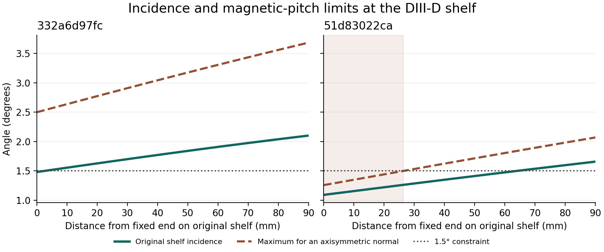
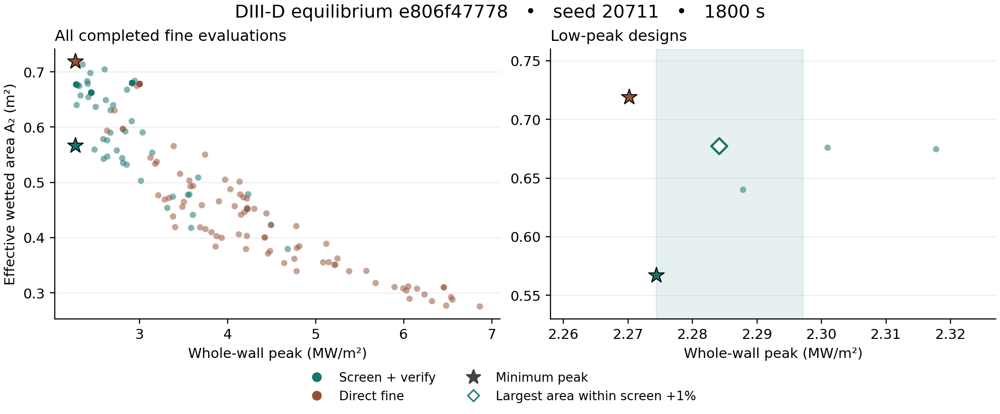

# 주어진 자기평형에서 divertor 열유속 피크를 빠르게 낮추는 연구의 Nuclear Fusion 투고 검토

2026년 11월 8일 · DIII-D 워크트리 `codex/selective-candidate-validation` · 검토한 코드 `524dcc5`

**판정은 원고 집필 시작, 일반 입력에 대한 성능 주장은 보강 후 투고다.** 이 연구의 목적은 주어진 자기평형, 기준 물질벽, 운전 입력을 유지하며 제한 시간에 쓸 만한 형상을 돌려주는 것이다. 이를 가장 잘 보여 주는 결과는 처음 보는 한 평형에서 600초 안에 원벽 대비 42.65–53.02% 낮은 전 벽 피크를 얻은 것이다. 가장 중요한 미해결점은 같은 절차가 나머지 두 등록 평형에서 첫 후보도 평가하지 못한 이유다. 이번 검토에서는 이 두 실패를 구별할 수 있는 **자기장으로 정해지는 입사각 상한**과 **실제로 하한을 위반한 곳에 들어간 전력**을 계산했다. 이 둘은 새 입력에 해를 줄 수 있는 조건, 실패를 빨리 판별할 조건, 정밀 계산으로 넘길 조건을 설명할 수 있는 연구 주제다. [프로젝트 연구목표](../../AGENTS.md) · [등록한 시험](../nf-prospective-search-20261107/protocol.ko.md) · [결과 원본](../nf-prospective-search-20261107/REPORT.ko.md)

## 지금까지 무엇을 달성했나

현 방법은 DIII-D의 고정된 축대칭 EFIT에서 열원을 대표하는 자기선을 추적한다. 형상을 바꿀 때마다 전 벽에서 첫 충돌을 다시 찾고, 토로이달 감김을 포함한 평행 경로 길이, 전도·sheath 두 점 모형, 횡확산으로 경로별 열폭을 계산한다. 충돌점 주변의 닫힌 벽 회전면적 좌표에 전력을 분배한다. 목적량은 표면 법선 열유속의 전 벽 최댓값이다. 총 침적전력을 $P_d$라 하면 유효면적 $A_2=P_d^2/\int q^2\,dA$는 열이 얼마나 넓게 분포하는지 보여 준다. 소스에서 벽에 이르는 동안의 입자·운동량 손실, 복사, 재결합, 탈착은 이 모델에서 풀지 않는다. IMP와 OMP에 각각 준 1 MW는 독립 조건이다. [모델 정의](../../BOUNDARY_OPTIMIZATION.md) · [경로 열수송식](../../docs/REFERENCE_TRANSPORT.md)

| 시험 | 확인된 성과 | 논문에서 붙여야 할 조건 |
|---|---|---|
| 과거 형상으로 만든 2차원 삼각 격자 28점 | 4개 열원·운전 조합에서 정밀 전수 최저와 일치. 한 장비에서 준비 포함 2.72–2.81배 단축 | 최저점은 모두 과거에 확보한 꼭짓점이다. 내부 10점도 사후에 따로 검산했다. 이 숫자는 전수 계산과 비교한 값이다. [유한 격자 및 정정 이력](../nf-method-20261105/REPORT.ko.md) |
| 과거 설계를 초기값으로 쓰지 않은 고정 72개 후보 | 6개 200초 비용 재생에서 선별과 직접 방법이 같은 형상을 선택했다. 별도 실시간 OMP 시험에서 원벽 대비 2.10%와 2.00% 감소 | 평가 횟수 절약이 벽시계 성능 향상으로 이어지는지는 실제 시간 대조가 필요하다. [동일 예산 기록](../d3d-base-budget-20261105/REPORT.ko.md) |
| 이후 개발용이 된 3개 평형, 600초, 3개 시드 | 고속 선별의 원벽 대비 피크 감소는 네 수치 설정에서 14.99–55.69%. 정밀 무작위보다 9/9, 직접 적응 탐색보다 6/9에서 양쪽 피크 범위가 분리됐다 | 직접 방법은 이 예산에서 DE 진화 trial을 0회 완료했다. 동일 방법 설정의 성능은 보여 주지만 예산에 맞춘 직접 탐색을 이겼다는 근거는 후속 시험에서 읽어야 한다. [개발 시험과 비용](../nf-anytime-fullspace-20261106/NF_REVIEW.ko.md) |
| 미사용 평형 3개, 예산별로 조정한 직접 대조군 | 5개 파일의 기하 사전검사에서 3개 등록. 18개 실행 중 6개 완료, 12개 원벽 준비 실패. 600초에서 비교 가능한 3/9쌍은 모두 같은 평형 | 성공 평형에서만 직접 대비 피크 차는 +18.254%, +2.663%, 약 0%. 1800초 첫 시드는 −0.185%. 1%는 사전 지정한 실용 차이이고 4개 격자·보간 조합의 범위는 수치 민감도다. [전향 결과](../nf-prospective-search-20261107/REPORT.ko.md) |

600초 시험의 성공 평형에서 기준벽은 5.22541 MW/m²였다. 고속 선별 후보는 피크를 낮추면서 원벽보다 $A_2$를 55.30–88.97% 넓혔다. 직접 정밀 탐색도 피크를 41.08–50.60% 낮췄다. **약 50%는 벽을 바꿔 얻은 효과이고, 2.66%는 이 평형에서 같은 시간에 돌린 두 탐색법의 피크 차이 중앙값이다.** 원벽 정밀 준비에 120.6–122.2초가 걸렸고 원벽보다 5% 낮은 첫 정밀 후보를 얻는 시각은 고속 183.5–189.2초, 직접 186.3–200.1초였다. 600초 실용 우세는 등록 9쌍 중 2쌍이다. 무작위 시드나 같은 방전의 여러 시각을 독립 평형으로 세면 성능의 일반성을 과장하게 된다. [시드별 피크·면적·시간](../nf-prospective-search-20261107/REPORT.ko.md)

## 이전 수정 중 유지할 것과 바로잡을 것

1. **10월 29일 OMP20의 ‘합격’은 후보 식별자와 검사 버전까지 붙여야 한다.** 당시 161점 벽 검사를 통과한 탐색 최저 후보가 더 세분한 전 벽 검사에서 $R\simeq1.295, Z\simeq-1.42315$ m 부근 진공용기 고체와 교차했다. 11월 2일 `d5c47e1`이 탐색과 최종 검증의 기하 판정을 통일한 수정은 유지할 가치가 있다. 이후 별도로 검토한 OMP20 18단계는 기준 대비 피크 −47.26%를 재현했지만 국소 분포 차 2.693%로 1% 기준을 초과했다. OMP50 34단계는 −34.56%로 해당 수치 기준을 통과했다. 후보 ID·원벽·입력·정책·국소 검증 상태가 붙은 표를 논문의 유일한 결과표로 삼고, README의 날짜별 이전 ‘통과’는 그 표로 안내하는 편이 안전하다. [용기 교차 재현](../geometry-consistency-20261102/REPORT.ko.md) · [서로 다른 후보와 국소 분포](../omp-policy-audit-20261104/REPORT.md)
2. **argmax 2 mm 절대 기준을 뺀 방향은 타당하다.** 거의 같은 두 봉우리가 자리를 바꾸면서 최고점 좌표는 71 mm 움직이고 전역 피크 크기는 약 0.21% 변한 사례가 있다. 피크 높이, 최고점의 99% 이상인 구간, 타일별 전력 및 공통 물질 좌표의 분포 차를 같이 제시하면 원인을 해석할 수 있다. v3의 1%·0.5%는 현 연구의 판정 기준으로 표기한다. 장치의 물리 오차나 제작 허용차 근거는 별도로 필요하다. [근분리면 경로·이중 열점 재검토](../nf-finalist-robustness-20261106/REPORT.ko.md)
3. **11월 5일 표 수정과 11월 7일 직접 대조군 보강은 이미 반영됐다.** 내부 10점 표에 잘못 기입한 꼭짓점 [6,0,0]은 `55050fd`에서 [4,1,1]로 정정됐다. 직접 탐색 집단을 개발 자료에서 32/12로 고른 후, 새 평형의 비교 가능한 세 시드에서 실제 적격 DE trial이 각각 7·11·6회 완료됐다. 원고에는 보강된 결과와 실패 분모를 쓰고, 이전 600초 결과는 개발 단계임을 명시한다. [내부 10점 검산](../nf-method-20261105/REPORT.ko.md) · [직접 대조군 선택](../nf-prospective-search-20261107/NF_REVIEW.ko.md)
4. **11월 7일 ‘원벽 부적격이어도 탐색 시작’ 제안에는 추가 수정이 필요하다.** 현 코드에서는 원벽 생성, 정밀 준비, 시점별 후보 복원 모두 원벽 적격을 전제한다. 준비 단계는 요청한 단일 λ를 적용하기 전에 과거 1·2·3·5·10 mm 묶음을 검사한다. 실패한 두 사례에서는 요청한 3 mm 자체도 위반했다. 단일 λ를 먼저 적용하는 수정은 재사용성을 높이지만 두 사례를 구제하지는 않는다. 원벽 열계산 가능, 원벽의 후보 제약 적격, 반환할 적격 후보 존재를 별도 상태로 관리하고 재개·보고·감사 경로까지 일관되게 처리해야 한다. [준비 경로](../../d3d_optimization/boundary_evaluator.py) · [생성자](../../d3d_optimization/continuous_boundary.py) · [결과 재구성](../../verification/nf_anytime_search.py) · [감사 경로](../../verification/nf_prospective_worker.py)

## 두 실패 평형에서 새로 확인한 물리·수치 결과

공급 전력 1 MW, OMP, λq 3 mm, 원래 벽과 기하 입력 해시를 유지했다. 원래 준비 함수가 예외를 내기 직전의 직접 매핑에서 선반에 첫 충돌한 양의 전력 가중치를 읽었다. 표의 하한 미달 전력은 **선반에서 입사각이 1.5° 미만인 직접 충돌에 도달한 전력**이다. 후속 Gaussian 재분배와 최종 $q(s)$는 이 실패 원벽들에서 관측되지 않았다. [재계산 코드](measure_shelf.py) · [6개 계산 원값](shelf-power.json)

| 1400 ms 평형 | 원벽 선반 전체 직접 전력, cubic1280 | 하한 미달 직접 전력, cubic320 → 640 → 1280 | 1280 미달 경로 / 선반 도달 경로 | 고정 접선 입사각 / 가능한 최대각, cubic |
|---|---:|---:|---:|---:|
| `332a6d97fc` | 33.61 kW | 4.161 → 3.164 → **2.618 kW** | 5 / 480 | 1.48147° / 2.49963° |
| `51d83022ca` | 43.89 kW | 41.960 → 41.882 → **41.921 kW** | 183 / 680 | 1.09244° / **1.25852°** |

첫 사례의 하한 미달 전력은 정밀 격자에서 공급 전력의 약 0.262%, 선반 도달 전력의 7.79%다. 640→1280에서 값이 더 줄었으므로 2.618 kW를 연속 해의 정밀 추정값으로 채택하기는 이르다. 각도 경계에 닿는 상류 자속 라벨을 찾아 구간 전력을 적분하는 편이 효율적이다. 두 번째 사례는 공급 전력의 약 4.192%, 선반 도달 전력의 95.52%가 위반 구간에 간다. 같은 예외 문자열이 전혀 다른 전력 분포를 가렸다.

축대칭 벽의 단위 법선은 R–Z 평면에 있으므로 다음의 필요조건을 평형에서 바로 계산할 수 있다.

$$
\sin\alpha=\frac{|\mathbf B\cdot\mathbf n|}{|\mathbf B|}\ \le\ \frac{|\mathbf B_p|}{|\mathbf B|},\qquad
\alpha_{\max}=\arctan\frac{|\mathbf B_p|}{|B_\phi|}.
$$

끝점 (1.40117, −1.24477) m에서 두 번째 평형의 가능한 최대각은 cubic/quintic에서 각각 **1.25852°/1.25794°**다. **같은 점이 노출되는 한, 축대칭 판을 어느 방향으로 기울여도 1.5°를 만족할 수 없다.** 첫 번째 평형의 상한은 **2.49963°/2.49821°**이므로 자기장 자체는 더 큰 입사각을 허용하나, 현재 spline이 양 끝의 위치와 접선을 고정한다. 이 차이는 새 파일을 받았을 때 줄 수 있는 물리적 설명이다. 이 상한은 국소·고정 평형·축대칭 조건부 판정이다. 가까운 곳의 실제 첫 접촉 여부와 다른 설계에서의 차폐는 따로 판정해야 한다. [끝점 고정의 기존 검산](../nf-prospective-search-20261107/fixed-shelf-corner.json) · [이번 상한 계산](measure_shelf.py)



오른쪽 평형에서는 원벽 끝점에서 원래 직선 선반을 따라 **26.38 mm**까지 자기장 자체가 1.5°를 허용하지 않는다. 실제 선반 접선의 입사각은 **63.99 mm**에서 하한을 회복한다. 왼쪽 평형의 원벽은 **2.50 mm**에서 하한을 회복한다. 이는 원벽 좌표에서 측정한 거리다. 벽을 변형하면 받는 면의 위치와 열분포를 다시 구해야 한다. [그림·거리 재현 코드](plot_shelf_limits.py)

**입사각 검사는 현재 최종 열계산 격자에서도 경계값의 반대편에 설 수 있다.** 첫 평형에서 선반의 네 계수만 (0, 0, 0, +39 mm)로 놓은 국소 수치 예를 만들었다. 이 선반의 최소 곡률반경은 20.359 mm, 길이비는 1.04058이다. 동일 끝점의 해석 spline 법선은 1.481471°를 주지만, 현재 방식대로 마지막 직선 조각의 법선을 대입하면 노드 161·321·641·1281개에서 각각 1.554388°, 1.518553°, **1.500167°**, **1.490858°**다. 이것은 국소 입사각의 판정 역전이다. 전체 형상 적격, 실제 수열 여부나 후보 열유속을 측정한 예는 아니다. 열 격자와 별개로 연속 spline의 한쪽 접선과 법선을 사용하고, 경계 근처에는 최소각 양옆의 수치 범위를 반환하는 회귀 사례로 보존할 만하다. [실제 곡선의 이산화](../../d3d_optimization/tangent_direct.py) · [셀 법선과 끝점 표본](../../d3d_optimization/boundary_transport.py) · [재현 코드](measure_shelf.py)

**‘차폐되면 허용’이라는 물리 문장과 구현의 가열 판정을 일치시킬 필요가 있다.** 직접 충돌 제약 외에 최종 침적에서는 `cell_power > 0`인 선반 셀에 입사각 하한을 적용한다. 유한 양의 폭을 갖는 수학적 주기 Gaussian은 연결벽 전체의 모든 유한 구간에 양의 전력을 준다. 따라서 이 커널과 양수 기준을 엄밀하게 채택하고 끝점의 연속 접선을 쓴다면, 끝점 근처에 각도 위반이 남는 두 평형에서 직접선을 차폐하는 것만으로는 위반을 없앨 수 없다. 실제 이산 코드에서는 작은 질량의 언더플로와 현의 법선 때문에 결과가 달라질 수 있다. 과거 전향 결과는 그대로 보존한다. 다음 버전에서는 ① 직접 입사 성분의 노출·입사각, ② 횡수송까지 포함한 면별 열부하, ③ 모서리·인접면의 포집 전력을 각각 정의한다. 기존 정책 비교군을 유지하고 기하적으로 접근 가능한 면에 흡수시키는 대안을 시험한다. 공학적 노출 문턱을 도입한다면 물리 근거·단위·민감도를 먼저 정한다. 두 실패를 통과시키기 위해 1.5°를 낮추는 방식은 연구 질문을 바꾼다. [CPU 침적](../../d3d_optimization/boundary_transport.py) · [GPU 수열면 판정](../../d3d_optimization/accelerated_transport.py) · [기존 첫 도달면 대조](../preimpact-firstwall-20261105/REPORT.ko.md)

## 피크 감소와 열 분산이 갈라지는 지점

공개 증거 ZIP에서 성공 평형 `e806f47778`의 시드 20711, 1800초 정밀 완료 이벤트를 다시 읽었다. 아래 점은 준비된 원벽, 캐시 재조회, 마감 초과, 부적격을 제외한 새 적격 정밀 평가다. 고속 72건, 직접 95건이다. 왼쪽 위가 설계상 유리하다. 오른쪽 음영은 고속 방법에서 관측한 최저 피크의 +1% 이내다. 1% 이내 면적을 고려하는 규칙은 이번 **사후 분석**이며 원래 승자를 변경하지 않는다. [그림 재현 코드](plot_peak_area.py) · [봉인된 자료](../nf-prospective-search-20261107/evidence-manifest.json)



| 같은 1800초 기록에서 선택한 형상 | 피크 (MW/m²) | A₂ (m²) |
|---|---:|---:|
| 고속 방법, 원래 규칙의 최소 피크 | 2.274385 | 0.567231 |
| 고속 방법, 최저 피크 +1% 범위의 최대 면적 | 2.284091 | 0.677202 |
| 직접 방법, 원래 규칙의 최소 피크 | 2.270195 | 0.719102 |

고속 방법은 이미 1267.5초에 두 번째 후보를 계산했다. 이 후보는 최저 피크보다 **0.427% 높고 면적은 19.39% 넓다.** 직접 방법의 최종 후보도 native 수치에서 고속 방법의 최종 후보보다 피크가 낮고 면적이 넓다. 반대로 과거 같은 방전의 1600 ms에서는 12개 후보 중 피크와 면적을 동시에 개선한 수가 0개였다. 연구목적이 피크 우선이라면 피크를 주목표로 두고 $A_2$와 주변부 포집을 보고하면 된다. ‘피크를 낮추면서 넓힌다’까지 성공 조건이라면, 기준 면적 유지 조건 또는 실용적으로 구별할 수 없는 피크 안에서의 면적 선택을 **다음 시험 전에** 정하는 편이 맞다. 동시 달성 후보가 없을 때는 그 결과를 그대로 반환한다. [1600 ms의 전수 대조](../nf-finalist-robustness-20261106/REPORT.ko.md)

## 어떤 물리 주장이 독립 검사를 견디는가

- **같은 수송식의 격자 변경**으로 큰 피크 감소를 재현한 것과 **다른 수송식**에서 같은 형상을 추천하는 것은 다른 질문이다. 첫 충돌 뒤 벽 위에 열을 퍼뜨리는 계산을 마지막 횡이동 뒤 첫 벽에 흡수시키는 계산과 비교하면, 옛 세 OMP 형상의 큰 순위는 지정한 하부 연결 가정에서 유지됐다. 그런데 OMP50의 열점은 34 mm 이동했고, 같은 2 mm 고리의 최대 국소 차이는 기존 피크의 17.94%였다. 사전에 허용한 private-flux 가지에 따라 미결 전력의 보수적 배치가 OMP50과 기준의 순서를 바꿀 수도 있다. 전력수지와 $q_{\max}$만으로 어떤 타일이 보호되는지 알 수 없다. [도달 전 확산 대조](../preimpact-firstwall-20261105/REPORT.ko.md) · [가지별 보수적 분석](../nf-finalist-robustness-20261106/leg-report.ko.md)
- **FIREFLY에서 OMP20은 조건부로 유효했다.** 명목 배경에서 기준 대비 피크 −11.2%, $A_2$ +23.5%였으나 30 eV·(4\times10^{18}\) m⁻³에서 피크는 +13.1%, $A_2$는 +11.2%였다. OMP50은 원 모델의 2 mm 고리에서 −34.1%, FIREFLY 명목 조건에서 +0.6%로 MC 시드 구간이 0을 포함했다. 두 모델의 열계수 정의, 배경과 공간 평균을 정렬해야 한다. 두 번째 배경은 온도와 밀도를 함께 바꿨으므로 한 변수에 원인을 귀속할 수 없다. [고정 형상과 시드 불확실성](../research-archive-20261105/firefly/common_rank/REPORT.ko.md)
- **실제 선별의 가치는 무작위와 비교해야 한다.** 기존 FIREFLY의 전향 패널 80개에서 기준 대비 피크 개선은 상위군 13/20, 무작위군 12/20, 중위군 14/20이었다. 상위 대 무작위 조건부 순열검정은 p=1.0이며 시드·후보를 함께 재표집한 탐색적 차이 구간은 −20~+35%p였다. 층마다 후보 네 개 중 최고 하나를 채택하면 5개 층 중 4개에서는 무작위군의 최저 피크가 더 낮았다. 동일 운전점에서 고속 모델 해상도만 올리는 것으로 이 결과가 해결되지는 않는다. [블라인드 후보 원자료](../research-archive-20261105/firefly/blind_screen/candidate_results.csv) · [표집 설계와 추정량](../research-archive-20261105/firefly/blind_screen/REPORT.ko.md)
- **이전 시험은 기하 효과에 관한 가설을 준다.** 과거 28점 격자에서 경로별 수송폭을 원벽 값으로 고정하고도 최종 선택은 네 조건 모두 같았고, 공동 적격점에서 OMP 피크 차이는 최대 약 0.16%였다. 새로운 16차원 최종 후보에서도 같은지 볼 가치가 있다. 평판·단조 가지에서는 자속 법선 폭을 벽 좌표로 옮길 때 $\sigma_s\simeq\sigma_n |\nabla\psi|/|\nabla\psi\cdot\mathbf t_s|$가 된다. 거의 접하거나 가지가 바뀌는 곳에서는 이 국소식을 그대로 연장하지 말고 유한 자속관의 첫 충돌을 적분한다. 이 비교는 현재의 벽방향 유효폭 가정과 다른 물리 가정을 시험한다. [폭 고정 및 경사 평판 대조](../nf-method-20261105/REPORT.ko.md)

## 관련 논문에서 확인되는 선행성과 차별점

가장 직접적인 비교는 **같은 토카막 표적에서 형상 자체를 최적화한 연구**다. 스텔러레이터 연구는 장치와 열 재분배 방향이 다르지만 고속 모델·비용 비교·물리 기전의 입증 수준을 가늠하는 데 참고할 수 있다. 아래에서는 논문이 계산하거나 측정한 것과 이 연구에 대한 제안을 구분했다. 문헌 범위는 2026년 11월 8일까지 확인한 관련 원저와 발표 기록이다. 정식 출판본의 수치를 우선했고, 저자 공개 원문이나 저널·연구기관 초록을 사용했다.

| 선행연구 | 논문이 실제로 한 일 | 이 연구에서 달라져야 할 주장 또는 시험 |
|---|---|---|
| Dekeyser, Reiter & Baelmans, *Nuclear Fusion* 2014 및 *J. Nucl. Mater.* 2015 | 단일 X점의 JET 유사 기하에서 간략화한 경계 플라스마 모형과 adjoint로 표적 부하를 균일하게 하는 형상을 구했다. 후속 연구는 복사까지 포함한 총 열부하를 목적에 반영했다. | 토카막 표적 자동 최적화와 부하 균일화에 직접 선례가 있다. 지정 시간, 고정 물질벽, 비매끄러운 최초 충돌·공학 제약에서 얻는 정밀 후보 품질을 비교하자. [2014 NF](https://doi.org/10.1088/0029-5515/54/7/073022) · [2015 JNM](https://doi.org/10.1016/j.jnucmat.2014.10.064) |
| Frerichs, 2025 공개 원고 | ITER 외측 평판의 위치와 기울기 2개 변수를 FLARE 열수송과 PSO로 탐색했다. 바닥·baffle 피크에는 가중 벌점을 줬고, 가정한 플라스마 분포가 바뀌면 유리한 위치와 기울기도 바뀌었다. 40만 입자 1회 약 1분은 12 CPU에서의 평가 비용이다. 반복 PSO 결과에는 미리 계산한 응답면 보간을 사용했다. | 가장 가까운 직접 경쟁 사례다. 원벽·최선 단순 기울기/낮은 차수 형상·다자유도 곡면을 공통 물리와 제약에서 비교하고, 최종 형상 간 순위를 독립 수송식에서 시험하면 이 논문이 남긴 질문에 답할 수 있다. [원문 §§3–5](https://arxiv.org/html/2509.00206v1) |
| Van den Kerkhof et al., 2024, SOLPS-ITER | ASDEX Upgrade에서 자기장 정렬·벽 적합 격자를 변형하여 형상 민감도를 계산했다. 매 후보마다 CARRE2로 격자를 재생성하는 경우보다 유한차분 민감도가 매끄러웠다. 2026 PSI에 SOLPS-ITER/GOAT 자동 표적 최적화 발표 기록도 있다. | 정밀 코드에서 같은 두 형상의 차이가 작으면 격자 변형과 재격자 자체가 순위에 영향을 줄 수 있다. 원벽을 단순 재분할한 음성 대조를 포함하자. 2026 발표에 대해서는 제목·발표 기록만 근거로 삼았다. [논문](https://doi.org/10.1002/ctpp.202300134) · [PSI 발표 기록](https://lirias.kuleuven.be/4438291) |
| Lore et al., *Fusion Engineering and Design* 2026 | DIII-D 음의 삼각도 전용 divertor에서 두 점 모형과 SOLPS-ITER로 자기 연결 길이와 중성입자 밀폐 효과를 구분했다. baffle 형상 변화는 중성 누설과 펌프 입구 입자속에도 영향을 줬다. | 실제 DIII-D에서 저차 모형과 정밀 코드를 결합한 선례다. 이 연구의 한 평형에서 형상만 바꿨을 때 피크 변화가 기하적 투영, 최초 도달면 변경, 횡방향 폭 중 어디에서 왔는지 정량화할 필요가 있다. [저자 기관의 논문 기록](https://impact.ornl.gov/en/publications/solps-iter-modeling-of-a-dedicated-divertor-for-negative-triangul/) |
| Frerichs et al., *Plasma Physics and Controlled Fusion* 2026, FIREFLY | W7-X 간략 열수송을 EMC3-EIRENE와 비교할 때 순손실 전력을 처리하고 배경 온도·밀도를 스캔했다. 중성입자 추적을 이용한 적용의 최적화량은 펌프 틈을 보호하면서 입자 배출을 높이는 것이었다. | FIREFLY는 자체 가정과 민감도를 가진 별도 수송 대조군이다. 우리 캠페인의 두 배경 사이 부호 반전을 숨기지 않고, T와 n을 하나씩 바꿔 열원이 어느 면으로 이동하는지 시험하자. [출판본](https://doi.org/10.1088/1361-6587/ae9592) · [수송식과 비교 원문 §2](https://arxiv.org/html/2604.11497v1) |
| Veksler et al., *PPCF* 2026 | 고정 스텔러레이터 평형에서 FLARE 자기선 확산과 Bayesian optimization을 사용해 포집 전력을 유지하는 열부하 조건을 맞췄다. 최종 출판본의 계산비 절감은 자체 매개변수 스캔 대비 75%다. | 고정 평형·고속 탐색·포집률 조합에도 선례가 있다. 비교 하드웨어, 출력 정밀도, 대조 알고리즘이 달라 이 75%와 본 연구의 2.7배를 서로 나눌 수 없다. [최종 원문](https://arxiv.org/html/2602.24049v3) · [출판본](https://doi.org/10.1088/1361-6587/aeb1f8) |
| Duligal et al., *Nuclear Fusion*, 2026년 10월 공개 | W7-X에서 Chebyshev 변형, EMC3-Lite, DE로 피크·균일도·포집을 함께 다루고, 단순 기울기로 구현할 수 없는 굽힘이 토로이달 침적 분산에 기여함을 보였다. | 최근 NF가 실은 가깝고 중요한 비교다. 현재 축대칭 모형이 구별하는 폴로이달 기전을 찾자. 저자들이 측정한 토로이달 분산을 DIII-D 결과에 적용할 수는 없다. [출판본](https://doi.org/10.1088/1741-4326/aeb703) |
| Lasnier et al., *Nuclear Fusion* 1998, Eich et al., *Nuclear Fusion* 2013, Gallo et al., *Nuclear Materials and Energy* 2017 | DIII-D X점 높이 스캔에서 피크 변동에 자속 팽창과 횡수송이 기여했다. Eich는 상류 감쇠길이 λq와 divertor spreading S를 구별했다. TCV L-mode leg-length 실험에서는 λq가 증가했으나 S는 뚜렷한 추세가 없었다. | 고정 λq는 사용자 지정 비교 조건으로 타당하다. 형상 변경이 실제 상류 열폭까지 바꾼다고 주장할 때는 별도 근거가 필요하다. 경로가 길어졌다는 설명을 폭·도달점·면별 전력으로 검증하자. [DIII-D 원저](https://doi.org/10.1088/0029-5515/38/8/209) · [Eich 원저](https://doi.org/10.1088/0029-5515/53/9/093031) · [TCV 원문](https://scipub.euro-fusion.org/wp-content/uploads/WPMST1CP16_14709_submitted.pdf) |
| Wang et al. 2022, Maurizio et al. 2024, DIII-D 슬롯 | 슬롯 내부 strike 위치와 드리프트 방향이 열·입자 소산에 영향을 줬다. V형과 평평한 슬롯을 비교한 실험에서는 V형의 중성 압력이 높았는데도 탈착 시작의 상류 밀도는 비슷했다. 이는 앞선 약 10% 감소 예측과 차이가 났다. | 이 반례의 측정량은 **탈착 밀도**다. 현재 계산을 부착 조건에서의 후보 선별로 한정하는 근거이며, 우리 후보 피크에 10% 오차를 부여할 근거는 아니다. [슬롯과 드리프트](https://doi.org/10.1016/j.nme.2022.101301) · [선행 예측](https://doi.org/10.1088/1741-4326/ac27c8) · [DIII-D 실험](https://doi.org/10.1088/1741-4326/ad58f4) |
| Masline et al., *Nuclear Fusion* 63, 016012 | DIII-D의 특정 운전에서 타깃 침적 띠 반경에 약 4.89 ± 0.31 mm 크기의 토로이달 변동을 확인했다. | 2 mm 회전 고리 위의 축대칭 평균 피크를 실제 타일 모서리의 최대값으로 읽으면 안 된다. 같은 형상을 인접 strike 위치에서 다시 계산할 물리적 동기가 된다. 이 수치를 연구 대상 샷의 오차분포로 대입할 근거는 없다. [DIII-D 측정](https://doi.org/10.1088/1741-4326/ac9cf1) |

## 투고까지 권하는 실행 순서

### 1. 평형을 넣으면 어떤 상태와 결과를 돌려주는지 완성한다

현재 생산용 고속 경로는 익명 parquet의 사전 지정 경로·시각 manifest, DIII-D 벽과 segment 58/59/60/68 등, 하부 X점과 편집 구간을 전제한다. 전향 시험은 새 평형 바이트를 기존 파일명으로 배치해 성공적으로 읽었다. 공개 벽은 OpenFUSIONToolkit의 DIII-D 예제 기하이며, 배포본에는 각 익명 샷의 당시 타일 형상과 일치한다는 정보가 없다. 따라서 현재 입출력 범위는 **같은 DIII-D 기준벽과 정의된 하부 영역에서 파일별로 재탐색**하는 것이다. 다른 장치까지 확장하는 일은 첫 논문 범위를 정한 뒤 선택할 수 있다. [로더와 구간 정의](../../d3d_optimization/independent_sources.py) · [벽 출처](../../d3d_optimization/data/geometry_provenance.json) · [공개 평형 자료](https://fusion-equilibrium-challenge.sophelio.io/data/)

- 사용자 진입점 하나에 평형 경로·시간, 물질벽·설계 가능 면·고정 끝점, 운전 입력, 예산을 받는다. DIII-D에서는 기존 벽·정책을 검증된 기본값으로 제공한다. 결과에는 형상 좌표와 계수, 기준/후보의 동일 정의 피크·A₂·전 벽 프로파일, 제약 잔여량, 실행 시간과 판정 사유를 저장한다.
- 지원 형식을 명시한다. G-EQDSK까지 지원한다면 R/Z 순서·단위, ψ 정규화·부호와 2π, LCFS, X점, SOL의 토로이달장 정의를 기록한다. 현 코드는 DIII-D 144권선과 코일 전류의 진공 근사 $B_\phi=C/R$를 쓴다. 같은 물리 평형을 parquet와 G-EQDSK로 읽어 같은 strike, $L_\parallel$, 입사각, 원벽 피크가 나오는 것이 완료 기준이다. 섞인 단위·규약, 불명확한 가지, 격자 외 표본은 별도 원인으로 반환한다. [현재 자기장 구성](../../d3d_optimization/frozen_field.py) · [Sauter & Medvedev의 COCOS 원문](https://doi.org/10.1016/j.cpc.2012.09.010)
- 원벽은 고정 비교면으로 보존한다. 열계산 가능 여부, 후보 제약 만족 여부, 후보를 찾았는지를 각각 기록한다. 처음부터 적격 원벽을 요구하지 않고 첫 적격 형상 또는 시간 내 미발견을 반환한다. 단, 수학적으로 모순되는 양수 꼬리/각도 규칙을 먼저 정의한다. 이번에 확인한 자기 피치 상한, 각도 위반 전력, 현 법선 반례를 회귀 사례로 쓴다. 양 끝이 고정된 현재 형상과 끝점 이동을 허용하는 별도 공학 설계는 연구 영역을 구분한다.

### 2. 첫 논문의 중심 물리를 적은 수의 형상으로 가린다

**검증할 가설**은 “매끄럽고 한 면으로 연결되는 영역에서는 저비용 모델이 피크를 낮추는 설계를 보존하고, 입사각 한계·모서리·첫 충돌면 전환에서는 후보 순위가 불안정해진다”이다. 이 가설이 맞으면 언제 고속 경로를 믿을지 정할 수 있다. 틀리면 그 가정으로 자동 선별을 보증할 수 있는 범위를 줄이는 결과도 논문에 남는다.

| 고정할 비교 | 바꿀 한 가지 | 저장할 결과와 해석 |
|---|---|---|
| 원벽, 동일 제약에 맞는 가장 단순한 바닥 변형, 고속 최종 곡면, 비슷한 피크의 넓은 면적 후보, 무작위 적격 대조. 비교 전에 잠금 | 바닥만 허용한 낮은 차수와 네 면 전체 16변수, 또는 면 하나씩 고정 | 첫 충돌 전력의 면별 이동(kW), 공통 재료 좌표의 q(s), 피크와 A₂, 연결 길이·입사각 분포. 단순 설계만으로 같은 효과를 얻는지 확인 |
| 같은 후보·평형·열원 | 직접 매핑 → 원벽 폭 고정 → 후보별 열폭 → 전 단계 횡이동을 갖는 첫 흡수 계산 | 기하적 면적 팽창, 충돌면 이동, 폭 변화의 기여를 구분. 단계 간 차이는 순서와 상호작용에 의존하므로 인과 기여율로 단정하지 않음 |
| 같은 벽 위치·법선, 동일 전력 적분과 고리 | FIREFLY 공통 배경의 온도·밀도를 각각 변경. 이후 횡확산 민감도. 공통 시드·고리 분할 및 표본수 증가 | 기준 대비 Δq와 ΔA₂, 후보쌍의 순위 반전, ½Σ\|ΔPᵢ\|, 피크 고리와 불확실성. 고속/무작위/판정 경계 후보를 동일 비용으로 검증 |
| 선택적 추가 검증 | 먼저 경사 평판·차폐된 두 면의 해석적 극한, 이어 대표 1–2쌍에 독립 2D 비등방 전도 또는 자원이 있으면 기하에 맞춘 SOLPS-ITER | 공유 가정에서 기하 매핑 오류를 찾고, 중성입자·복사 피드백까지 논문 범위를 넓힐 때만 그 물리를 추가. 실측 절대 q(s) 피팅은 이 도구의 완료 기준에 넣을 필요가 없다 |

고정 형상 검증에는 전 벽 피크 외에 **어느 면이 대신 열을 받았는가**가 반드시 들어가야 한다. 예를 들어 바닥 피크가 낮아지고 baffle이나 비설계면의 전력·피크가 증가했다면 그 이동을 kW와 MW/m²로 같이 보인다. 실제 재료별 한계값을 사용할 근거가 없다면 가정된 설계 시나리오임을 명시한다. 기존의 총 전력 보존 검사는 유지한다. [기존 경로 대조](../preimpact-firstwall-20261105/REPORT.ko.md) · [Frerichs의 다중 표면 목적량](https://arxiv.org/html/2509.00206v1)

### 3. 처음 보는 평형으로 ‘얼마나 빨리 쓸 만한 형상을 주는가’를 측정한다

- 이미 열결과를 확인한 평형은 개발용으로 돌리고, 새 파일 추출 순서·시각·입력 영역·제외 사유·예산·대조군을 새 열계산 전에 잠근다. 이번 5개 중 사전 제외 2개의 사유는 내측 strike 구간 70 대 고정 규칙 69, EFIT 격자 밖 표본이다. 적용률은 원래 파일 → 지원 기하 → 열계산 가능 → 적격 후보 → 피크 개선까지 각 분모를 표시한다. 실패 사례를 교체하지 않는다. [기하 검사](../../verification/nf_equilibrium_times.py) · [입력 등록과 선별](../../verification/nf_prospective_inputs.py)
- 연구 설계 예시로, 먼저 미사용 평형 12개에 기존 기본 OMP 조건·최소 곡률반경 20 mm·각 3개 짝시드·600초 × 두 방법을 고정할 수 있다. 검색 예산 합은 12시간이며 취득·후처리·추가 검증은 별도다. 이는 표본수의 검정력 보장이 아니다. “어느 범위까지 일반화할 것인가”에 맞춰 파일 수와 미지원 입력 처리, 적용률 목표를 먼저 정한다. 첫 논문을 OMP에 한정하면 IMP는 별도 탐색 연구로 둬도 된다.
- 시드마다 예산에 맞춘 직접 정밀 DE, 저비용 선별+정밀 채택을 동일한 물리·형상 조건으로 비교한다. 분석을 위해 단순 기하 기준 탐색 또는 무작위 정밀을 개발 자료에 남긴다. 준비부터 첫 적격 형상, 원벽 5% 이상 개선까지 걸린 시간, 200/400/600초의 정밀 피크·면적, 기하 탈락·시간 초과·미발견을 출력한다. 시간 내 성과와 사후 검증 비용, 완전 콜드 실행과 동일 평형 반복 사용 시 캐시 이득을 구분한다. 임의로 고른 단일 GPU 커널 가속비를 전 과정 가속비로 쓰지 않는다.
- 형상과 평형 간 전이를 나눈다. (a) 새 평형마다 **재탐색**한 성과가 제품 목표다. (b) 한 번 찾은 형상을 인접 시각·다른 λq·χ⊥에서도 쓰는 것은 **고정 설계의 견고성**이다. 평형 불확실성·strike 이동, 열폭과 확산 입력은 사전에 고정한 변화량으로 따로 시험한다. 두 시험을 합쳐 표본수를 늘리지 않는다. 최소 피크 대신 면적도 반영할 경우 규칙과 허용폭 역시 이 단계 전에 고정한다.

### 4. NF 원고 구성과 투고 판단

**제목 방향**은 “고정 DIII-D 평형에서 시간 제약을 둔 divertor 형상 최적화와 자기 입사각에 따른 적용 한계”다. 새 비교에서 독립 수송식에서도 순위가 보존되는 영역이 확인되면 그 물리 결과를 제목과 초록의 앞에 놓을 수 있다. NF의 공식 안내는 유의미하고 독창적인 기여와 과학적 엄밀성을 요구한다. 여기 제시한 표본수·정밀 코드·허용오차는 저널의 의무 규정이 아니다. [Nuclear Fusion 공식 저자 안내](https://publishingsupport.iopscience.iop.org/journals/nuclear-fusion/)

| 원고 그림 | 답해야 하는 질문 |
|---|---|
| 1. 같은 평형의 원벽·단순 후보·최종 형상에 첫 도달면과 q(s)를 표시 | 열이 어디에서 어디로 이동했는가? 전력과 포집률이 유지됐는가? |
| 2. 두 실패 평형의 선반에서 호길이별 실제 입사각·자기 피치 상한·1.5° 하한·위반 전력 | 어느 실패를 형상으로 고칠 수 있으며 어느 실패는 입력 자기장이 제한하는가? |
| 3. 미사용 평형별 시간–정밀 피크 곡선, 적용률, 미발견 표시 | 무엇이 준비 비용이고 언제부터 고속 선별이 유리한가? 새 파일에서 반환할 확률은 얼마인가? |
| 4. 고정 형상쌍의 원 모델·첫 흡수·FIREFLY의 Δ피크와 ΔA₂, 공통 면별 프로파일 | 개선의 부호와 후보 순위가 어느 수송 조건에서 남는가? |
| 보충자료. 후보 ID·입력/코드 해시·SI 단위·장비·시드·실행 명령·증거 파일 | 다른 연구자가 원자료에서 표와 그림을 다시 만들고 자기 파일로 실행할 수 있는가? |

우선순위는 **선반 판정 및 입력 경로 수정 → 형상별 기전·독립 수송 대조 → 새 평형 전향 벤치마크**다. 방법과 과거 결과를 설명하는 원고는 지금 작성할 수 있다. 앞의 세 단계가 완료되면 일반 입력에서 실제로 얻은 성공률과 실패 영역을 결론에 쓸 수 있다. 독립 수송에서 선별이 계속 무작위 수준이라면 원고의 결론을 동일 축약 모델의 시간–정확도, 그리고 어느 조건에서 고정 형상을 정밀 평가해야 하는지로 한정하는 것이 정직하다.

## 이번 검토의 검산 범위와 재현

전향 증거 ZIP의 manifest에 기재된 760개 멤버의 크기·SHA-256을 대조했다. 완료된 원 이벤트에서 600초 9쌍과 1800초 3쌍을 재구성했고, FIREFLY CSV의 주 조건 80개 후보와 기준벽 두 행을 구별해 성공 수를 다시 셌다. 추가 물리 계산은 실패 원벽 두 개의 320·640·1280 직접 충돌, 고정 끝점의 입사각 상한과 현 법선 진단이다. 전체 최적화·FIREFLY·SOLPS-ITER를 새로 실행한 결과로 보고하지 않는다. 과거 점수와 코드에는 손대지 않고 이번 검토 디렉터리에 재계산과 도표를 보존했다. [증거 ZIP의 manifest](../nf-prospective-search-20261107/evidence-manifest.json) · [원 실행의 재현 절차](../nf-prospective-search-20261107/reproduce.ko.md)

워크트리 루트에서 기존 연구용 Python 환경과 PyArrow 경로를 사용한다. 별도 위치에 증거를 풀었으면 선반 진단에 `--input-study <풀어 둔 nf-prospective-inputs-20261107 폴더>`를 붙일 수 있다.

```powershell
$env:PYTHONPATH = (Resolve-Path '.local_dependencies/d3d-fixed-equilibrium').Path
$py = 'C:/Users/FPL-user/miniforge3/python.exe'
& $py -B -m results.nf-submission-review-20261108.measure_shelf 332a6d97fc 51d83022ca
& $py -B -m results.nf-submission-review-20261108.measure_shelf 332a6d97fc 51d83022ca --endpoint-only
& $py -B results/nf-submission-review-20261108/plot_peak_area.py
& $py -B -m results.nf-submission-review-20261108.plot_shelf_limits
```
