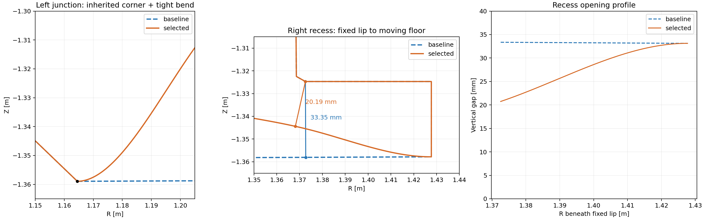

# OMP 왼쪽 접합부와 오른쪽 협소 구간 분석

대상은 2026-10-28 독립 OMP 최적화의 검증 후 채택 형상(case 236)입니다. 기존 최적화 결과와 코드는 변경하지 않았습니다. 저장된 1280-donor 결과의 벽 좌표, 열유속 및 원래 B-spline 계수를 사용했습니다.

**왼쪽은 기존 코너에 급한 곡률이 더해진 경우이고, 오른쪽은 실제 벽 내부 공간이 좁아진 경우입니다. 오른쪽 협소화는 현재 peak 목적함수에서 필수적인 변화가 아니라는 비교 결과가 나왔습니다.**

## 1. 왼쪽: 기존 코너는 유지되고, 바닥이 빠르게 위로 휩니다

접합점은 R=1.16450 m, Z=-1.35894 m입니다. OMP 실행에서 왼쪽 경사면은 고정이고, 오른쪽의 floor만 변형됩니다.

| 지표 | 기준 | 채택 형상 |
|---|---:|---:|
| 접합점에서 두 접선 사이의 벌어진 각 | 135.759° | 135.759° |
| 벽을 따라 진행할 때의 접선 방향 변화 | 44.241° | 44.241° |
| 접합점에서 바닥을 따라 10 mm 떨어진 점까지의 현과 왼쪽 고정면 사이 각 | 135.759° | 113.709° |
| 바닥 곡선의 접합점 한쪽 극한 곡률반경 | 직선(무한대) | 10.143 mm |

매개변수화는 양 끝에서 변위와 변위 미분을 모두 0으로 고정합니다. 따라서 **각 표면의 원래 접선 방향은 유지하지만, 서로 다른 두 기준 표면 사이에 원래 있던 코너를 매끈하게 연결하지는 않습니다.** 접합점의 정확한 꺾임각 자체는 증가하지 않았습니다. 다만 그 옆에서 바닥이 빠르게 상승하므로 몇 mm~cm 크기로 보면 더 좁고 날카로운 골처럼 보입니다.

10.143 mm는 바닥 곡선 자체의 한쪽 극한 반경입니다. 접선이 불연속인 두 표면의 접합점 전체에 유한한 곡률반경이 있다는 의미는 아닙니다.

현재 수송 모델에서 이 접합점 반경 5 mm 안의 최대 열유속은 약 0.065 W/m²입니다. 전체 peak는 R≈1.20554 m, Z≈-1.31192 m에 있습니다. **표시한 코너 자체가 이번 계산의 최고 열유속 위치는 아닙니다.**

## 2. 오른쪽: 고정된 턱 아래의 입구가 실제로 좁아졌습니다

고정 턱 끝은 R=1.37256 m, Z=-1.32470 m입니다. 턱과 오른쪽 수직 벽은 유지되고 바닥이 올라왔습니다.

| 지표 | 기준 | 채택 형상 |
|---|---:|---:|
| 고정 턱 끝에서 바닥 곡선까지 최단거리 | 33.354 mm | 20.195 mm |
| 턱 끝과 같은 R에서의 수직 간격 | 33.355 mm | 20.740 mm |
| 턱 아래 R=1.37256~1.42770 m 구간의 단면적 | 1,832.706 mm² | 1,547.696 mm² |

최단거리는 약 **39.45% 감소**했습니다. 단면적은 약 **15.55% 감소**했습니다. 입구가 가장 크게 좁아지고, 오른쪽 고정 끝에 가까워질수록 간격이 원래 값으로 돌아옵니다.

최단거리 선분의 중간점이 폐곡선 벽 내부에 있음을 확인했습니다. 따라서 단순히 구조물 외부의 빈 그림 영역이 좁아진 것은 아닙니다. 여기서 측정한 값은 **특정 고정 턱 끝과 바닥 사이 거리**이며, 전체 벽의 전역 최소 간격이나 실제 배기 성능을 뜻하지 않습니다.

641개 바닥 좌표로 구한 값과 원래 spline을 10,001점으로 재구성한 값의 차이는 약 0.000084 mm입니다. 화면의 선 두께나 거친 격자 때문에 생긴 현상이 아닙니다.

## 3. 국소 계수 변경으로 확인한 peak와 형상의 관계

같은 입력과 기존 CPU 평가기로 320-donor 해상도에서 비교했습니다. 다른 계수는 유지했습니다. 다음은 원인 분석용 평가이며 재최적화 또는 최종 형상 교체 결과가 아닙니다.

| 비교 | peak [MW/m²] | 오른쪽 최단거리 [mm] | 왼쪽 바닥 끝 곡률반경 [mm] |
|---|---:|---:|---:|
| 현재 채택 형상 | 1.35790149 | 20.195 | 10.143 |
| 오른쪽 끝을 제어하는 floor 계수 하나를 0으로 | 1.35790149 | 28.702 | 10.143 |
| 왼쪽 끝을 제어하는 floor 계수를 절반으로 | 2.03712159 | 20.195 | 20.286 |
| 위 두 변경을 함께 적용 | 2.03712159 | 28.702 | 20.286 |

모두 현재 평가기의 형상·전력 제약을 통과했습니다. 오른쪽 변경 전후 peak 차이는 약 6.1×10⁻¹⁰ MW/m²로, 이 계산에서 실질적인 차이는 없었습니다. **peak를 거의 유지하면서 간격을 약 8.51 mm 넓힐 여지가 이미 확인됐습니다.**

왼쪽 변경은 곡률을 완만하게 만들지만 주요 열 도착 구간의 형상도 함께 바꾸어 peak가 약 50.02% 증가했습니다. 따라서 왼쪽에는 열유속과 형상 사이의 절충이 있습니다. 다만 B-spline 계수는 유한한 넓이의 구간을 바꾸므로, 이 결과만으로 날카로운 접합부가 반드시 필요하다고 결론내릴 수는 없습니다.

이 대안들은 기존 채택 형상에 수행했던 4단계 격자·보간 검증을 다시 거치지 않았습니다. 최종 대안으로 채택하려면 그 검증이 필요합니다.

## 4. 현재 최적화가 이런 형상을 허용한 이유

- 양 끝 위치와 변위 기울기는 고정됩니다. 표면 사이의 기존 코너를 없애는 조건은 없습니다.
- 자기교차, 고정 벽 및 용기와의 교차, LCFS 침범 등을 막고, 각 설계 표면의 길이를 기준의 1.2배 이내로 제한합니다.
- 현재 peak 최적화 경로에는 **최소 곡률반경, 특정 개구부의 최소 간격, 형상 굽힘에 대한 목적함수 항**이 없습니다. 코드에 굽힘 미분을 계산하는 기능이 존재하는 것과 현재 목적함수에서 이를 사용하는 것은 다릅니다.
- 따라서 교차하지 않는 20 mm 간격은 허용됩니다. 열이 적게 도달해 peak에 거의 영향을 주지 않는 부분의 불필요한 변형도 억제되지 않습니다.

이전의 '검증 통과'는 설정된 제약, 전력 보존 및 수치 해상도에 대한 판정입니다. 최소 간격이나 매끄러움까지 확인한 판정은 아니었습니다. 현재 모델에는 이 공간의 유동·중성입자 거동 또는 재료 내부 열응력을 평가하는 항이 없어, 그 성능을 이 결과로 판단할 수는 없습니다.

## 5. 보완 방향

1. **오른쪽 개구부를 별도의 제약으로 정의**합니다. 예를 들어 해당 입구의 기준 간격을 유지하도록 하고, peak를 거의 유지하는 대안을 먼저 찾는 것이 합리적입니다. 전체 벽의 최소 거리에는 인접 표면의 공통 끝점 때문에 항상 0이 포함되므로, 지정한 턱과 바닥 사이 간격을 측정해야 합니다.
2. **기존 코너각과 새로 생긴 내부 곡률을 따로 관리**합니다. 바닥 곡선의 최소 곡률반경 또는 굽힘 제한을 넣고 peak 감소와의 절충을 비교할 수 있습니다. 허용 반경은 설계 조건으로 정해야 하며 이번 분석에서 임의의 제작 기준을 정하지 않았습니다.
3. 같은 수준의 peak를 갖는 후보 중에는 **불필요한 변형이 적고 간격이 넓은 형상**을 우선하도록 보조 선택 기준을 둡니다.
4. 왼쪽 코너 자체를 없애려면 현재의 끝 접선 고정 방식 또는 접합부 설계 구간을 바꾸어야 합니다. 단순히 현재 spline에 평활화 벌점을 추가하는 것만으로는 고정된 기존 코너가 사라지지 않습니다.

계산 원자료: [analysis.json](analysis.json) · 재현 스크립트: [analyze.py](analyze.py) · [기준 간격 분포](baseline_gap_profile.csv) · [채택 형상 간격 분포](selected_gap_profile.csv)
