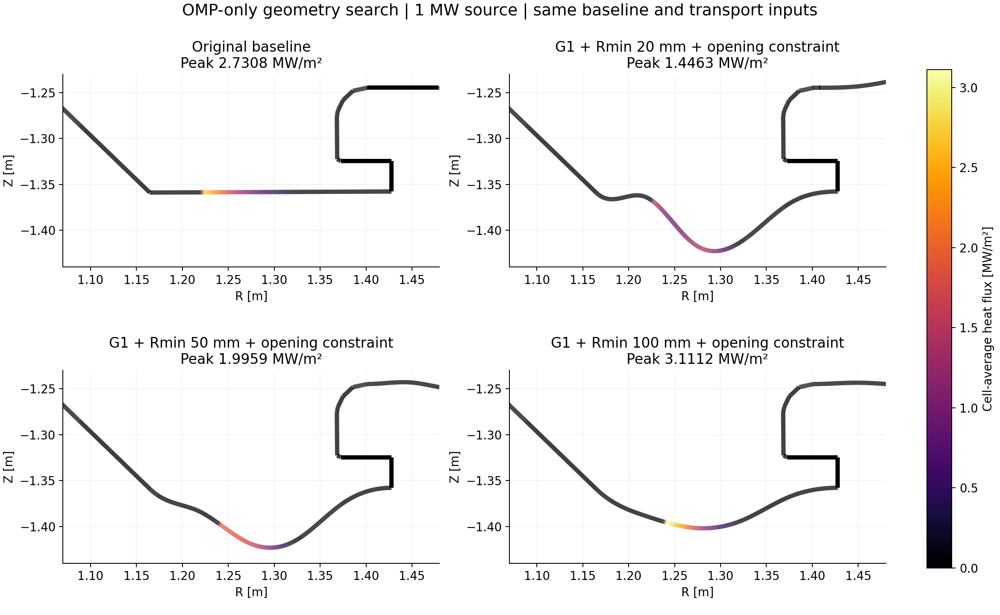
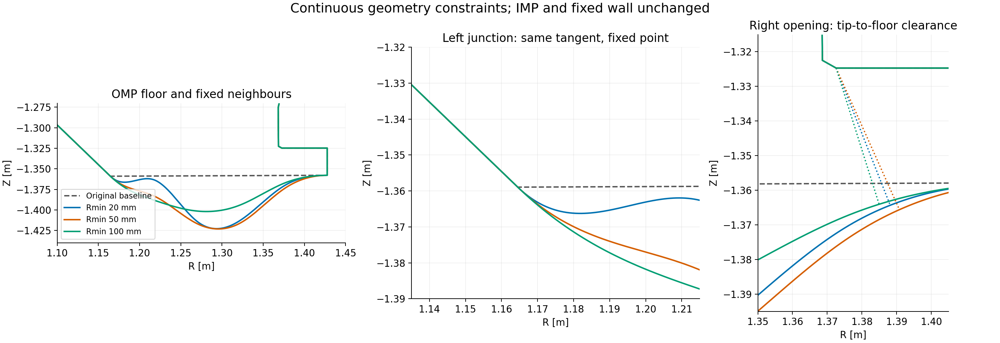
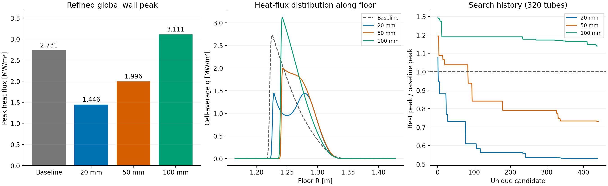

# OMP 접선·곡률·개구부 제약 재최적화

기준 D3D 형상은 원본 그대로 보존했습니다. OMP 왼쪽 바닥 접합부는 위치와 접선 방향을 고정하고, 가변 OMP 곡선에 절대 곡률 제한을 적용했습니다.
오른쪽 고정 lip 끝점에서 바닥까지의 최소 거리는 기준 33.354336 mm 이상입니다. IMP 영역과 고정 벽은 변형하지 않았습니다.

| 최소 반경 제약 | peak (MW/m²) | 기준 대비 감소율 | 실제 바닥 최소 반경 | 최소 간격 | 격자 검증 | 개선 확인 |
|---:|---:|---:|---:|---:|---|---|
| 20 mm | 1.446258 | 47.038% | 22.027 mm | 42.577 mm | True | True |
| 50 mm | 1.995853 | 26.912% | 50.306 mm | 44.781 mm | True | True |
| 100 mm | 3.111172 | -13.931% | 102.797 mm | 41.239 mm | True | False |

원본 기준 peak: **2.730756 MW/m²**. 음의 감소율은 기준보다 peak가 증가했다는 뜻입니다.
표 수치는 cubic 1280 tubes, geometry 641 nodes/surface, receiving wall 0.25 mm입니다. 검증은 320/640/1280 tubes, 별도 wall refinement, quintic 640을 포함합니다.
원래 기준 형상은 새 접선 조건을 만족하는 후보가 아닙니다. 비교 기준과 후보 집합을 분리했으며, 조건을 어긴 기준 형상을 최적해로 반환하지 않습니다.

## 고정 입력과 탐색 범위

OMP 열원 1 MW, n=1e19 m⁻³, χ⊥=0.3 m²/s, λq=3 mm, γ=7, κ₀=2000. 이전과 같은 단방향 열전도·sheath 폭 모델과 전력 보존형 벽 경계 분포를 사용했습니다.
OMP의 네 구간 각각 4개 자유 계수를 탐색했습니다. 원래의 길이 1.2배 상한, 구조물·LCFS·자기 교차 금지, shelf 입사각 조건, ±100 mm 계수 범위를 유지했습니다.
위·아래 양 방향 초기 형상과 확률 탐색, 좌표 미세 탐색을 사용했습니다. 실제 최고 성능은 기록된 탐색 예산에서 찾은 결과이며 전역 최적임을 증명하지 않습니다.
GPU는 Gaussian 합산에 사용했고, 전력 CDF·형상 교차·열 상태·최대점 정밀 탐색은 기존 알고리즘을 유지했습니다. 최초 유효 후보와 최종 후보의 CPU/GPU peak 일치 여부를 기록했습니다.

## 해석 범위

접선 연결은 G1입니다. 접합부의 접선 방향은 연속이지만 곡률까지 연속인 G2는 강제하지 않았습니다. 요청한 왼쪽 접합부 외의 원래 고정 구조물 코너는 그대로입니다.
간격은 고정 lip 끝점과 바닥 사이의 유클리드 최소 거리입니다. 개구부 전체의 유동·중성입자 배기 성능을 대체하는 모델은 아닙니다.
최대 곡률과 최소 간격은 각 cubic span의 정상점과 끝점에서 검사했습니다. 교차 및 수송 도착 계산은 여전히 곡선을 근사한 polyline을 사용하므로 geometry node refinement를 함께 검증했습니다.
수치 검증은 동일한 축약 수송 모델 안의 비교 신뢰도를 확인합니다. 실험값 일치나 완전한 플라즈마 수송 모델 검증을 의미하지 않습니다.

## 재현

`run_tangent_curvature_study.py --output <새 D 드라이브 경로>`로 탐색하고, `qualify_tangent_candidates.py --output <경로>`로 상위 후보를 640 tubes에서 다시 비교합니다. 이후 `verification/validate_tangent_curvature.py --output <경로>` 및 `visualize_tangent_curvature.py --output <경로>`를 실행합니다.
640 tubes 후보 선별에는 각 탐색의 상위 5개 후보와 더 엄격한 반경 조건의 선택 후보를 포함합니다. 이 선별 결과와 원래 탐색 승자는 별도 기록합니다.
각 R020/R050/R100 폴더의 manifest, evaluations.jsonl, search.json, validation.json과 refined CSV/NPZ에서 계수·형상·열유속·전력 장부·검증 결과를 확인할 수 있습니다.
