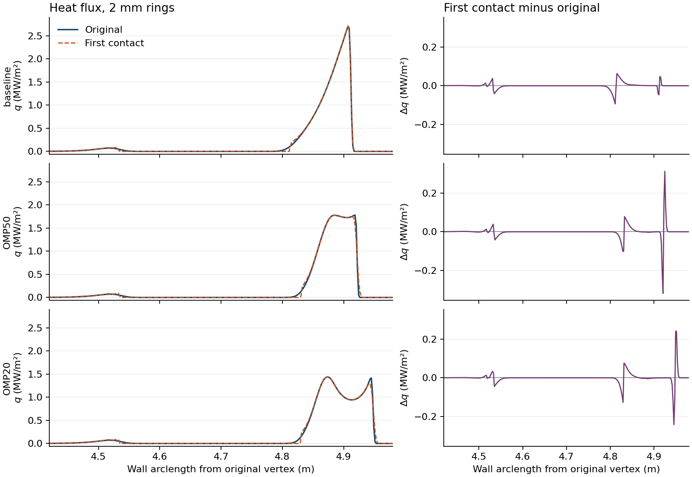

# 도달 전 횡방향 이동이 OMP 형상 선택에 미치는 영향

고정 DIII-D 평형과 OMP 1 MW에서 벽에 열을 분배하는 가정 하나를 바꿔도 기준·OMP50·OMP20의 피크와 유효면적 순위는 유지됐다. 이 세 형상 사이의 선택에는 기존 고속 평가를 쓸 근거가 있다. OMP50에서는 최고 열유속을 받는 위치가 벽을 따라 34 mm 이동했다. 특정 타일 보호나 근소한 후보 간 비교에는 분포를 따로 검토할 이유가 있다.

## 동일한 입력으로 무엇을 비교했나

- 익명 평형 `1a3155370c`의 1,400 ms, cubic 자기장, 원래 벽, OMP 1 MW, 서로 다른 최소곡률반경 제약에서 선정한 OMP50 stage34와 OMP20 stage18을 사용했다. 운전 입력은 λq 3 mm, χ⊥ 0.3 m²/s, n 10¹⁹ m⁻³, γ 7, κ₀ 2000이다. 형상별 1,280개 열원의 전력과 계산된 열폭을 동결했다. 각 열원의 전력은 보관된 계산의 수열면별 분배 전력을 합한 값과 일치한다. 형상 간 협소한 피크 차이의 일반 판별력은 별도 질문이다.
- 기존 계산은 원래 자기선의 첫 충돌점 주위에 벽 면적 좌표의 가우시안으로 전력을 분배한다. 대안은 같은 폭으로 등가 자속 좌표 u=(ψ−ψsep)/(∂ψ/∂R)sep 에서 한 번 이동시키고, 그 뒤 자기선을 따라 처음 만나는 벽에 흡수시킨다. 같은 자속의 면이 여러 곳에 있으면 경로상 제일 먼저 만난 면만 받는다. 평행 전도·sheath·열폭을 새로 풀거나 피팅하지 않았다. 도중에 횡확산과 평행수송이 계속 함께 일어나는 경우는 이 단일 변위 시험의 범위 밖이다.
- 분포는 각 형상의 원래 벽 꼭짓점을 원점으로 하는 동일 고리에 보존적으로 재집계했다. 고리별 피크는 max(Pᵢ/Aᵢ), 유효면적 A₂는 (ΣPᵢ)²/Σ(Pᵢ²/Aᵢ)이다. Pᵢ는 도달 경로를 정할 수 있었던 전력이다. 미배정 전력은 따로 보관했다. 여기서 2 mm는 고리의 폴로이달 호 길이이며, 과거의 연속 피크 수치와 직접 비교하려면 동일하게 재집계해야 한다.

## 주결과

음의 자속 라벨에 대해 X점 아래 Z=−1.305 m 바깥 가지에서 출발한다고 가정한 경우를 표시했다. 고리 폭은 2 mm이다. 감소율과 면적 증가율은 각 방식에서 각각 계산한 기준 형상 대비 값이다.

| 형상 | 기존 → 첫 도달 피크 (MW/m²) | 기준 대비 피크 변화, 기존 → 첫 도달 | 기존 → 첫 도달 A₂ (m²) | 기준 대비 A₂ 변화, 기존 → 첫 도달 |
| --- | --- | --- | --- | --- |
| 기준 | 2.70666 → 2.70238 | — | 0.61131 → 0.61115 | — |
| OMP50 | 1.78260 → 1.77472 | −34.14% → −34.33% | 0.68131 → 0.68975 | +11.45% → +12.86% |
| OMP20 | 1.43948 → 1.43719 | −46.82% → −46.82% | 0.93571 → 0.94562 | +53.07% → +54.73% |

전력으로 가중한 열폭의 중앙값은 OMP 등가 좌표에서 0.209–0.219 mm다. 이 값은 지정한 상류 전력 감쇠길이 3 mm보다 작다. 표적 분포에서 큰 차이는 주로 열유속이 급하게 변하는 곳에 모였다. OMP50의 최대 국소 차이는 0.320 MW/m², OMP20은 0.243 MW/m²로, 각각 기존 피크의 17.94%, 16.88%이다. 기준 형상은 3.47%이다. 같은 2 mm 고리에서 OMP50의 피크 위치는 s=4.91849 m에서 4.88449 m로 이동했다. OMP20과 기준의 피크는 각각 원래 고리에 남았다. 세 형상의 분포 차이 ½Σ|ΔPᵢ|는 각각 기준 12.43 kW, OMP50 20.97 kW, OMP20 20.61 kW였다.

## 결과가 바뀔 수 있는 조건

OMP에서 직접 출발할 수 있는 열린 자속 라벨만 추적하면 세 형상에 입력의 1.62–1.68%가 남는다. 대부분 separatrix 안쪽 라벨이다. OMP 안쪽의 닫힌 자기선과 하부 private-flux 영역은 같은 라벨에서 연결성을 달리할 수 있다. 아래의 하부 연결은 별도로 가정했다.

| 잔여 전력 처리 | 피크 순위 | A₂ 순위 |
| --- | --- | --- |
| OMP 추적만 사용하고 남은 전력을 어느 고리에든 둘 수 있게 허용 | 세 형상 전체 순위 미확정. 2 mm에서 OMP20 피크 상한 2.457은 기준 하한 2.702보다 낮지만, OMP50 상한 2.828은 기준 하한보다 높다. | 시험한 네 고리 설정 모두 OMP20 > OMP50 > 기준 |
| OMP 추적 후 같은 자속 라벨에 도달 가능한 고리에만 잔여 전력 허용 | 네 설정 모두 OMP20 < OMP50 < 기준 | 네 설정 모두 역순 |
| 음의 라벨은 하부 Z=−1.285 또는 −1.305 m 바깥 가지에서 출발. 나머지 전력은 어느 고리에든 허용 | 두 연결 각각 네 설정 모두 OMP20 < OMP50 < 기준 | 두 연결 각각 네 설정 모두 역순 |

네 고리 설정은 1, 2, 4 mm와 반 칸 이동한 2 mm다. 두 하부 연결에서 배정되지 않은 전력은 모든 형상을 통틀어 0.00258–0.00298%, 즉 1 MW 중 약 26–30 W다. 보수적 상·하한에는 미결 전력이 일부만 벽에 도달하는 경우도 포함했다. 각 고리의 자속 범위를 이용한 상한은 마지막 변위 뒤 추가 횡이동이 없다는 가정에 의존한다. 이 상·하한은 계산한 유한 고리와 수치적으로 식별한 도달 가지에 적용된다.

## 수치 검증과 해석 범위

- 저장된 1,280개 자기선의 충돌 가지가 세 형상 모두 재현됐고, 같은 자속 라벨에서 원래 충돌점과의 최대 R–Z 거리는 0.085 µm 미만이었다. 1 mm와 0.5 mm 자기선 적분 스텝 및 서로 다른 구간내 표본에서 보고한 피크와 A₂가 일치했다. 이는 동일 자기장 표현에서의 검사다.
- 별도 직접 합산에서는 벽의 자속 역함수를 사용하지 않고 8,192개 OMP 자기선과 1,024개 하부 가지 자기선의 첫 충돌 전력을 2 mm 고리에 모았다. 같은 −1.305 m 연결에서 자속 구간 적분 대비 피크 차이는 기준 +0.077%, OMP50 +0.108%, OMP20 +0.294%였다. A₂ 차이는 세 경우 모두 0.008% 이내였다. 두 적분법은 자기장·경로 추적기·열폭을 공유한다. 2,048+256개로 계산한 더 성긴 결과도 저장했다.
- 36개 정밀 조합(세 형상 × 세 가지 연결 처리 × 네 고리 설정)의 최대 전력 수지 오차는 1.7×10⁻¹⁵ MW 이하이다. 기존 common_rank 재집계 프로그램과 별도로 대조한 원래 고리 전력의 최대 차이는 3.3×10⁻¹² MW 이하이다. CUDA는 가우시안 전력 구간 적분에 사용했다. 2,048구간 기준 CPU 0.265 s, GPU 0.00223 s, 최대 구간 전력 차이 5.3×10⁻¹⁸ MW 이하이다. 자기선 추적은 CPU에서 했다.
- 연구 목적상 전역 피크와 A₂로 후보를 고르는 고속 탐색을 유지하고, 근소한 후보 또는 국소 타일 부하를 주장할 때 이 비교를 사용한다. 같은 조건의 세 OMP 형상에서 얻은 결과다. IMP, 다른 자기 평형, 형상 전 영역의 순위, 연속 표면의 국소 피크 정확도, 독립 FIREFLY에서 OMP50에 남은 차이는 별도 검증 대상이다. FIREFLY와 실험 자료는 이 계산에 사용하지 않았다.

## 재현

1. 결과를 저장할 D 드라이브의 새 빈 폴더를 만든다. 입력 `--evidence`는 submission-adversarial-20261105/audit.json, `--source-csv`는 firefly-baseline-20261105/OMP.csv이다. 실행 위치는 저장소 루트다. 입력·형상 SHA-256은 [검증 기록](verified.json)에 있다.
2. 각 `--case baseline|OMP50|OMP20`와 `--quality coarse|fine` 조합에서 `python -m verification.nf_preimpact_comparison --output <새 폴더> --case <형상> --quality <해상도> --evidence <audit.json> --source-csv <OMP.csv>`를 실행한다.
3. `python -m verification.nf_preimpact_raycheck --study <새 폴더> --evidence <audit.json> --source-csv <OMP.csv>`로 독립 합산한 후, 같은 인수로 `python -m verification.nf_preimpact_audit`를 실행한다. 최종 비교표, 전체 벽 호 길이별 프로파일, 그림과 검증 기록을 생성한다.
4. 원시 출력과 전 벽 CSV는 `D:/DivertorOptimization/studies/preimpact-firstwall-20261105`에 있다. [조건별 비교표](comparisons.csv)에서 연결·고리·경로 스텝의 영향을 확인할 수 있다.
