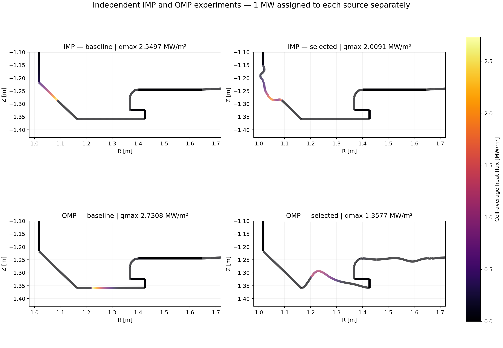
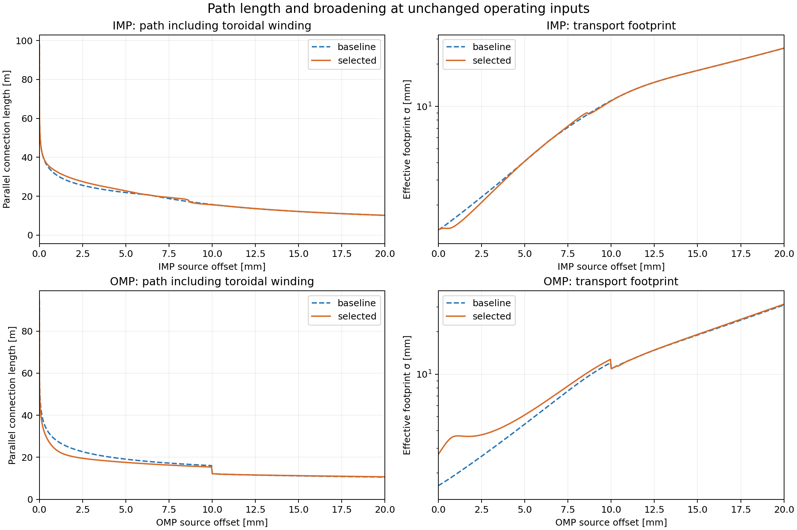
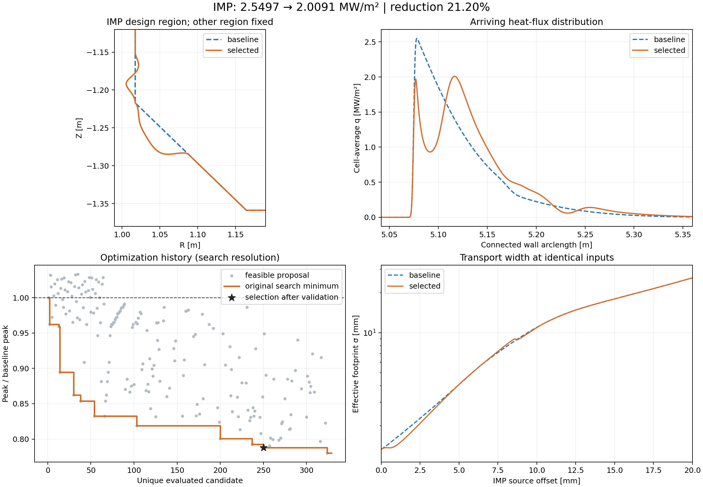
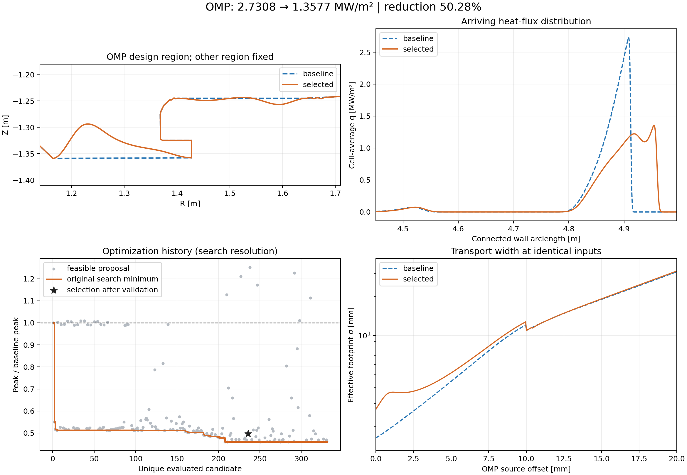

# IMP·OMP 영역별 독립 형상 최적화

기준 D3D 형상과 자기 평형을 보존하고, 같은 입력 전력에서 도착 열유속을 넓게 분산해 peak를 낮추는 형상을 탐색했습니다.
IMP 열원에서는 imp_sloped·imp_vertical만, OMP 열원에서는 omp_entry·shelf·omp_connector·floor만 변형했습니다. 각 실행의 반대 영역은 고정입니다.
**두 열원 각각 1 MW를 부여한 독립 실험입니다. 두 열원을 동시에 켠 합성 형상의 최적화 결과는 아닙니다.**

입력: 각 소스 P=1 MW, n=1e19 m⁻³, χ⊥=0.3 m²/s, λq=3 mm, γ=7, κ₀=2000. 소스의 유한 계산 구간은 각 manifest에 기록했습니다.

| 소스 | 기준 peak | 선택 peak | 감소율 | 수치 검증 | 고유 후보 | 탐색 시간 |
|---|---:|---:|---:|---|---:|---:|
| IMP | 2.549663 | 2.009104 | 21.201% | True | 329 | 223.9 s |
| OMP | 2.730756 | 1.357740 | 50.280% | True | 331 | 308.5 s |

열유속 단위는 MW/m²입니다. 최종 수치는 cubic/1280 donor 결과이며, 320/640/1280 및 quintic640 보간·격자 검증을 통과한 경우에만 개선 확인을 표시합니다. 시간은 두 탐색을 병렬 실행했을 때 각 프로세스의 경과시간으로, 초기 계산 준비를 포함하고 후속 후보 선별과 정밀 검증 시간은 제외합니다.

GPU: RTX 3090의 FP64 Gaussian 합산 사용. 같은 OMP320 후보 세 개의 중앙 평가시간 비교에서 약 1.46배 빨랐습니다. CPU/GPU 전 분포 차이는 약 5e-16(peak 대비), 최대값 차이는 0이었습니다. 이 가속비는 전체 최적화의 가속비를 뜻하지 않습니다.
CDF 전력·형상 교차·열 상태·연속 최대점 정밀 탐색 및 최종 검증은 CPU로 수행했습니다. GPU 패키지, 캐시, 연구 데이터와 코드/입력 스냅샷은 D 드라이브에 저장했습니다.

## 형상과 분포

### IMP

반대 영역/고정 벽의 최대 좌표 변화: 0.0e+00 m. 최대 설계 변위: 25.482 mm.
도착 전력: 1.000000 MW; 미도착/미해결 전력: 0/0 W; 전력 장부 상대 오차: 6.66e-16.
유효 가열 면적 P도착/qmax: 0.3922 → 0.4977 m². 이는 FWHM이나 특정 열유속 문턱의 면적과 다른 지표입니다.
전력가중 평균 연결 길이: 27.903 → 29.127 m; 유효 footprint 폭: 3.192 → 3.086 mm.
최대 peak 상대변화(격자/보간): 0.0926%; 최대점 위치 변화: 0.0558 mm.
격자/보간 간 peak 비율 차이: 0.0118%p (허용치 0.2%p).
[선택 전체 벽 좌표](qualified/IMP/selected_wall_refined.csv) · [선택 도착 분포](qualified/IMP/selected_profile_refined.csv) · [후보별 탐색 데이터](qualified/IMP/optimization_history.csv) · [입력·최종 계수](qualified/IMP/manifest.json)

원래 탐색 최저 peak 후보의 정밀 격자값은 1.989497 MW/m²였으나, 보간법에 따른 peak 비율 차이가 허용치 0.2%p를 넘어 개선 확정 판정을 받지 못했습니다. 원래 결과는 `IMP/`에 보존했습니다. 기준을 바꾸지 않고 탐색 로그에서 순위에 따라 뽑은 12개 후보를 검사하여 그중 통과 후보의 peak가 가장 낮은 case 250(원래 탐색 순위 2)를 선택했으며, 이 후보에 전체 검증을 다시 수행했습니다. 탐색 이력의 최저선과 검증 후 선택점이 다른 이유입니다.

### OMP

반대 영역/고정 벽의 최대 좌표 변화: 0.0e+00 m. 최대 설계 변위: 64.967 mm.
도착 전력: 1.000000 MW; 미도착/미해결 전력: 0/0 W; 전력 장부 상대 오차: 1.44e-15.
유효 가열 면적 P도착/qmax: 0.3662 → 0.7365 m². 이는 FWHM이나 특정 열유속 문턱의 면적과 다른 지표입니다.
전력가중 평균 연결 길이: 25.173 → 22.174 m; 유효 footprint 폭: 3.577 → 4.717 mm.
최대 peak 상대변화(격자/보간): 0.3599%; 최대점 위치 변화: 0.1216 mm.
격자/보간 간 peak 비율 차이: 0.1971%p (허용치 0.2%p).
[선택 전체 벽 좌표](qualified/OMP/selected_wall_refined.csv) · [선택 도착 분포](qualified/OMP/selected_profile_refined.csv) · [후보별 탐색 데이터](qualified/OMP/optimization_history.csv) · [입력·최종 계수](qualified/OMP/manifest.json)

원래 탐색 최저 peak 후보의 정밀 격자값은 1.255154 MW/m²였으나, 보간법에 따른 peak 비율 차이가 허용치 0.2%p를 넘어 개선 확정 판정을 받지 못했습니다. 원래 결과는 `OMP/`에 보존했습니다. 기준을 바꾸지 않고 탐색 로그에서 순위에 따라 뽑은 12개 후보를 검사하여 그중 통과 후보의 peak가 가장 낮은 case 236(원래 탐색 순위 46)를 선택했으며, 이 후보에 전체 검증을 다시 수행했습니다. 탐색 이력의 최저선과 검증 후 선택점이 다른 이유입니다.

## 데이터 사용과 한계

- 각 영역 폴더의 `selected_<표면명>_refined.csv`가 해당 표면의 최종 R,Z 좌표입니다. `selected_wall_refined.csv`는 반대 영역을 고정한 전체 벽입니다.
- `*_refined.npz`에는 전 도착 열유속 샘플, 셀 전력, 자기장 기울기, 연결 길이, 열 상태와 donor→표면 전달 배열이 있습니다. CSV는 검사·후처리용입니다.
- 입력 및 수송 가정은 기존과 동일합니다. 주기 Gaussian을 연결된 벽의 면적 좌표에 분배하는 대리모델이며, 실제 2D 수송 방정식이나 방사 손실을 풀지 않습니다.
- 토로이달 감김을 포함한 연결 길이를 적분하지만, 이번 감소율을 연결 길이 단독 효과로 분해한 결과는 아닙니다.
- 목적함수는 연결 길이나 평균 σ 자체를 키우는 것이 아니라 도착 peak를 낮추는 것입니다. 입사 위치, 표면 기하, 면적 및 수송 폭이 함께 바뀌므로 평균 연결 길이 또는 평균 σ가 감소한 후보도 peak를 낮출 수 있습니다.
- 분포 그림의 가로축은 각 형상을 따른 벽 호길이입니다. 같은 호길이가 두 형상에서 정확히 같은 R,Z 위치를 뜻하지는 않습니다. 최대값은 연속 분포에서 정밀 탐색하며, 열유속 지도와 곡선은 셀 평균값입니다.
- 제한된 탐색 예산에서 찾은 적합 후보입니다. 전역 최적해 또는 두 독립 최적 형상의 조합이 동시 두 열원에 최적이라는 주장은 하지 않습니다.
- 두 결과를 한 형상으로 합치려면 합성 벽에서 두 열원의 열유속을 함께 다시 평가해야 합니다. 이번 데이터에는 각 영역의 독립 결과를 분리해 보존했습니다.
