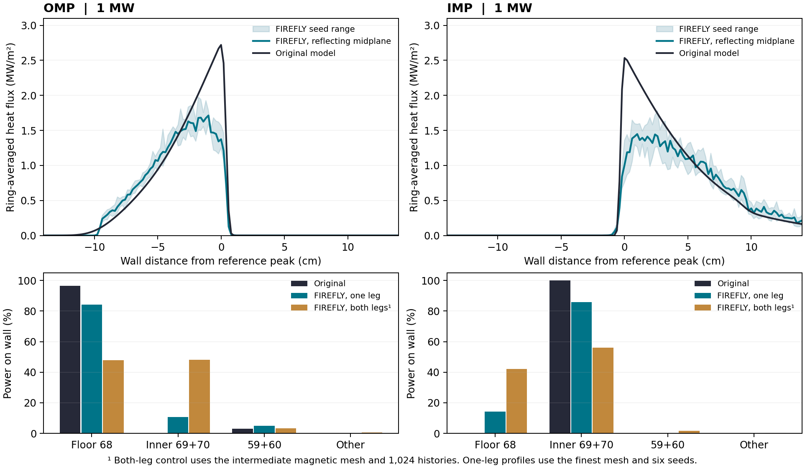

# DIII-D 기준 형상의 OMP·IMP 중간면 열원 교차 검증

2026-11-05 · 고정 EFIT 1,400 ms · 기준 형상에서 독립적인 1 MW 부하 두 건

같은 중간면 열원을 FIREFLY에 주입하고 FLARE 직접 적분과 FIREFLY의 재구성 자기 격자, 열수송을 차례로 비교했다. 원래 코드가 선택하는 아래쪽 leg의 자기 연결은 재현되었다. 유한한 횡전도를 켜면 두 모델의 열유속 분포는 분리된다. 아래 값은 모두 실제로 실행한 고정 평형 연구 사례의 계산값이다.

## 기준 열유속과 전력 분포

전체 회전면의 1 MW를 분모로 사용했다. 동일한 약 2 mm 벽 고리에서 기존 셀 전력을 보존적으로 적분했고, FIREFLY는 토로이달 방향의 셀 전력을 합쳤다. 반사 경계를 사용한 표의 FIREFLY 값은 가장 촘촘한 자기 격자, 100 eV, 시드 6개 × 1,024 이력의 프로파일을 먼저 평균한 값이다. 최대값은 이렇게 얻은 고리 평균 열유속의 최대값이다.

|열원과 주 표면|기존 모델 → FIREFLY 피크 (MW/m²)|기존 모델 → FIREFLY 주 표면 전력 (%)|기존 모델 → FIREFLY 유효면적 A₂ (m²)|분포 차이 (MW)|
|---|---:|---:|---:|---:|
|OMP · 68번|2.721 → 1.713|96.43 → 84.17|0.611 → 0.916|0.188|
|IMP · 69번|2.534 → 1.448|87.97 → 70.60|0.687 → 1.122|0.205|

A₂ = (ΣP)² / Σ(q²A). 분포 차이는 ½Σ|ΔP|이며, 두 분포의 총전력이 같을 때 한 분포를 다른 분포로 바꾸기 위해 옮겨야 하는 전력이다. 원래 연속 프로파일의 피크는 OMP 2.73076, IMP 2.54966 MW/m²였다. 고리 평균 비교의 기준값은 표에 별도로 표시했다.

## 어떤 조건이 결과를 바꾸는가

|실험|OMP 바닥 68번|IMP 안쪽 69번|
|---|---:|---:|
|FLARE 직접 자기장, 아래쪽 첫 충돌|96.43%|88.12%|
|FIREFLY 횡확산 0, 아래쪽 반사 경계|96.39%|87.99%|
|FIREFLY 유한 횡확산, 양방향, 중간 격자|47.98%|44.46%|
|FIREFLY 유한 횡확산, 아래쪽 반사 경계, 같은 중간 격자|84.31%|69.54%|
|FIREFLY 유한 횡확산, 아래쪽 반사 경계, 최종 격자 시드 평균|84.17%|70.60%|

OMP의 반대 방향 자기선은 전력 가중 99.50%가 안쪽 69·70번에, IMP의 반대 방향은 98.80%가 바닥 68번에 걸린다. 양방향 열확산에서 이 경로로 실제 얼마나 나가는지는 수송으로 결정된다. 물리 벽은 그대로 두고 중간면을 가로지르는 열만 반사했을 때 주 표면 전력이 크게 변한다. 유한 횡전도에서는 아래쪽 영역 안에서도 인접한 자속면으로 에너지가 이동한다.

## 맞춘 입력과 남은 물리 차이

- EFIT ψ(R,Z) 65 × 65, 상수 R Bφ, 전체 벽 윤곽, 분리면, donor 반경과 가중치를 기존 계산에서 가져왔다. GEQDSK의 압력·q 프로파일은 자기선 추적에 사용하지 않는 자리표시자다. 사용 범위는 이 고정 자기장의 재현이다.
- OMP·IMP는 서로 독립된 1 MW 실험이다. 각각 donor 1,280개의 원래 반경 가중치에 대해 누적분포 층화 표집을 사용했다. 축대칭 토로이달 1/64 섹터에서 방위각을 균일하게 뽑고 출력에 64를 곱해 전력 수지를 계산했다. 각 이력의 주입 좌표 역변환 오차가 0.1 µm를 넘으면 계산을 중단하도록 했다.
- 원래 아래쪽 부호는 OMP −B, IMP +B다. 비교용 FIREFLY에서는 중간면에서 확산 열류를 반사하고, 그 위치에서 0.1 µm 아래에 발사했다. 평행 스텝은 경계에서 남은 이동을 반사하고 수직 스텝은 경계를 넘으려는 시도를 기각한다. 이는 선택된 단일 leg를 시험하기 위한 추가 경계 가정이다. 양방향 대조군에서는 같은 중간면 표집을 쓰되 반사 경계를 제거했다.
- n₀=10¹⁹ m⁻³, γ=7, 중수소 질량, κ₀=2,000을 맞췄다. 기존 전자 수직전도도는 1.5 e n χₑ, χₑ=0.30 m²/s이므로, FIREFLY의 e n χ 형식에는 0.45 m²/s를 사용했다. 이 환산은 같은 n의 전도 계수에 한한다.
- 기존 모델은 donor마다 Tᵤ·Tₜ·nₜ를 구하고 그 경로에서 환산한 가우스 폭으로 벽에 재분배한다. FIREFLY는 일정한 n₀,T₀에서 선형화한 평행·수직 확산과 확률적 sheath 부하를 계산한다. 따라서 같은 γ에서도 위치별 표적 밀도, 온도와 경계 열흐름은 달라질 수 있다. 두 모델의 차이를 횡전도계수 하나에 귀속할 수 없다.
- T₀=100 eV는 기준 파일럿을 위해 고른 공통 값이다. 추가 실험으로 기존 donor의 전력 가중 평균 Tᵤ에 가까운 OMP 130 eV, IMP 172 eV를 각각 사용했다. 피크를 맞추기 위한 계수 적합은 수행하지 않았다.

## 독립 자기선 및 해석해 대조

FLARE에서 벽 내부와 열원 위치 7,801곳을 대조했다. 벡터 자기장의 최대 상대 차이는 2.29e-06. 기준 벽의 3,914점을 같은 직선 구간에서 74점으로 축약했을 때 형상 Hausdorff 거리는 3.2×10⁻¹⁶ m 이하였다. FLARE 직접 적분에서 기준 OMP·IMP 각 1,280개가 원래 벽 구간과 모두 일치했다.

|비교량|OMP|IMP|
|---|---:|---:|
|기준 직접 적분 충돌 위치 최대 차이 (µm)|1.268|1.082|
|기준 연결 길이 전력 가중 평균 절대 상대차 (%)|0.0019|0.0026|
|기준 연결 길이 개별 donor 최악 상대차 (%)|5.97|7.70|

FLARE 기본 적분 설정에서는 강화 설정 대비 충돌 위치 p95가 OMP 0.647 mm, IMP 0.359 mm만큼 달랐다. 본 비교에는 강화 설정을 사용했다. FIREFLY 자기 격자는 극방향 240 → 640 → 1,000, 반경 간격 5 → 2 → 1.5 mm로 바꾸었다. 아래쪽 충돌 위치의 전력 가중 p95 오차는 OMP 1.524 → 0.250 → 0.100 mm, IMP 0.384 → 0.036 → 0.014 mm였다. 최종 격자에서 아래쪽 두 열원 모두 1,280개가 벽에 도달하고 같은 원래 벽 구간에 도달했다. 반대쪽에서는 OMP의 다른 구간 분류 2.28 kW와 IMP의 700 m 절단 미포착 0.84 kW가 남는다.

해석해 시험에는 ψ=[(R−R₀)²+Z²]/2와 일정한 RBφ를 사용했다. 자기선의 극방향 투영은 원이므로 기울어진 평판·편심 원형 표면의 충돌점과 연결 길이를 닫힌 식으로 구할 수 있다. 81개 발사점이 만드는 80개 환형 면적과 같은 전력에서의 고리 열유속도 대조했다.

|표면|최대 충돌점 차이 (µm)|최대 연결 길이 차이 (mm)|최대 고리 열유속 상대차 (%)|
|---|---:|---:|---:|
|경사 평판|0.0002|0.0061|0.00001|
|원형 표면, 180선분|265.9847|1.9208|4.08070|
|원형 표면, 720선분|16.3048|0.1152|0.51026|

저장된 OMP20 18단계와 OMP50 34단계 벽에도 같은 OMP donor를 FLARE로 직접 적분했다. 위치 차이의 전력 가중 p95는 각각 1.50 µm, 1.02 µm, 최대는 각각 1.55 µm, 1.27 µm였다. 벽을 구성하는 세부 선분 ID는 경계 부근에서 OMP20 donor 1개(0.055% 전력), OMP50 donor 4개(0.572%)가 달랐다. 이는 두 후보의 자기 연결 검사다. 독립 열수송에서의 후보 순위는 미판정이며, OMP20 18단계는 원래 v3 분포 수렴 정책을 넘지 못한 진단 형상이다.

## 수치 민감도와 전력 수지

아래 피크는 단일 시드에서 얻은 약 2 mm 고리 평균값이다. 각 열의 변화를 격자나 시간 간격의 효과로 해석할 때 Monte Carlo 변동도 함께 본다.

|반사 경계 계산|OMP 피크 (MW/m²)|IMP 피크 (MW/m²)|
|---|---:|---:|
|중간 격자, 평행 RMS 스텝 2 m|2.020|1.560|
|최종 격자, 2 m|1.787|1.588|
|최종 격자, 1 m|1.874|1.869|
|최종 격자, 2 m, OMP 130 eV / IMP 172 eV|1.892|1.859|
|100 eV 최종 격자, 독립 시드 6개의 범위|1.741–1.975|1.492–1.782|

시드 범위는 관측 산포다. 실험 오차나 95% 신뢰구간으로 해석하지 않는다. 고리마다 평균을 낸 뒤 최대를 구하므로, 표의 통합 피크는 개별 피크의 단순 평균과 다를 수 있다.

이력 시간을 2 ms에서 0.2 s로 늘렸다. 2 ms의 유한 횡전도 계산은 일부 전력을 추적 중인 상태로 남겨 최종 수치에서 제외했다. 최종 6개 시드 모두 실벽 전력으로 1 MW를 회수했고, 반사면에 침착된 전력 및 중간면 위 벽에 집계된 전력은 0이었다. χ=0 진단군에서는 가장 촘촘한 격자에서 IMP 이력의 약 0.000977 MW가 2 ms에 미종료로 남았다. 다시 정규화하지 않고 기록했다.

## 논문에서 지킬 결론의 범위

같은 고정 평형·형상·열원에서 자기 연결이 일치한다는 결론은 기준 형상과 두 OMP 후보에서 점검됐다. 절대 열유속의 교차 모델 일치, 후보 순위, 실험적 예측 정확도는 서로 별개의 주장이다. 이 결과는 횡전도와 표적 폐쇄식 선택이 기준 열분포를 얼마나 바꾸는지 보여준다. NF에서 물리 예측력을 주장하려면 독립 관측량이나 별도로 검증된 수송 계산, FED에서 설계 우위를 주장하려면 같은 조건에서의 후보 피크와 유효면적 순위 및 그 불확실성이 추가로 필요하다.

또한 기준 벽을 바깥 경계로 만든 자기 격자를 후보에 재사용하면 일부 영역의 포함이 보장되지 않는다. (R,Z) 단면에서 기준 경계 밖에 놓이는 후보 내부 면적은 OMP20 0.00775 m², OMP50 0.00926 m²이고, 벽 사이 Hausdorff 거리는 두 후보 모두 약 64.8 mm다. 세 형상을 모두 포함하는 공통 외곽 경계로 격자를 만들고 기준도 그 격자에서 다시 계산해야 비교에서 이 차이를 통제할 수 있다. 그 다음 동일한 반사 경계, 사전 지정한 수송계수와 같은 시드 묶음으로 형상 간 차이를 추정할 수 있다. 추가 정밀도를 결정할 때는 개별 피크의 절대값보다 기준과 후보 사이의 차이 및 그 산포를 사용한다.

## 출처와 재현

원 계산 브랜치 커밋 dc8ab43a9a930ca155813cb53a448bba39f6291f. FIREFLY는 85a1e6c006e8af0c6a6cb6775ff78efee61af47e에서 중간면 표집·비교 경계와 진단 출력을 추가했다. FLARE는 공식 컨테이너 태그 v1.4.7로 실행했으며 프로그램이 출력하는 빌드 식별자는 development-1.4.7-6-g3e06acfd-dirty다. 로컬에 받은 태그의 소스 리비전은 80eec5423fb74ae74870d04c919dd83ca9c07a42다. [FLARE](https://gitlab.com/hfrerichs/flare) · [FIREFLY](https://gitlab.com/hfrerichs/firefly) · [원 계산 브랜치](https://github.com/gyub05110-sudo/divertor_optimize/tree/codex/selective-candidate-validation)

계산 이미지·파일시스템·격자·NetCDF는 D 드라이브에 보관했다. RTX 3090은 인식됐고 사용한 추적 및 수송 경로는 Fortran CPU/MPI 빌드였다. [실행 기록](REPRODUCE.md) · [donor별 OMP](OMP_audit.csv) · [donor별 IMP](IMP_audit.csv) · [기준 OMP 열분포](OMP_pooled_profile.csv) · [기준 IMP 열분포](IMP_pooled_profile.csv) · [수치 요약](pooled_results.json)
