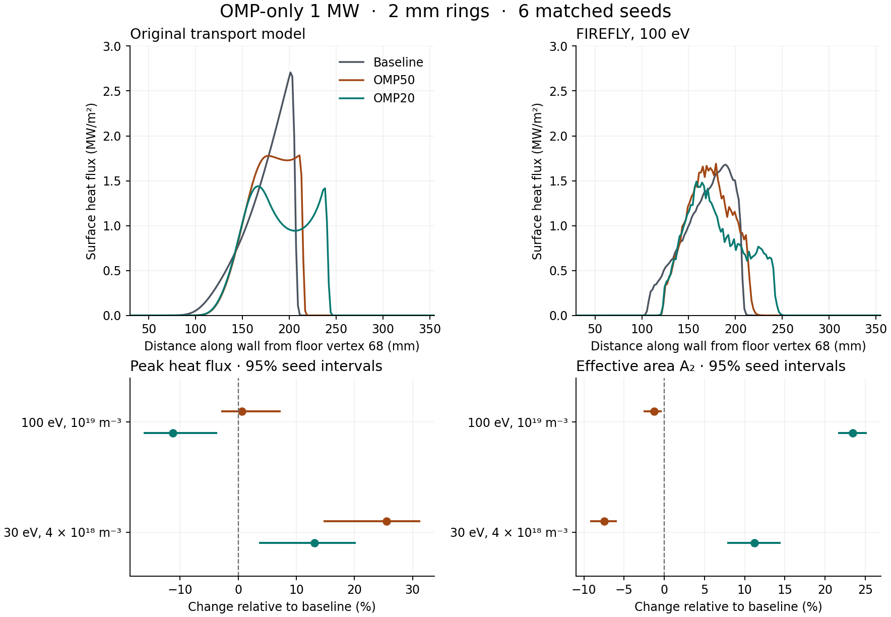

# 공통 자기 격자에서 비교한 기준·OMP50·OMP20 열부하

DIII-D 고정 평형 1,400 ms · OMP50 34단계와 OMP20 18단계 · 2026-11-05

원래 형상 최적화와 독립적으로 구현된 FIREFLY 열수송에서 두 후보의 피크 감소와 유효면적 증가를 재시험했다. 단위는 전체 토러스의 흡수 전력에 대해 MW, 표면 열유속에 대해 MW/m²다. 아래쪽 leg만 선택한 실험으로, 외측 중간면(OMP)과 내측 중간면(IMP)은 각각 1 MW 부하다.

**판정.** 중간면 열원의 위치·전력 가중치와 아래쪽 자기 연결을 옮기는 작업은 이 고정 평형에 대해 검증했다. FIREFLY는 형상에 따른 열부하 예측을 반증하는 독립 계산으로 쓸 수 있다. 절대 피크를 서로 대체할 수 있다는 주장과 후보의 운전조건 전반 우월성을 지지하는 증거는 부족하다.

- OMP50의 원래 모델에서 기준 대비 피크 / A₂ 변화는 -34.1% / +11.5%였다. FIREFLY의 주 조건은 +0.6% / -1.2%다. 기존 의미의 이득을 재현하지 못했다.
- OMP20의 FIREFLY 주 조건은 -11.2% / +23.5%였다. 30 eV·4×10¹⁸ m⁻³로 바꾼 같은 6시드의 비교는 +13.1% / +11.2%다. 면적 증가가 유지되는 동안 피크의 부호가 뒤집혔다. 따라서 두 목적을 동시에 만족하는 설계 순위에는 적용할 수 있는 운전조건을 명시해야 한다.
- IMP 부하에서 OMP50과 OMP20의 기준 대비 피크 변화는 각각 +2.2%, -1.2%이며 두 구간 모두 0을 포함한다. IMP는 두 OMP 후보를 대상으로 시행한 별도 설계 외 부하 시험이다.

## 주 계산

MPI 4랭크, 동일 시드 6개 × 1,024이력으로 형상마다 6,144이력을 얻었다. 같은 열원에서 같은 면적 정의로 전력을 먼저 평균하고, 그 뒤 최고 고리 열유속과 A₂ = (ΣP)²/Σ(P²/A)를 계산했다. A₂가 클수록 같은 전력이 넓고 고르게 분포한다. 표의 원래 모델 값 역시 동일한 약 2 mm 회전 고리로 재적분했다.
입력은 원래 1,280개 donor의 R·Z·누적 전력분포(CDF)다. 같은 시드에서 각 MPI 랭크가 같은 순서의 CDF 층을 맡는다. 벽 충돌 이후 난수 소모가 달라지면 다음 이력이 해당 층 안에서 뽑는 donor까지 달라질 수 있다. 각 층에서 1,024분의 1 MW를 한 번만 뽑으므로, 어떤 donor 반경에서 누적 전력을 자르더라도 두 형상의 단일 시드 주입량 차이는 최대 1/1,024 MW(약 0.98 kW)다. 이 경계는 입력 표집량에만 적용된다.

| 1 MW 열원 | 형상 | 원래 피크 | FIREFLY 피크 | 원래 A₂ (m²) | FIREFLY A₂ (m²) | ½Σ∣ΔP∣ (MW) | FIREFLY 피크 R, Z (m) |
|---|---|---|---|---|---|---|---|
| OMP | baseline | 2.707 | 1.680 | 0.611 | 0.937 | 0.189 | 1.238, -1.359 |
| OMP | OMP50 | 1.783 | 1.690 | 0.681 | 0.925 | 0.192 | 1.268, -1.416 |
| OMP | OMP20 | 1.439 | 1.491 | 0.936 | 1.156 | 0.174 | 1.287, -1.422 |
| IMP | baseline | 2.530 | 1.453 | 0.687 | 1.104 | 0.195 | 1.062, -1.260 |
| IMP | OMP50 | 2.523 | 1.486 | 0.687 | 1.130 | 0.198 | 1.069, -1.267 |
| IMP | OMP20 | 2.532 | 1.437 | 0.687 | 1.160 | 0.201 | 1.069, -1.267 |

원래 IMP에서 후보 벽이 영향을 주는지 별도 재계산했다. 1,280개 donor 모두 기준과 첫 충돌점·도달 경로 길이가 일치했고, 같은 donor별 열폭으로 각 벽 위에 원래 커널을 다시 적분했다. 각 형상의 고리 원점에서 둘레를 정수 개로 분할하므로, IMP의 같은 국소 분포도 고리 평균 피크가 아주 조금 달라질 수 있다.

## 동일 시드 대비 효과와 Monte Carlo 불확실성

각 재표집에서 세 형상에 같은 시드 빈도를 적용해 프로파일을 다시 평균하고 두 지표를 다시 계산했다. 6⁶=46,656개 순서 있는 재표집을 462개 빈도 조합으로 전부 산정했다. 대괄호는 백분위 95% 구간이다. 단위는 상대 변화율이며 시드 표본 오차만 반영한다. 서로 다른 벽에서 충돌·반사가 달라지므로 같은 시드가 모든 입자의 이후 경로까지 고정하지는 않는다. 시드 6개와 공간 최댓값이라는 조건에서 구간의 정밀도와 명목 커버리지는 제한된다.

| 열원 / 배경 | 후보−비교형상 | 피크 변화 | 피크 구간 | A₂ 변화 | A₂ 구간 |
|---|---|---|---|---|---|
| OMP | OMP50-baseline | +0.6% | [-2.9, +7.3]% | -1.2% | [-2.6, -0.3]% |
| OMP | OMP20-baseline | -11.2% | [-16.3, -3.6]% | +23.5% | [+21.6, +25.2]% |
| OMP | OMP20-OMP50 | -11.8% | [-17.9, -7.2]% | +25.0% | [+23.6, +26.3]% |
| IMP | OMP50-baseline | +2.2% | [-2.9, +9.5]% | +2.3% | [+0.2, +4.7]% |
| IMP | OMP20-baseline | -1.2% | [-6.2, +4.4]% | +5.1% | [+2.4, +7.9]% |
| IMP | OMP20-OMP50 | -3.3% | [-11.2, +5.7]% | +2.7% | [+1.4, +4.2]% |
| OMP 30 eV | OMP50-baseline | +25.5% | [+14.7, +31.4]% | -7.5% | [-9.2, -5.9]% |
| OMP 30 eV | OMP20-baseline | +13.1% | [+3.6, +20.2]% | +11.2% | [+7.8, +14.5]% |
| OMP 30 eV | OMP20-OMP50 | -9.9% | [-20.4, +1.3]% | +20.2% | [+16.3, +24.1]% |

## 수치·물리 민감도

각 칸은 피크(MW/m²) / A₂(m²)다. coarse는 극방향 640·반경 2 mm, fine은 1,000·1.5 mm이며 각각 세 형상에 같은 자기 격자를 사용했다. step1은 평행 RMS 스텝을 2 m에서 1 m로, tally1은 벽 기록 간격을 2 mm에서 1 mm로 줄였다. 출력은 같은 2 mm 고리 위에서 비교했다. warm은 OMP 130 eV, IMP 172 eV다. cold는 두 열역학 입력을 함께 바꾼 탐색 조건(30 eV, 4×10¹⁸ m⁻³)이다. 각 조건 끝 숫자는 서로 맞춘 시드 수이며 한 시드의 변화에는 Monte Carlo 산포가 함께 들어 있다.

| 열원 | 계산 조건 | 기준 | OMP50 | OMP20 |
|---|---|---|---|---|
| OMP | fine_nominal_1 | 1.800 / 0.925 | 1.858 / 0.909 | 1.540 / 1.118 |
| OMP | fine_warm_1 | 1.739 / 0.919 | 1.685 / 0.906 | 1.425 / 1.162 |
| OMP | fine_step1_1 | 1.890 / 0.874 | 1.797 / 0.885 | 1.537 / 1.108 |
| OMP | coarse_nominal_1 | 1.745 / 0.916 | 1.803 / 0.933 | 1.481 / 1.161 |
| OMP | fine_tally1_1 | 1.872 / 0.919 | 1.858 / 0.909 | 1.540 / 1.117 |
| OMP | fine_cold_1 | 1.553 / 1.084 | 1.879 / 0.997 | 1.645 / 1.275 |
| OMP | fine_coldstep_1 | 1.520 / 1.081 | 1.686 / 1.073 | 1.753 / 1.187 |
| OMP | fine_cold_3 | 1.451 / 1.122 | 1.759 / 1.030 | 1.589 / 1.243 |
| OMP | fine_nominal_3 | 1.760 / 0.934 | 1.771 / 0.910 | 1.555 / 1.139 |
| IMP | fine_nominal_1 | 1.544 / 1.100 | 1.515 / 1.137 | 1.595 / 1.197 |
| IMP | fine_warm_1 | 1.688 / 1.029 | 1.710 / 1.020 | 1.681 / 1.054 |
| IMP | fine_step1_1 | 1.784 / 1.031 | 1.688 / 1.022 | 1.668 / 1.087 |
| IMP | coarse_nominal_1 | 1.606 / 1.111 | 1.573 / 1.123 | 1.506 / 1.154 |
| OMP | fine_cold_6 | 1.377 / 1.120 | 1.728 / 1.036 | 1.557 / 1.246 |

2·4·8 mm 고리 및 반 고리만큼 원점을 옮긴 6개 조합의 기준 대비 상대 변화 범위다.

| 열원 / 배경 | 형상 | 피크 변화 범위 | A₂ 변화 범위 |
|---|---|---|---|
| OMP | OMP50 | -3.1% ~ +0.7% | -1.9% ~ -1.0% |
| OMP | OMP20 | -12.7% ~ -10.9% | +22.7% ~ +23.8% |
| IMP | OMP50 | -0.4% ~ +2.2% | +2.1% ~ +2.5% |
| IMP | OMP20 | -3.6% ~ -0.4% | +4.8% ~ +5.2% |
| OMP 30 eV | OMP50 | +18.9% ~ +25.5% | -7.5% ~ -7.3% |
| OMP 30 eV | OMP20 | +6.4% ~ +13.1% | +11.2% ~ +11.5% |

## 같은 벽을 더 잘게 나눈 음성 대조군

완전히 같은 기준 벽 파일과 시드 4127로 처음부터 별도 MPI 작업을 두 번 더 실행했다. 원시 셀 열유속의 최대 재실행 차이는 OMP 0, IMP 0 MW/m²다.
기준 벽의 꼭짓점 74개를 OMP50이 보존한 재료 좌표 인덱스 2,634개로 다시 표현했다. 두 기준 벽 사이 Hausdorff 거리는 3.15×10⁻¹⁶ m 미만이다. 같은 6개 시드로 평형·가열·실제 형상을 고정하고 표면 표현만 바꿨다.

| OMP, 100 eV | 피크 변화 · 95% 구간 | A₂ 변화 · 95% 구간 |
|---|---|---|
| splitbase-baseline | +1.6% [-0.4, +5.3]% | -0.4% [-0.6, -0.4]% |
| OMP50-splitbase | -1.0% [-5.1, +4.8]% | -0.8% [-2.0, +0.2]% |
| OMP20-splitbase | -12.7% [-17.9, -5.7]% | +24.0% [+22.3, +25.8]% |

## 자기 연결·전력 수지·원시 셀

서로 다른 세 실제 벽을 감싸는 공통 계산 경계를 만들고 실제 벽까지의 최소 거리 11.52 mm를 검사했다. 진단용 자기선은 반사 절단면을 제거한 실제 벽에 먼저 닿을 때까지 추적했다. 표는 선택된 아래쪽 방향의 FIREFLY 공통 격자와 직접 FLARE 자기선 간의 차이다. IMP 후보는 각 donor의 기준까지의 직접 경로와 후보까지의 직접 경로가 동일함을 먼저 검증했다.

| 열원 | 형상 | 도달/1,280 | 위치 전력가중 p95 (mm) | 최대 (mm) | 2 mm 초과 전력 (W) | 가중 연결길이 절대 상대차 |
|---|---|---|---|---|---|---|
| OMP | baseline | 1280 | 0.100 | 0.471 | 0 | 0.2553% |
| OMP | OMP50 | 1280 | 0.145 | 0.471 | 0 | 0.2384% |
| OMP | OMP20 | 1280 | 0.201 | 0.471 | 0 | 0.2421% |
| IMP | baseline | 1280 | 0.014 | 0.076 | 0 | 0.0685% |
| IMP | OMP50 | 1280 | 0.014 | 0.076 | 0 | 0.0685% |
| IMP | OMP20 | 1280 | 0.014 | 0.076 | 0 | 0.0685% |

열수송 산출물 86건. 입사한 1 MW 기준 실제 벽 흡수 범위 1.000000000–1.000000000 MW. 반사면 흡수 최대 0 MW, 도메인 손실 최대 0, 시간 절단 최대 0, 중간면 위 실제 벽으로 간 전력 최대 0 MW. 손실 재정규화는 수행하지 않았다.

| 열원 | 형상 | 원래 표면 68 / 69 전력 (MW) | FIREFLY 표면 68 / 69 전력 (MW) | FIREFLY 원시 셀 피크, 6시드 통합 (MW/m²) | 원시 셀 피크, 단일 시드 범위 |
|---|---|---|---|---|---|
| OMP | baseline | 0.964 / 0.000 | 0.835 / 0.110 | 1.895 | 1.960–2.410 |
| OMP | OMP50 | 0.964 / 0.000 | 0.834 / 0.112 | 2.438 | 6.043–14.214 |
| OMP | OMP20 | 0.964 / 0.000 | 0.845 / 0.101 | 2.498 | 5.876–14.273 |
| IMP | baseline | 0.000 / 0.880 | 0.137 / 0.713 | 1.605 | 1.906–2.179 |
| IMP | OMP50 | 0.000 / 0.880 | 0.141 / 0.709 | 1.628 | 1.911–3.618 |
| IMP | OMP20 | 0.000 / 0.880 | 0.141 / 0.703 | 1.620 | 1.842–2.379 |

원시 셀은 형상에 따라 면적과 극방향 분할이 크게 다르다. 개별 토로이달 셀의 최대값은 Monte Carlo 희소 표집에 민감하다. 약 2 mm 회전 고리 순위를 재료의 최대 국소 열부하 또는 공학적 안전여유로 사용할 근거는 제한된다.

## 물리적 해석과 독립 관측량

원래 모델은 아래쪽 자기선을 따라 donor별 상류·표적 상태를 구한 뒤 그 폭을 이용해 열을 벽 위의 가우스 커널로 분배한다. FIREFLY는 모든 donor에 동결한 밀도·온도를 부여하고, 공간에서 평행·수직 확산과 확률적 sheath 흡수를 계산한다. 같은 열원, 중수소 질량, γ=7, κ₀=2,000과 같은 수직전도 계수(원래 χₑ=0.30에 대응하는 FIREFLY 0.45 m²/s)를 사용했다. 중간면 절단은 양방향 확산 중 위쪽으로 가는 열을 반사하는 연구용 조건이다. 선형 고정배경 수송에는 중성입자·복사 냉각·운동량 손실로 발달하는 탈착 상태나 자기장에 대한 플라스마 피드백이 빠져 있다.

기준 OMP에서는 바닥 구간 68의 흡수 전력이 0.964 → 0.835 MW로 줄고 인접한 69에 0.110 MW가 간다. 반대로 기준 IMP에서 기존 모델이 구간 68에 주는 전력은 1 W 미만인데 FIREFLY에서는 0.137 MW가 간다. 자기선의 직접 충돌을 맞춘 뒤에도 공간 횡수송이 있는 모델에서 이웃 표면으로 전력이 갈 수 있음을 보여준다. 표적의 수송 경계 조건과 공간적으로 변하는 T의 차이도 함께 작용하므로, 각 메커니즘의 기여분을 한 번의 모델 비교만으로 분리하기는 어렵다.

저온 조건에서는 100 eV 기준 대비 평행 열확산계수(∝T⁵ᐟ²/n)가 0.123배가 되고 같은 2 m 평행 RMS 스텝에서 수직 RMS 이동은 약 2.85배가 된다. sheath의 흡수 확률도 바뀐다. 기준 벽의 피크가 1.680에서 1.377로 낮아지는 동안 OMP20은 1.491에서 1.557로 올라간다. 넓은 저·중열유속 부분이 A₂를 늘려도 특정 고리에 열이 집중되면 피크가 더 높을 수 있다. 저온 조건은 관측을 참고한 반증용 입력으로 선정했다. T와 n의 개별 인과 효과 및 실제 방전의 수송 상태는 분리해 결정할 수 없다.

### 같은 방전에서 대조한 Thomson 산란

익명 파일의 1,400 ms 자기 평형과 가장 가까운 펄스를 실제 위치로 등록했다. 중간면 부근 tangential 계통의 최근접 펄스는 1,399.976 ms였다. 모델 열원 영역 안의 2개 채널은 양의 온도·밀도 쌍이 없고 ±20 ms 안에서도 유효 쌍은 0개다. 수직 core 계통의 최근접 펄스는 1,402.991 ms이고 R=1.94 m, Z≈0.72–0.73 m의 아래 세 채널이 OMP 등가거리 3λq(9 mm) 이내였다. 0은 결측으로 제외했다. 아래는 같은 ψ의 donor와의 비교이며 물리적 측정 위치는 모델의 OMP 주입 위치보다 위에 있다. FIREFLY 반사 계산의 하부 영역 밖이다.

| OMP 등가거리 (mm) | 측정 Te (eV) | 측정 ne (10¹⁸ m⁻³) | 원래 모델의 같은 ψ 상류 Tu (eV) | FIREFLY 공통 배경 (eV) |
|---:|---:|---:|---:|---:|
| 2.20 | 15.04 | 4.48 | 131.34 | 100.00 |
| 4.55 | 22.20 | 4.51 | 78.17 | 100.00 |
| 8.24 | 58.82 | 3.77 | 37.78 | 100.00 |

1,380·1,400·1,420 ms의 인접 EFIT 평형으로 재등록해도 세 채널 모두 이 9 mm 구간에 머문다. ±20 ms 채널별 유효 표본은 4–7개이고, 한 채널에서 150.5 eV까지 나오므로 한 펄스의 세 값을 방전 전체의 상류온도로 정할 수 없다. 보정 오차·장치 캠페인별 실제 타일 형상·같은 펄스의 표적 열유속 및 전력 분배가 확인되지 않았다. 측정값은 평형 재구성에 쓰였을 가능성이 있고 같은 EFIT로 위치를 등록했다. 이 비교가 직접 제약하는 것은 입력 배경의 대표성이다.

### 공개 저장소에서 확인한 자료

- 익명 ID가 여러 GitHub 학습/적합 목록에서 확인됐다. 방전번호 대응 필드 또는 표적 진단은 이 기록에서 찾지 못했다. 배포 기관은 공개 벤치마크에서 실제 기기 방전번호를 제공하지 않는다고 명시한다. [해당 GitHub 목록](https://github.com/Nas01010101/neurips26-fusion-equilibrium/blob/ffa593ec5416258529ec2a62d96d038193dd011e/docs/lists/d3d_train.txt) · [제공 기관의 식별자 설명](https://fusion-equilibrium-challenge.sophelio.io/data/)
- 공식 GitHub 예제의 현행·과거 번호 182344, 182348, 203702, 203703, 203704를 실제로 내려받아 5개 신호 배열의 SHA-256을 대조했다. 어느 예제도 일치하는 신호가 없었다. 로컬 파일의 82개 divertor Thomson chord 위치에는 해당 계통의 온도·밀도 시계열이 붙어 있지 않다. DIII-D의 공개 probe 조회 코드는 실제 방전번호로 MDSplus를 연다. [공식 예제 및 신호 사전](https://github.com/Sophelio/fusion-equilibrium-challenge-starter) · [probe 조회 코드](https://github.com/shawnzamperini/d3dscripts/blob/de7277ab8271849dd41f363223eb8df7abbd0aa8/Utilities/get_lp.py)
- DIII-D 안에서 별도 표적 벤치마크를 시작할 수 있는 공개 자료가 있다. ORNL의 #167195, 4–5 s 예제는 외측 표적 probe Te와 Jsat를 제공한다. 안쪽 복사값과 수동으로 보완한 PFZ 값은 독립 관측에서 제외해야 한다. 3차원 가열 사례 #147170, 2.1 s의 내측 IR 공간 분포도 공개 논문에 있다. 각각 다른 방전·시간·형상을 갖는다. [ORNL GitHub의 probe 표](https://github.com/ORNL-Fusion/OEDGE/blob/736d9afa/docs/source/beginner_osm.rst) · [DIII-D 내측 IR 프로파일](https://www.osti.gov/servlets/purl/2575667)
- 다른 장치의 코드 검증용으로 TCV-X21 GitHub의 실제 실험 NetCDF도 열어 확인했다. 순방향장 파일에 외측 IR q∥ 값과 오차 97점, 내·외측 probe 그룹이 있다. 측정량은 자기장 평행 열유속이므로 FIREFLY의 표면 법선 열유속과 비교하려면 그 장치의 형상·자기장·관측 연산자를 적용해야 한다. 이 자료를 현재 세 DIII-D 형상의 순위 산정에는 사용하지 않았다. [TCV-X21 실험 파일](https://github.com/SPCData/TCV-X21/blob/9a0a5eb13e2f0ff34494c31a66a3d32b042ddd7d/1.experimental_data/TCV_forward_field.nc)

## 투고 시 주장할 수 있는 범위

**Nuclear Fusion 관점.** 가장 큰 반론은 물리적으로 가능한 배경 범위에서 피크 개선의 부호가 달라지고, 같은 방전의 실제 하부 표적 q(s)로 어느 수송 조건이 현실에 가까운지 결정할 수 없다는 점이다. 고정 EFIT와 분석 모델을 공유하는 두 계산의 일치는 물리적 실험 검증보다 약하다. 현재 지지할 수 있는 주장은 지정된 OMP 부하에서 형상 변화가 열의 공간 분포를 바꾸며, OMP20의 넓은 유효면적이 시험한 두 배경의 통합 계산에서 재현된다는 것이다.

**Fusion Engineering and Design 관점.** 설계 후보의 허용 열부하를 보증하려면 분해능이 정해진 표면의 국소 피크, 실제 장착 형상과 각도·공차, 입사전력 조건이 필요하다. 수 mm 회전 고리 평균과 단일 셀 점유의 큰 차이가 현재의 제한이다. OMP50 34단계는 원래 v3 수치 정책을 통과했지만 FIREFLY에서 두 지표 개선이 재현되지 않았다. OMP20 18단계는 원래 cubic/quintic의 국소 분포 차이 약 2.69%로 v3 기준을 넘었다. 독립 모델의 넓어진 유효면적만으로 두 후보의 설계 적격성을 인증하기 어렵다. [원래 v3 재검수](https://github.com/gyub05110-sudo/divertor_optimize/blob/dc8ab43a9a930ca155813cb53a448bba39f6291f/results/omp-policy-audit-20261104/REPORT.md)

이전 적대적 감사에서 원래 OMP 모델의 열을 벽 셀 중심의 자기 입사각으로 나누면 1.5° 미만인 셀의 전력 분율은 기준 80.8%, OMP50 61.5%, OMP20 68.4%였다. 이는 실제 타일 모서리의 shadowing이 포함된 조사각 측정과 구분한다. 작은 물리적 형상 공차가 이 영역의 피크를 어떻게 바꾸는지는 현재 공통 격자에서 시험하지 않았다. 원래 2점 모델에서도 표적온도 5 eV 미만인 donor가 전체 전력의 약 1.7%를 운반해, 동결된 부착 플라스마 가정의 적용 범위를 donor별로 살펴야 한다.

표적 측정과의 대조가 투고의 핵심이라면 공개된 명명 방전에서 실제 벽·평형·가열과 진단 시야를 먼저 고정한 뒤 기준 벽의 q(s), strike 위치와 폭, 표면별 전력 분율을 검증하는 것이 다음 단계다. 그 결과를 물리 모델의 전이 근거로 쓰고, 제작 전 후보의 성능은 예측으로 구분할 수 있다.

재현 명령과 입력의 출처는 [REPRODUCE.md](REPRODUCE.md), 원시 결과별 수지·시드별 지표·민감도 및 신뢰구간은 [rank.json](rank.json), 독립 검산 기록은 [verified.json](verified.json)에 있다. 별도 DIII-D 벤치마크용으로 공개 표에서 외측 SOL 25개 행을 추출했다. [#167195 probe CSV](DIIID_167195_outer_probe.csv) · [같은 익명 방전의 Thomson 대조](comparison_Tu.json)
