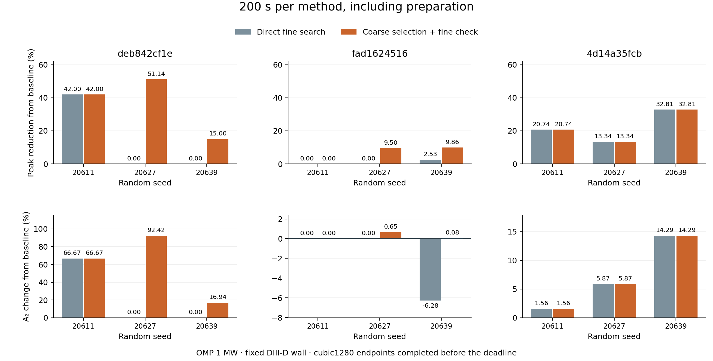
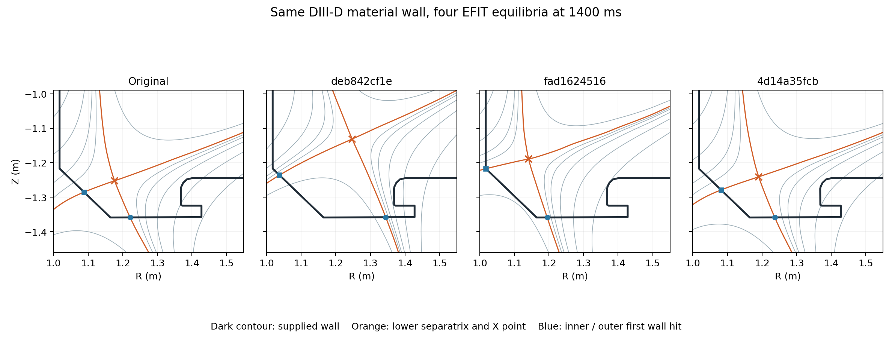

# 미사용 DIII-D 평형의 200초 비교

세 공개 방전 자료의 1,400 ms 평형에서 원래 DIII-D 벽을 출발점으로 새 형상을 생성했다. 같은 시드와 200초 마감에서 고속 선별은 아홉 비교 중 **4회 더 낮은 피크, 5회 동일 피크**를 얻었다. 기준벽보다 피크를 낮춘 경우는 고속 선별 **8/9**, 직접 정밀 탐색 **5/9**였다. 세 평형 모두 최소 한 시드에서 개선 후보를 찾았다. 이 결과는 지정한 입력과 유한 후보 생성 규칙에서 선별 효과를 보여준다. [계산 전 규칙](protocol.ko.md) · [원자료에서 재계산한 요약](summary.json) · [독립 이벤트 감사](final-outcome-audit.json)

위쪽 그림의 감소율은 각 평형의 원형 벽 피크를 기준으로 한다. 아래쪽 A₂ 패널은 평형별 세로축 범위가 다르다. 원 모델의 cubic1280 정밀 결과를 사용했으며, 200초 뒤에 끝난 평가는 최종 선택에서 제외했다.

| 공개 자료 ID | 시드 | 직접 탐색 피크 감소 (%) | 고속 선별 피크 감소 (%) | 직접 탐색 A₂ 변화 (%) | 고속 선별 A₂ 변화 (%) |
|---|---:|---:|---:|---:|---:|
| deb842cf1e | 20611 | 42.00 | 42.00 | +66.67 | +66.67 |
| deb842cf1e | 20627 | 0.00 | 51.14 | 0.00 | +92.42 |
| deb842cf1e | 20639 | 0.00 | 15.00 | 0.00 | +16.94 |
| fad1624516 | 20611 | 0.00 | 0.00 | 0.00 | 0.00 |
| fad1624516 | 20627 | 0.00 | 9.50 | 0.00 | +0.65 |
| fad1624516 | 20639 | 2.53 | 9.86 | −6.28 | +0.08 |
| 4d14a35fcb | 20611 | 20.74 | 20.74 | +1.56 | +1.56 |
| 4d14a35fcb | 20627 | 13.34 | 13.34 | +5.87 | +5.87 |
| 4d14a35fcb | 20639 | 32.81 | 32.81 | +14.29 | +14.29 |

0%는 기준벽을 유지한 결과다. 기준벽의 피크/A₂는 표 순서로 10.340528 MW/m² / 0.179456 m², 4.848364 / 0.376099, 2.911389 / 0.586187이다. A₂는 실제 침적 전력의 제곱을 전 벽 열유속 제곱의 면적 적분으로 나눈 값이다. 시드 20639의 두 번째 평형에서 직접 탐색은 피크를 낮추면서 A₂를 줄였다. 따라서 해당 후보의 피크 개선을 넓은 분산의 개선으로 확장할 수는 없다.

고속 선별이 직접 탐색보다 더 낮은 피크를 얻은 네 경우의 차이는 각각 51.14%, 15.00%, 9.50%, 7.52%였다. 마지막 숫자는 9.86%와 2.53%의 단순 차이 대신 두 최종 피크의 비율로 구했다. 아홉 쌍 전체의 중앙값은 동률이 다섯 개여서 0%다. 0.1% 또는 1% 허용 범위를 적용해도 네 우세와 다섯 동률의 구분은 같다.

시간 내 완료한 **후보 정밀 계산은 선별 26회, 직접 42회**였다. 두 방법에 모두 들어간 정밀 기준벽 준비는 이 횟수와 별도로 실제 시간 예산에 포함했다. 첫 5% 감소를 시간 안에 정밀 확인한 횟수는 선별 8/9, 직접 4/9다. 두 방법이 모두 5%에 도달한 네 경우에는 직접 탐색이 세 번, 선별이 한 번 먼저 도달했다. 예를 들어 4d14a35fcb/20627은 같은 최종 형상을 골랐지만 직접 136.1초, 선별 153.0초였다. 선별의 강점은 제한된 정밀 계산을 좋은 후보에 배정한 데서 나타났다. 목표 도달 시간을 모든 실행에서 줄이는 결과는 얻지 않았다. [초기화·생성·계산 단계의 실측 시간](live/audit.json)

마감 뒤에 끝난 정밀 계산 10회는 모두 폐기했다. 실행은 진행 중인 한 번의 계산이 끝난 뒤 기록을 남기므로 프로세스 종료 시각은 200초를 넘을 수 있으며 최댓값은 약 215.14초였다. 모든 채택 결과는 200초 안에 완료됐다. 두 방법은 각 쌍마다 별도 프로세스와 비어 있는 전용 CUDA/CuPy 캐시에서 시작했고, 실행 순서를 교차했다. 후보 생성·탈락, 기준벽 및 자기선 준비, GPU 초기화와 정밀 확인을 모두 예산에 넣었다. 자료 확보·기하 입력 검사·최종 보고서와 사후 수치 민감도 검사는 별도 비용이다. 독립 감사의 2,147개 검사가 원래 벽, 입력/코드 해시, 공통 후보 접두사, 마감 및 최종 선택을 확인했다. [독립 감사 설명](final-outcome-audit.md) · [장비와 라이브러리](environment.json)

추가 수치 검사에서는 두 방법이 최종 채택한 서로 다른 아홉 형상과 각 기준벽을 quintic640으로 다시 계산했다. 아홉 비교의 우세·동률이 모두 유지됐고, 각 기준 대비 피크 감소율 변화는 최대 **0.07696%p**, A₂ 변화율 차이는 최대 **0.45748%p**였다. 모든 추가 계산이 적격이었고 아홉 형상의 CPU/GPU 피크 및 A₂ 상대차는 저장된 double 값에서 0이었다. 작은 A₂ 증가 사례도 0.649% → 0.667%, 0.076% → 0.092%로 부호를 유지했다. 이 진단은 진행 중 관측한 작은 면적 차이를 확인하려고 추가했다. 해상도와 자기장 보간을 함께 바꾸는 유한 민감도 검사이며 연속체 오차상한과 국소 q(s) 인증은 별도다. 약 199초의 사후 검사 비용은 실시간 성능 수치에 포함하지 않았다. [추가 검사 규칙](numerics-protocol.ko.md) · [수치 비교](numerics-comparison.json)

사용한 공개 데이터는 Sophelio/fusion-equilibrium-challenge의 revision 1e280905b85f2a6fdde7e06fca8cf3a1edf447cb, diii_d_train 분할이다. 제공자는 한 행이 한 방전이라고 설명하며 CC-BY-4.0으로 배포한다. 파일에는 실제 숫자 방전 번호가 없어 공개 익명 ID를 사용했다. 원래 사용한 1a3155370c는 현재 배포판의 같은 ID와 121개 평형·그리드·축·LCFS·TF 입력이 일치해 제외를 확인했다. 새 12개 자료의 전체 2,693개 자속 배열에서 원래 자료 또는 다른 자료와 동일한 프레임은 없었다. [데이터 출처와 라이선스](https://huggingface.co/datasets/Sophelio/fusion-equilibrium-challenge) · [원자료 감사](source-audit.json)

원래 ID를 제외한 7,040개 파일 경로의 해시 순서로 첫 12개를 열계산 전에 고정했다. 1,400 ms에서 너무 멀거나 하부 X점/최초 도달면이 현재 입력 조건을 만족하지 않는 8개를 기록했고, 기하 검사를 통과한 4개 중 사전 순서의 첫 3개를 실시간 시험에 넣었다. 나머지 한 개는 예약 자료로 남겼다. 열계산 결과에 따른 평형 교체는 없었다. [선정 목록](selection.json) · [12개 전체 검사와 제외 이유](preflight.json)

운전 입력은 OMP 단독 1 MW, 밀도 10¹⁹ m⁻³, χ⊥ 0.3 m²/s, λq 3 mm, γ 7, κ₀ 2000이다. 세 시드 20611·20627·20639, 후보 상한 12개, 기하 제안 상한 600회, 최소 곡률반경 20 mm를 고정했다. 기존 DIII-D 물질 벽과 OMP 변형구간을 유지한 채 각 평형에서 새 후보를 생성했다. 고속 방법은 네 후보씩 cubic320으로 평가해 적격 최저 피크 후보를 cubic1280으로 확인한다. 직접 방법은 같은 생성 순서로 cubic1280을 계산한다. 원래 기준벽을 유지하는 선택을 양쪽에 포함했다.

이 시험의 독립 입력은 세 공개 방전 자료다. 같은 방전에 시드 세 개를 적용한 아홉 쌍을 아홉 개 독립 방전으로 해석하지 않는다. 각 후보의 가치는 동일한 물리식의 정밀 계산에서 판정했다. 연속 형상 공간의 최적성, 다른 장치·운전점에서의 성공률, 임의 평형에서의 우월성과 실제 표적 열유속 예측은 이번 결과로 일반화하기 어렵다. 이번 증거가 직접 보강하는 주장은 **지정한 새 평형들에서 고속 선별이 동일 시간의 직접 탐색과 동등하거나 더 좋은 최종 후보를 얻은 관측 결과**다.

코드·규칙·작은 결과 파일은 이 보고서와 함께 저장했다. 원본 parquet, 평형별 실행 입력, 전체 코드 스냅샷과 로그는 D:/DivertorOptimization/studies/unused-equilibrium-20261106/에 있다. 실행 입력의 parquet 파일명은 기존 코드의 고정 입력 슬롯을 따른다. 실제 파일 바이트는 각 사례의 새 원파일과 해시가 동일하다. [다운로드 URL·SHA-256](downloads.json) · [재현 명령](reproduce.ko.md)

